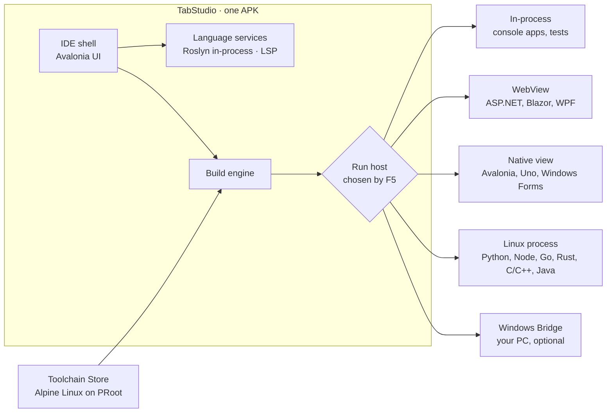

<div dir="rtl">

<div align="center">

# TabStudio

**סביבת פיתוח מלאה לטאבלטים של אנדרואיד.**<br/>
פותחים פתרון, לוחצים F5, והקוד נבנה, רץ ומדובג על הטאבלט עצמו.

[](LICENSE)
[](https://github.com/yahav2898/tabstudio/actions/workflows/ci.yml)
[](https://github.com/yahav2898/tabstudio/releases/latest)


[**הורדה**](https://github.com/yahav2898/tabstudio/releases/latest) ·
[English](README.md) ·
[תיעוד](docs/README.md) ·
[ארכיטקטורה](docs/ARCHITECTURE.md) ·
[מפת דרכים](docs/ROADMAP.md) ·
[תרומה לפרויקט](CONTRIBUTING.md)


</div>

## תוכן העניינים

- [סקירה](#סקירה)
- [איך מתחילים](#איך-מתחילים)
- [יכולות](#יכולות)
  - [סביבת הפיתוח](#סביבת-הפיתוח)
  - [שפות](#שפות)
  - [פלטפורמות אפליקציה](#פלטפורמות-אפליקציה)
  - [שרתי רשת ואפליקציות מובייל](#שרתי-רשת-ואפליקציות-מובייל)
  - [Embedded ומיקרו־בקרים](#embedded-ומיקרובקרים)
  - [פרויקטים ומאגרי קוד](#פרויקטים-ומאגרי-קוד)
  - [שירותים ומסדי נתונים](#שירותים-ומסדי-נתונים)
  - [מתכנתים יחד עם TabStudio Live](#מתכנתים-יחד-עם-tabstudio-live)
  - [כל המסכים בבת אחת](#כל-המסכים-בבת-אחת)
  - [פיתוח מרחוק דרך SSH](#פיתוח-מרחוק-דרך-ssh)
  - [GitHub](#github)
  - [שותף תכנות מבוסס AI](#שותף-תכנות-מבוסס-ai)
  - [AI בלי אינטרנט](#ai-בלי-אינטרנט)
  - [בנוי למכשיר שבידיים שלכם](#בנוי-למכשיר-שבידיים-שלכם)
- [איך זה עובד](#איך-זה-עובד)
- [דרישות](#דרישות)
- [בנייה מקוד המקור](#בנייה-מקוד-המקור)
- [מבנה המאגר](#מבנה-המאגר)
- [תרומה לפרויקט](#תרומה-לפרויקט)
- [רישיון וסימנים מסחריים](#רישיון-וסימנים-מסחריים)

## סקירה

TabStudio הופך טאבלט אנדרואיד למכונת פיתוח שתרצו לעבוד איתה. זו אפליקציה אחת: בלי Termux, בלי root, בלי התקנות
נלוות ובלי חשבון בענן. הקוד שלכם נבנה ורץ על הטאבלט, ליד העורך.

| | |
| --- | --- |
| **מוכר** | המבנה והקיצורים של Visual Studio, בנויים מחדש למגע: Solution Explorer, Properties, Error List, Output וכפתור Run גדול. |
| **כלים אמיתיים** | המהדר האמיתי של C# ו-Visual Basic ‏(Roslyn) בתוך האפליקציה, וכלי הפיתוח הרשמיים של Python, ‏Node.js, ‏Go, ‏Rust, ‏C/C++‏, Java, ‏Kotlin, ‏PHP, ‏Swift ו-Dart. |
| **כל עומסי העבודה** | Console, ‏ASP.NET Core ו-Blazor, ‏Avalonia, ‏Windows Forms, ‏WPF ו-WinUI, וקושחה לרוב המיקרו־בקרים, הכול מהטאבלט. |
| **שלכם** | עובד בלי אינטרנט, שומר את הקוד על המכשיר, וקוד פתוח ברישיון Apache-2.0. |

**למה זה קיים.** למיליארדי אנשים יש מכשיר אנדרואיד, והרבה פחות מהם מחזיקים מחשב. לסטודנטים רבים טאבלט או טלפון הם
המסך היחיד, וסביבות פיתוח בענן מפסיקות לעבוד כשהחיבור נופל, כשהמכסה החינמית נגמרת או כשנדרש כרטיס אשראי. שני
דברים מאפשרים היום סביבת פיתוח אמיתית על טאבלט: עזרת ה-AI הזיזה את הפיתוח לכיוון קריאה, הכוונה ובדיקה, וזה בדיוק
מה שמסך מגע גדול עושה טוב; ו-.NET, ‏Roslyn, ‏clang וכל השאר רצים היום על ARM64 ועל אנדרואיד. TabStudio הוא סביבת
הפיתוח שמחברת את הכול.

## איך מתחילים

1. בטאבלט, פותחים את [הגרסה האחרונה](https://github.com/yahav2898/tabstudio/releases/latest) ומורידים את
   `TabStudio-<version>.apk`.
2. פותחים את הקובץ. אנדרואיד יבקש פעם אחת לאשר התקנות מהדפדפן או ממנהל הקבצים.
3. מפעילים את TabStudio, מקישים **Open the sample** ולוחצים **F5**.

משם אפשר לנסות **New project** לתבנית בכל שפה, **Open from GitHub** עם כתובת של מאגר קוד, או **Tools > Toolchain
Store** כדי להוסיף שפה. כל גרסה מותקנת כעדכון מעל הקודמת.

<table>
  <tr>
    <td align="center"><br/><sub>ערכה בהירה</sub></td>
    <td align="center"><br/><sub>אפליקציית ווב ליד הקוד</sub></td>
    <td align="center"><br/><sub>לאורך</sub></td>
  </tr>
</table>

## יכולות

### סביבת הפיתוח

- **המבנה שאתם מכירים, בכל מסך.** סרגל תפריטים, סרגל כלים, לשוניות מסמכים, Solution Explorer עם Properties, ‏Error
  List, ‏Output ושורת מצב. סרגל פעילות מרכז את כל חלונות הכלים, עם תגים לקבצים ששונו, ל-CI, לבדיקות שנכשלו ולהצעות
  של הסוכן. לאורך ובטלפונים הסרגל הצדדי הופך למגירה, וסרגל הכלים ושורת המצב מקפלים את הכפתורים הפחות שימושיים
  לתפריט **More** במקום לחתוך אותם.
- **חיפוש אחד לכל דבר.** **Ctrl+Q** מוצא קבצים, פקודות תפריט עם הקיצורים שלהן, הגדרות, טיפוסים וחברים, תבניות
  ופתרונות אחרונים, מדורגים יחד.
- **בגודל של אצבע, שקט מול מקלדת.** כל מטרה בגובה 34 עד 48 פיקסלים. סרגל מגע צף שם Rename, ‏Peek, ‏Comment, ‏Run to
  Cursor, ‏Format ו-Run במרחק הקשה אחת. הוא לא מסתיר את השורה שעורכים, ונעלם כשמקלידים במקלדת פיזית, שבה כל קיצורי
  Visual Studio עובדים.
- **גלילה כמו בעורך מקורי.** גרירה עוקבת בדיוק אחרי האצבע, והעפה גולשת על עקומת התנופה של אנדרואיד עצמה, בקצב
  הרענון המלא של המסך, גם בקבצים של אלפי שורות.
- **מצב שולחני.** מחברים מסך דרך USB-C או HDMI, או מסך אלחוטי, וסביבת הפיתוח עוברת למסך הגדול עם המסמכים, הסמן
  והדיבאגר כפי שהיו. הטאבלט הופך לשלט מגע עם כפתורי הרצה ודיבאג, ‏Toolbox ו-Properties.
- **בהיר, כהה או לפי המערכת.** ערכה בהירה בהשראת Visual Studio Light, הכהה, או מעקב אחרי הגדרת הטאבלט (**Tools >
  Theme**). כל צבע עומד בתקן WCAG AA.

### שפות

| שפה | בנייה והרצה | IntelliSense | דיבאגר |
| --- | --- | --- | --- |
| **C#** | ‏Roslyn בתוך האפליקציה, מקומפל לזיכרון, F5 בפחות משנייה | ‏Roslyn: השלמה, חתימות, Quick Info, ניווט, שינוי שם, תיקונים מהירים | נקודות עצירה, צעדים, Locals, ‏Watch, ‏Call Stack, ‏DataTips, חריגות |
| **Python** | ‏CPython מחנות הכלים | ‏Pyright | ‏debugpy |
| **JavaScript / TypeScript** | ‏Node.js מחנות הכלים | ‏typescript-language-server | ‏vscode-js-debug, כולל תהליכי בן |
| **Go** | ‏`go build` | ‏gopls | ‏Delve |
| **Rust** | ‏Cargo, כולל workspaces | ‏rust-analyzer | ‏LLDB |
| **C / C++** | ‏CMake, ‏Make או קבצי מקור, עם clang | ‏clangd, ממסד הקומפילציה של CMake | ‏LLDB |
| **Java** | ‏Maven, ‏Gradle או קבצי מקור, OpenJDK | ‏Eclipse JDT LS | ‏java-debug |
| **Visual Basic** | ‏Roslyn בתוך האפליקציה, כמו C#‏: קונסול, Windows Forms עם `My`, ספריות מחלקות | ‏Roslyn: השלמה, עזרת חתימות, Quick Info, ניווט, שינוי שם, תיקונים מהירים | מנפה הבאגים של C#‏, Hot Reload ו-Live Unit Testing |
| **PHP** | ‏PHP 8.5 ו-Composer; ‏Laravel, ‏Symfony, ‏Slim ואתרים פשוטים בתצוגת הווב | ‏Phpactor | ‏Xdebug, דרך PHP Debug |
| **Kotlin** | ‏Gradle ‏(Kotlin DSL) או Maven על OpenJDK, ‏`kotlinc` לקבצים ולסקריפטי `.kts` | שרת השפה של JetBrains ל-Kotlin | ‏java-debug |
| **Swift** (ניסיוני) | ‏SwiftPM ו-`swiftc` מהכלים הרשמיים | ‏sourcekit-lsp | ‏LLDB |

- **C# על הטאבלט.** חבילות NuGet מותקנות על המכשיר, כך שפרויקטים אמיתיים נבנים כמו שהם. ‏Test Explorer מריץ xUnit,
  ‏NUnit ו-MSTest, ו-**Live Unit Testing** מסמן כל שורה מכוסה כעוברת, נכשלת או לא מכוסה, ומריץ מחדש את הבדיקות
  הרלוונטיות תוך כדי הקלדה. מחברות C# מריצות תאים בזמן הכתיבה.
- **‏Hot Reload ו-Edit and Continue ל-C# (בגרסת המחשב).** מקישים **Hot Reload** או **Alt+F10** כדי להחיל שינויים
  על אפליקציית Console, ‏Avalonia, ‏ASP.NET Core או Blazor Server שרצה, בלי להפעיל מחדש, או נותנים לשמירה להחיל
  אותם. באנדרואיד שינויי C# מוחלים בהפעלה מחדש מהירה. ראו [Hot Reload](docs/ARCHITECTURE.md#hot-reload).
- **דיבאג אחורה בזמן.** **Debug > Start with Recording**, ואז Step Back ‏(**Shift+F10**), ‏Reverse Continue וציר זמן
  מציגים ערכים קודמים של Locals, ‏Watch ו-Call Stack, גם אחרי שהתוכנית קרסה. **When did this change?** מוצא את
  הכתיבה האחרונה למשתנה. ראו [פרטי ההקלטה והתקורה](docs/features/time-travel.md).
- **חנות הכלים.** שפות ו-SDK-ים מותקנים בסביבת Linux בתוך האפליקציה: Alpine Linux שרץ עם PRoot, בלי root ובלי
  הרשאות מיוחדות. חבילות Alpine נבדקות מול החתימות של Alpine, ורכיבי SDK יכולים להגיע גם מארכיונים רשמיים עם
  בדיקת SHA-256 נעולה.
- **אותו דבר בכל שפה.** הפלט והקלט של התוכנית ב-Output, שגיאות מהדר ב-Error List עם קישור לשורה, **Ctrl+F5** מריץ
  בלי דיבאגר, ו-**Ctrl+`** פותח טרמינל. אם חסר שרת שפה או מתאם דיבאג, שורת המצב, העורך ו-F5 מציעים להתקין אותו.
- **עוד שפות דרך הרחבות.** הרחבות VS Code מ-Open VSX מוסיפות דקדוק, קטעי קוד, ערכות נושא והגדרות שפה לכל השאר.
- **‏Visual Basic, כמו C#.** פרויקטי `.vbproj` מקומפלים בתוך האפליקציה עם אותם IntelliSense, תיקונים מהירים, ניווט,
  מנפה באגים, Hot Reload ו-Live Unit Testing. ‏`Microsoft.VisualBasic` ומרחב השמות `My` עובדים באפליקציות קונסול ו-Windows
  Forms, כולל ה-Application Framework ‏(`Application.myapp`, ‏`My.Settings`, ‏`My.Resources`).
- **‏Test Explorer לכל שפה עם מריץ בדיקות סטנדרטי.** מלבד xUnit, ‏NUnit ו-MSTest: ‏PHPUnit ו-Pest, ‏JUnit דרך Gradle או
  Maven ‏(Kotlin ו-Java), ו-XCTest ו-Swift Testing דרך `swift test`.
- **‏PHP ו-Laravel.** פתיחת אפליקציית Laravel מריצה `composer install`, יוצרת `.env` ומפתח, ו-F5 מריץ את המיגרציות,
  בונה את נכסי Vite ומגיש `php artisan serve` בתצוגת הווב, עם מסד הנתונים ש-`.env` מציין ב-Services ו-Xdebug שעוצר
  בקונטרולרים. ראו [PHP ו-Laravel](docs/features/laravel.md).
- **‏Kotlin מעבר ל-Android.** שרתי Ktor ו-Spring Boot נפתחים בתצוגת הווב, אפליקציות קונסול קוראות קלט בחלון ה-Output,
  ונקודות עצירה ב-Kotlin עוצרות דרך מנפה הבאגים של Java. שרת השפה של JetBrains הוא תוכנה חינמית קניינית, ורישיונו מוצג
  לפני ההתקנה.
- **‏Swift (ניסיוני).** הכלים הרשמיים של Swift רצים בסביבת glibc לצד Alpine: חבילות SwiftPM ואפליקציות Vapor נבנות,
  רצות, נבדקות ומנופות. ראו [מצב ומגבלות](docs/features/swift.md).
- **‏Flutter ו-Dart (ניסיוני).** כלי Flutter רצים בסביבת Linux נפרדת. פרויקטי `pubspec.yaml` מקבלים
  `flutter pub get`, ‏IntelliSense ודיבאג ל-Dart, והתבניות רצות בתצוגת הווב עם hot restart. הפצת אפליקציות Flutter
  לאנדרואיד עוד לא נבדקה. ראו [מצב ומגבלות](docs/features/flutter.md).

### פלטפורמות אפליקציה

| עומס עבודה | איך הוא רץ על הטאבלט |
| --- | --- |
| אפליקציות Console וספריות | מקומפלות בזיכרון ורצות בתוך התהליך |
| ‏ASP.NET Core, ‏Blazor, ‏Razor Pages, ‏MVC | מוגשות מהטאבלט ומוצגות חי ליד הקוד, כולל WebAssembly |
| ‏Avalonia | מצוירת באופן מקורי ליד העורך, עם מעצב XAML חי |
| ‏Windows Forms | שכבת Windows Forms של TabStudio, עם מעצב גרירה במגע |
| ‏WPF | ‏OpenSilver, בתצוגת הווב, עם IntelliSense ל-XAML |
| ‏WinUI 3 ו-Uno Platform | מנוע Skia של Uno, באופן מקורי באנדרואיד |
| ‏WPF ו-Windows Forms קלאסיים של .NET Framework | נקראים כמו ש-MSBuild קורא את הפורמט הישן, ורצים במסלולים שלמעלה |
| כל מה שדורש Windows | ‏Windows Bridge: נבנה ורץ על מחשב Windows שלכם, ומוזרם ליד הקוד |

- **‏Windows Forms.** אפליקציות רצות בחלון בסגנון Windows 10, עם דיאלוגים, תפריטים, טבלאות, data binding ותיבות
  הודעה, וגם ציור על תמונות. `Form1.cs` נפתח במעצב מגע: מקישים על כלי ואז על הטופס, גוררים ומשנים גודל של פקדים על
  רשת, עורכים ב-Properties, והקשה כפולה על כפתור כותבת את אירוע ה-Click שלו. המעצב כותב את `Form1.Designer.cs`
  בדיוק כמו Visual Studio. ראו [מה שכבת ה-Forms תומכת](src/TabStudio.Forms/README.md). ‏`Form1.vb` מעוצב באותה
  דרך: המעצב כותב את `Form1.Designer.vb` כמו Visual Studio, והקשה כפולה על כפתור כותבת אירוע `Handles Button1.Click`.
  ראו [מעצב Visual Basic](docs/features/vb-winforms-designer.md).
- **‏WPF.** ה-XAML מקומפל עם OpenSilver ורץ בתצוגת הווב, וחלון גדול מתאים את עצמו לתצוגה. שמירה מפעילה את האפליקציה
  מחדש. לעורך ה-XAML יש השלמה, ‏Quick Info, ‏Go to Definition, שגיאות חיות ונורה שמוסיפה אירוע חסר
  ([השלמה](docs/images/wpf/xaml-completion.png), [אירוע](docs/images/wpf/add-event-handler.png)). ממשקי WPF שדורשים
  Windows מסומנים ב-Error List עם הפניה ל-Windows Bridge.
- **פרויקטים קלאסיים של .NET Framework.** הפורמט הישן שבו כתובים רוב המדריכים ופרויקטי הסטודנטים ב-GitHub
  (`App.config`, תיקיית `Properties`, ‏`TargetFrameworkVersion` v4.x) רץ על הטאבלט כמו פרויקט מודרני. מה שבאמת
  דורש Windows מסביר למה בהודעה אחת, ו-**Upgrade project** ממיר את הפרויקט לפורמט SDK, כשינוי שבודקים לפני אישור.
- **‏WinUI 3 ו-Uno Platform.** פרויקטים נבנים על הטאבלט ומצוירים באופן מקורי ליד הקוד; שמירה של XAML או C# מפעילה
  אותם מחדש.
- **‏Windows Bridge.** למה שבאמת דורש Windows (P/Invoke, ‏COM, ‏Visual C++), מצמידים מחשב Windows עם קוד QR
  (**File > TabStudio Link > Be a Windows Bridge** במחשב). הפרויקטים נבנים ורצים שם ומוזרמים לחלונית ליד הקוד: מגע,
  מקלדת ולוח העתקה עוברים חזרה, שגיאות ממופות לקבצים שלכם, ודיבאג .NET עובר דרך אותו דיבאגר.

### שרתי רשת ואפליקציות מובייל

- **כל שרת, בתצוגה מקדימה.** תוכנית בכל שפה שמאזינה לפורט נפתחת בתצוגת הווב ליד הקוד, או בדפדפן של המכשיר.
- **אפליקציות אנדרואיד.** כלי **Android SDK** מביאים OpenJDK, ‏Gradle וכלי ה-SDK. ב-**Android App (Kotlin)**, ‏F5
  בונה APK, מתקין ומפעיל אותו, עם IntelliSense ל-Kotlin ול-Java, שגיאות מהדר ב-Error List, ו-Logcat.
- **אפליקציות Capacitor.** ‏F5 מריץ את צד הווב, ו-**Run Android App** בונה ומתקין את האפליקציה המקורית.
- **‏iOS בלי Mac.** **Build for iOS…** כותב תהליך GitHub Actions לבדיקה שלכם, ו-**Run iOS Workflow…** בונה את ה-IPA
  בענן. נדרשים חשבון Apple Developer וסודות חתימה.
- [הגדרות ומגבלות](docs/features/mobile.md).

### Embedded ומיקרו־בקרים

- **פרויקטי קושחה כמו שהם.** פרויקטי PlatformIO, ‏Arduino, ‏STM32Cube, ‏ESP-IDF, ‏Zephyr, ‏Raspberry Pi Pico SDK
  ו-Rust embedded נבנים עם הכלים שלהם על הטאבלט. ‏GCC ל-ARM, ‏RISC-V ו-AVR, ‏PlatformIO Core ו-Arduino CLI מגיעים
  מחנות הכלים, בגרסאות נעולות ומאומתות.
- **‏Microchip PIC.** מתקינים **Microchip XC8** ‏(PIC10/12/16/18) או **XC32** ‏(PIC32) לפי הרישיון של Microchip;
  המהדרים הרשמיים רצים על הטאבלט בלי מחשב ובלי הפעלת רישיון. פרויקטי MPLAB X נפתחים כמו שהם, ‏F5 מדבג קוד PIC18
  בסימולטור gpsim, ו-**Flash** צורב דרך bootloader או מתכנת USB-OTG נתמכים.
- **צריבה דרך USB.** מכשיר ה-USB שאנדרואיד מאשר מועבר לכלי הצריבה הסטנדרטיים, כך ש-esptool, ‏picotool, ‏BOSSA,
  ‏OpenOCD, ‏probe-rs והאחרים רצים בלי שינוי: ESP32, ‏Raspberry Pi Pico (קובץ UF2 שמועתק ל-BOOTSEL בלי לחבר דיסק),
  ‏Arduino, ‏STM32, ‏nRF, ‏CH32, ‏MSP430, ‏Teensy ו-AVR UPDI. כל צריבה נבדקת מול הקובץ, ונקראת חזרה איפה שהמסלול
  מאפשר.
- **דיבאג על השבב.** ‏probe-rs ו-OpenOCD מפעילים את הדיבאגר של TabStudio: נקודות עצירה, צעדים, ‏Call Stack, דפדפן
  רגיסטרים מקובצי SVD, ולוגים של RTT ו-defmt ב-Output.
- **להבין את הקושחה.** מפת זיכרון ושינוי הגודל בכל בנייה, קריסות שמפוענחות לשורת המקור, תקציבי stack, בדיקות פינים
  ותיקונים מהירים שמכירים את הרגיסטרים.
- **עבודת ייצור.** גיבוי והשוואה של זיכרון הפלאש, צריבה של קבוצת כרטיסים עם אימות לכל כרטיס, והעלאה דרך Wi-Fi
  לכרטיסי ArduinoOTA. ה-Serial Monitor מדבר CDC-ACM, ‏CH340, ‏CP210x ו-FTDI.
- **כיסוי כנה.** ה-CI בודק בנייה, דיבאג על Cortex-M, ‏RISC-V ו-AVR מדומים, וכל מסלול USB מול תמלילים מוקלטים.
  [מדריך ה-embedded](docs/features/embedded.md) מפרט כל כרטיס, מתכנת ו-bootloader עם הראיות שלו, כולל מה נבדק על
  חומרה פיזית; ראו גם את [מדריך ה-PIC](docs/features/pic.md).

### פרויקטים ומאגרי קוד

- **פתיחה מ-GitHub.** מדביקים כתובת של מאגר; TabStudio מוריד אותו, מזהה במה הוא נבנה, פותח את הפתרון הראשי ובוחר
  את תוכניות הבנייה, ההרצה והדיבאג.
- **הגדרה אוטומטית.** פתיחת מאגר Python, ‏Node.js, ‏PHP, ‏Kotlin או Swift מתקינה את הכלים והחבילות שלו, פעם אחת לכל שינוי במניפסט, עם
  התקדמות וביטול: גרסת ה-Python שהפרויקט מבקש בסביבה וירטואלית, ספריות המערכת שחבילות צריכות כדי להתקמפל, ו-`npm
  ci` כשיש קובץ נעילה, `composer install` עם `.env` ומפתח לאפליקציית Laravel, ו-`swift package resolve`. כשל מוצג כהודעה אחת ברורה, עם הלוג המלא במרחק הקשה. **Set projects up when they open**
  ב-Tools מכבה את זה.
- **אתרים סטטיים.** תיקייה עם `index.html` נפתחת כאתר. ‏F5 מגיש אותו בתצוגת הווב, HTML שנשמר נטען מחדש ו-CSS שנשמר
  מוחל בלי לאבד את מצב הדף, עם IntelliSense ל-HTML, ‏CSS ו-JSON.
- **‏Compatibility Doctor.** לכל פרויקט הוא מראה איפה הוא רץ על הטאבלט ולמה, ומתקן את מה שעומד בדרך.
- **קובצי פרויקט מהעולם האמיתי.** פרויקטי SDK, ‏`Directory.Build.props`, ‏`.targets` והקבצים שהם מייבאים,
  ‏`Directory.Packages.props`, הפניות בין פרויקטים, ניהול חבילות מרכזי וריבוי פלטפורמות יעד נקראים כמו ש-MSBuild
  קורא אותם. פרויקטים מקומפלים מול ההפניות העקיפות שלהם, מקבלים את `InternalsVisibleTo` ושאר תכונות האסמבלי שה-SDK
  מייצר, ונחתמים בחתימה חזקה עם קובצי המפתח שלהם. מחוללי קוד נטענים עם התלויות שלהם, ומחולל שנכשל מופיע ב-Error
  List. ‏Build Solution בונה לפי סדר התלויות ומדווח כל שגיאה פעם אחת.
- **כנה לגבי מה שלא יכול לרוץ כאן.** ‏Aspire AppHost מוסבר ב-Compatibility Doctor ומדולג ב-Build עם הסיבה: הוא מפעיל
  את הפרויקטים והקונטיינרים של האפליקציה על מחשב.
- **נבדק על מאגרי קוד אמיתיים.** ה-CI פותח 42 מאגרים ציבוריים, נעולים לקומיט, בונה ומריץ אותם בתוך סביבת הפיתוח,
  ומחזיק כל אחד לרף שגיאות שיכול רק לרדת: פתרונות .NET כמו MediatR, ‏CleanArchitecture, ‏Polly, ‏eShopOnWeb,
  ‏SimplCommerce, ‏Conduit ו-Avalonia.Samples, מדריכי Windows Forms ו-WPF קלאסיים, פרויקטי Visual Basic, ופרויקטי Node, ‏Python, ‏Java, ‏Go, ‏Rust ו-C כמו אפליקציות Next.js, ‏Spring ו-Gin, ‏PHP ‏(Laravel, ‏BookStack, ‏Symfony), ‏Kotlin ‏(Ktor, ‏Spring Boot) ו-Swift ‏(Vapor, ‏Swift Argument Parser). תהליך ה-embedded עושה אותו
  דבר ל-11 פרויקטי PlatformIO, ‏Arduino, ‏STM32Cube, ‏ESP-IDF, ‏Zephyr, ‏Pico SDK ו-Rust embedded, ביניהם Marlin.

### שירותים ומסדי נתונים

- **שירותי עזר בלי Docker.** **View > Services** קורא קובצי Compose והפניות devcontainer, ומריץ PostgreSQL, ‏Redis
  ו-Valkey, ‏MySQL (דרך MariaDB), ‏RabbitMQ, ‏nginx, ‏Mailpit, ‏MinIO ו-MongoDB כתהליכים מקוריים על הטאבלט, עם מצב
  בריאות, לוגים וקישורי תצוגה. שירות עולה כשמפעילים אותו, או כשתצורת ההרצה מצביעה עליו, והאפליקציה מקבלת את פרטי
  החיבור. לכל workspace נתונים משלו. ראו [מדריך השירותים](docs/features/services.md).
- **התחברות.** קובצי SQLite, ‏PostgreSQL ו-SQL Server. מחרוזות חיבור מתגלות מ-`appsettings*.json` ומ-user secrets של
  הפתרון, ומה שנשמר מוצפן עם מפתח Android Keystore.
- **עיון ושאילתות.** מסדי נתונים, סכמות, טבלאות, תצוגות, עמודות, מפתחות ואינדקסים. לשוניות SQL משלימות מהסכמה
  המחוברת, ו-**Ctrl+Enter** מריץ את הבחירה, עם תוצאות שאפשר למיין, העתקה כ-CSV ו-JSON, כמה סטים של תוצאות ותזמונים.
- **עריכת נתונים.** מדפדפים בטבלה ומשנים תאים; כל עדכון נבדק מול השורה כפי שנקראה.
- **‏EF Core.** רשימת DbContexts ו-migrations, הוספת migration ועדכון מסד הנתונים, בבנייה בזיכרון על הטאבלט.
- [הגדרות ומגבלות](docs/features/database.md).

### מתכנתים יחד עם TabStudio Live

- **שיתוף בסריקה.** **File > Share Session** מציג קוד QR; טאבלט או טלפון אחר עם TabStudio סורק אותו (**File > Join
  Live Session**) ומצטרף דרך אותה רשת Wi-Fi. בלי חשבון, בלי ענן ובלי אינטרנט; החיבור מוצפן מקצה לקצה, והאורחים
  רואים רק את ה-workspace המשותף.
- **מקלידים באותו זמן.** כל מסמך פתוח משותף תוך כדי הקלדה, ועריכות במקביל מתמזגות. הסמן והבחירה של כל משתתף מוצגים
  בצבע שלו עם השם שלו, אווטרים על הלשוניות מראים מי פתח איזה קובץ, ו-Undo מבטל רק את העריכות שלכם. חיבור שנפל
  מתחבר מחדש וממזג את מה שהוקלד בינתיים.
- **מעקב.** מקישים על משתתף ורואים את הקובץ, הבחירה והגלילה שלו, עד שמקלידים או מקישים.
- **מריצים ומדבגים יחד.** ה-Output, הטרמינל, ה-Error List ונקודות העצירה של המארח משותפים לכולם; כשהתוכנית נעצרת,
  כל מכשיר מראה את אותה שורה, ‏Call Stack ו-Locals, והמארח מחליט מי רשאי לבצע צעד.
- **כיתה.** מציג אחד ועד 32 מכשירים שעוקבים כברירת מחדל, עם הצבעה ביד והעברת שליטה לתלמיד. המארח בוחר מי עורך ומי
  רק צופה, ויכול להוציא כל אחד. ראו [המדריך](docs/features/live.md).

### כל המסכים בבת אחת

- **הרצה על Swarm.** טלפונים וטאבלטים עם TabStudio מצטרפים ל-swarm בסריקה אחת (**File > Join a Swarm**). בוחרים
  Swarm בתפריט Run, ו-F5 מפעיל את האפליקציה בכולם; כל שמירה מעדכנת את כולם.
- **דיבאג בכל מכשיר.** נקודת עצירה שנתפסה בטלפון עוצרת בדיבאגר של הטאבלט, עם ה-Locals וה-Call Stack של אותו
  טלפון. אפשר לעצור מכשיר אחד או את כולם.
- **‏Device Matrix.** כל המסכים זה לצד זה: הטלפונים שלכם, ‏App Preview, ומכשירים וירטואליים מטלפון קטן ועד טאבלט,
  בבהיר ובכהה, משמאל לימין ומימין לשמאל, ועם גופנים גדולים. הקשה במסך אחד קורית בכולם.
- **בדיקות פריסה.** כל מסך נבדק אחרי כל שינוי: טקסט חתוך, פקדים מחוץ למסך או חופפים, מטרות מגע קטנות וניגודיות
  נמוכה. הממצאים מגיעים ל-Error List עם תמונה, במרחק הקשה מ-**Fix with Agent**.
- **בדיקות ממשק מוקלטות.** מקליטים כמה הקשות בכל מסך ומקבלים בדיקת ממשק שרצה בכל מכשיר, ב-Test Explorer וב-CI.

### פיתוח מרחוק דרך SSH

- **פותחים תיקייה בשרת שלכם.** **File > Open Remote Folder (SSH)** שומר שרת או מייבא `~/.ssh/config`. מפתח המכשיר
  נוצר בתוך Android Keystore ולא יוצא ממנו.
- **עובדים כאילו זה מקומי.** סייר הפתרון, עריכה וחיפוש דרך SFTP, שמירה עם זיהוי התנגשויות, טרמינל מרוחק, ‏F5
  ו-Build דרך הפקודות השמורות של התיקייה, ופורטים של שרת שמועברים לתצוגת הווב.
- **פרסום לשרת.** פרויקט ASP.NET Core מפורסם, מועלה כגרסה חדשה, ושירות ה-systemd שלו מופעל מחדש.
- [הגדרות, פרסום ומגבלות](docs/features/remote-ssh.md).

### GitHub

- **‏Git מובנה.** ‏Clone, ענפים, commit, ‏pull ו-push, ופתיחת pull requests.
- **סקירת pull requests.** תיאור, שיחה, קבצים ששונו וקומיטים בעמוד אחד; הערות על שורות ב-diff, אישור או בקשת
  שינויים, מיזוג, או מעבר לענף. **Review with Claude** מנסח הערות שתבחרו אם להשאיר.
- **‏GitHub Actions.** הבדיקות של הקומיט שלכם בשורת המצב, ריצות עם ה-jobs והשלבים שלהן, לוגים מקופלים לפי שלב
  וגלולים לשגיאה הראשונה, הרצות חוזרות, הפעלת workflow, ושגיאות CI ב-Error List ליד השגיאות המקומיות.

### שותף תכנות מבוסס AI

- **‏Claude, בתוך סביבת הפיתוח.** הסוכן רואה את כל הפתרון, בונה אותו, מריץ את הבדיקות ומתקן את מה שנכשל. כל שינוי
  מגיע כ-diff שאתם מאשרים.
- **‏Fix with Agent.** משגיאה, מכשל CI, מממצא פריסה או משורה ב-Compatibility Doctor, הקשה אחת מעבירה לסוכן את הבעיה
  עם ההקשר שלה.
- **‏Port to Avalonia.** מה-Compatibility Doctor, מתפריט ההקשר של סייר הפתרון או מתפריט Project, ממירים פרויקט C# של
  WPF או Windows Forms לפרויקט Avalonia מקביל; המקור לא משתנה. הסיכום מקשר הערות המרה לשורות המקור, יכול לשלוח אותן
  לסוכן כמשימה אחת, ומאפשר ביטול. ‏F5 מריץ את הפרויקט המומר. ראו [התנהגות ומגבלות](docs/features/porting.md).
- **‏Sketch to XAML** עם העט, ושרתי **MCP** לכלים שלכם.

### AI בלי אינטרנט

- **מצב מקומי.** בוחרים מודל GGUF ב-**Agent settings**, מאשרים את הרישיון שלו ומורידים. שיחה, הסברים, תיקונים
  ויצירת בדיקות רצים אז על הטאבלט, עם אותן הצעות Keep ו-Undo, ושום דבר לא יוצא מהמכשיר.
- **השלמות בשורה.** טקסט רפאים בכל שפה: **Tab** מאשר, **Escape** מבטל. ההשלמות נעצרות כשהטאבלט חם או כשהסוללה
  נמוכה.
- **מודלים.** ‏Qwen2.5-Coder ‏1.5B ו-3B ו-Qwen2.5 ‏0.5B, נעולים ומאומתים ב-SHA-256, עם הגודל, הזיכרון והמהירות על
  המכשיר הזה לפני ההורדה. הרישיון של כל מודל חל עליו. דורש גרסת 64 ביט.
- [מדידות ההרצה](docs/features/local-ai.md).

### בנוי למכשיר שבידיים שלכם

- **רץ על טאבלטים צנועים.** בטאבלט של 3 GB, ‏TabStudio מחזיק מודל מהדר מלא רק לפרויקטים שעורכים, קורא מטא-דאטה של
  .NET מהאחסון, ומחזיר זיכרון ברגע שאנדרואיד מבקש.
- **שואלים כוח מהטלפון.** עם **TabStudio Link**, אותה אפליקציה בטלפון או במחשב הופכת לשרת בנייה ושפה לטאבלט דרך
  Wi-Fi מקומי, מוצפן מקצה לקצה ומוצמד בקוד QR.
- **אף פעם לא מאבד את המקום.** הסשן, כולל עריכות שלא נשמרו, נשמר תוך כדי עבודה ומשוחזר כשאנדרואיד סוגר את
  האפליקציה.
- **בנייה שמתחשבת בחום, ובלי אינטרנט כברירת מחדל.** הבנייה משתמשת בפחות ליבות כשהטאבלט מתחמם, והכול חוץ מהורדות,
  שרתי Git מרוחקים ומצב הסוכן בענן עובד בלי חיבור.

הסדר שבו יכולות יוצאות מופיע ב[מפת הדרכים](docs/ROADMAP.md).

## איך זה עובד

TabStudio הוא אפליקציית אנדרואיד אחת שנבנתה עם .NET 10 ו-[Avalonia](https://avaloniaui.net). כל מה שהוא צריך מגיע
בתוך ה-APK, או שהאפליקציה מורידה אותו בעצמה.

</div>



<div dir="rtl">

- **המעטפת** היא המבנה בסגנון Visual Studio, מותאם למגע.
- **שירותי השפה** מריצים את [Roslyn](https://github.com/dotnet/roslyn) בתוך האפליקציה עבור C#, ושרתי שפה (LSP)
  ומתאמי דיבאג (DAP) לכל שפה אחרת.
- **מנוע הבנייה** קורא קובצי פרויקט כמו MSBuild ומתקין חבילות NuGet על המכשיר. ‏C# מקומפל ישירות לזיכרון; שפות
  אחרות נבנות עם הכלים שלהן.
- **מארחי ההרצה** הם המקומות שבהם תוכניות רצות: בתוך התהליך, ב-WebView, באופן מקורי ליד העורך, כתהליך Linux, או על
  מחשב Windows מוצמד.

אנדרואיד מגביל את מה שאפליקציה רשאית להריץ, ולכן כל החלטת תכנון מתחילה מהכללים של הפלטפורמה. הפרטים נמצאים
ב[מסמך הארכיטקטורה](docs/ARCHITECTURE.md).

## דרישות

| | מינימום | מומלץ |
| --- | --- | --- |
| אנדרואיד | ‏9 (API 28) | ‏14 ומעלה |
| מעבד | ‏ARM של 32 או 64 ביט | ‏ARM64 עדכני עם 8 ליבות |
| זיכרון | ‏3 GB, או 2 GB עם TabStudio Link | ‏8 GB ומעלה לפתרונות גדולים |
| אחסון | ‏1 GB פנוי | ‏4 GB פנויים אחרי הוספת כלים |
| קלט | מגע | מקלדת ומשטח מגע לעבודה ארוכה |

זה מכסה את רוב הטאבלטים שנמכרו בשש השנים האחרונות, כולל טאבלטים של בתי ספר שמריצים אנדרואיד 32 ביט על שבב 64
ביט.

## בנייה מקוד המקור

צריך את [.NET 10 SDK](https://dotnet.microsoft.com/download) עם ה-workload של אנדרואיד (`dotnet workload install
android`), ‏JDK 17 ומעלה, ו-Android SDK ‏(API 36). כל מערכת הפעלה מתאימה.

</div>

```bash
git clone https://github.com/yahav2898/tabstudio.git
cd tabstudio

dotnet test                                                       # run the tests
dotnet run --project src/TabStudio.Desktop                        # the desktop build, for development
dotnet publish src/TabStudio.Android -c Release -f net10.0-android  # the Android APK
```

<div dir="rtl">

גרסת המחשב מאפשרת לתורמים לעבוד על TabStudio מכל מחשב. הטאבלט הוא המוצר.

## מבנה המאגר

תיאור כל פרויקט נמצא ב[README באנגלית](README.md#repository-layout) וב[מסמך הארכיטקטורה](docs/ARCHITECTURE.md).
בקצרה: `src/` מכיל את הספריות ואת האפליקציה, `tests/` את הבדיקות לכל ספרייה, `native/` קוד מקורי שנבנה לתוך ה-APK,
`samples/` את פתרון הדוגמה, `docs/` את התיעוד (מתחילים ב-[docs/README.md](docs/README.md)), ו-`build/` את סקריפטי
ה-CI והבנייה.

## תרומה לפרויקט

TabStudio נבנה בקוד פתוח, ותורם אחד עדיין יכול לעצב יכולת שלמה. מתחילים ב[מפת הדרכים](docs/ROADMAP.md), וקוראים
את [CONTRIBUTING.md](CONTRIBUTING.md) כדי להבין איך הקוד מאורגן, איך ה-CI עובד ומה הופך pull request לטוב.

## רישיון וסימנים מסחריים

TabStudio מופץ ברישיון [Apache License 2.0](LICENSE). תוכנות צד שלישי שמגיעות איתו או שהוא מוריד, כל אחת ברישיון
שלה, מפורטות ב-[THIRD-PARTY-NOTICES.md](THIRD-PARTY-NOTICES.md).

TabStudio הוא פרויקט עצמאי. הוא לא קשור ל-Microsoft, לא מאושר על ידה ולא ממומן על ידה. ‏Visual Studio הוא סימן מסחרי
של Microsoft Corporation, ומוזכר כאן רק כדי לתאר את סוג החוויה ש-TabStudio מציע.

</div>
