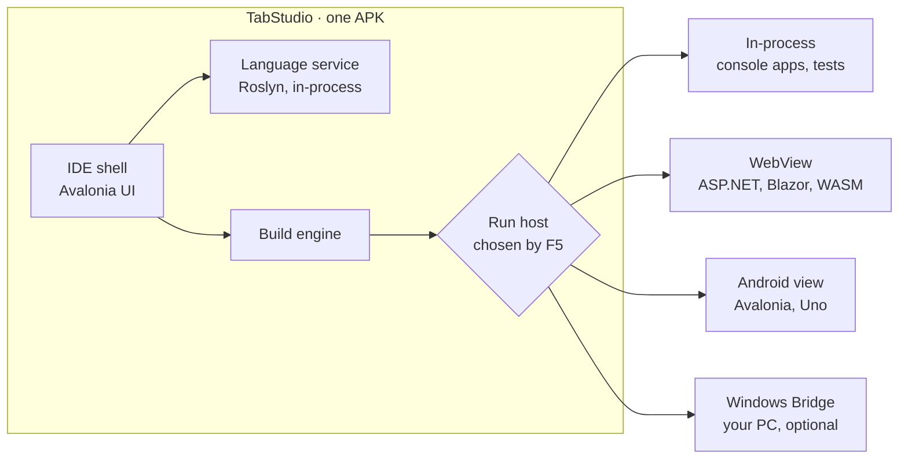

<div align="center">

# TabStudio

**A real IDE for Android tablets. Open a `.sln`, press F5, watch it run.**

[](LICENSE)


[עברית](README.he.md) · [Architecture](docs/ARCHITECTURE.md) · [Roadmap](docs/ROADMAP.md) · [Contributing](CONTRIBUTING.md)

</div>

---

## The short version

TabStudio turns an Android tablet into a development machine you would actually choose to use.

- **One app.** Download it, open it, write code. No Termux, no root, no companion installs.
- **The layout you already know.** Solution Explorer, Properties, Error List, Output, a toolbar with a big Run button. If you have used Visual Studio, you already know where everything is.
- **Your code runs on the tablet.** Not on a server you rent, not in someone else's cloud. Press F5 and it builds and runs right there, next to the code.
- **Open source, from day one.** Apache-2.0. Read it, fork it, ship it.

## Why this needs to exist

**Billions of people own an Android device. Far fewer own a computer.** For a student without a laptop, a phone or a tablet is the only screen they have, and today none of them can open a real C# solution, build it and debug it.

The usual answer has been "use a cloud IDE". That works until the connection drops, the free tier runs out or the account needs a credit card. A development environment should be something you *own*, that works on a bus, in a classroom without Wi-Fi, or in a country where cloud services are expensive.

**Two things changed that make this possible now:**

1. **Typing stopped being the bottleneck.** With AI assistance, a developer spends more time reading, directing and reviewing than typing. That is exactly what a large touch screen is good at.
2. **The toolchains finally fit.** .NET, Roslyn, clang and the rest now run on ARM64 and on Android's own libc. A tablet in 2026 has more cores and memory than the laptops many of today's professionals learned on.

The missing piece is the IDE that puts it together. That is TabStudio.

## What you get

### A real Visual Studio experience, built for touch

- **The layout you already know.** Menu bar, toolbar, document tabs, Solution Explorer, Properties, Error List, Output and a status bar, docked exactly where your hands expect them.
- **Sized for fingers.** Every target is at least 44 pixels. A floating action bar puts Rename, Comment, Format, Peek and Run to Cursor one tap away.
- **Keyboard when you want it.** Attach a keyboard and every Visual Studio shortcut works: F5, Ctrl+Shift+B, F12, Ctrl+. and the rest.
- **Desktop mode.** Plug in a monitor and the full layout moves to the big screen, while the tablet becomes a touch Toolbox and Properties panel.

### C# that runs on the tablet

- **Roslyn inside the app.** The real C# compiler powers semantic highlighting, live errors as you type, and the Error List.
- **F5 in under a second.** Projects compile straight to memory and run next to the code. Console input and output live in the Output panel.
- **IntelliSense.** Completion, signature help, Quick Info, Go to Definition, Find All References, Rename and quick fixes.
- **A debugger.** Breakpoints, Step Into, Over and Out, Locals, Watch, Call Stack, DataTips and break on exceptions.
- **Tests.** Test Explorer for xUnit, NUnit and MSTest, and Live Unit Testing markers beside every line.
- **NuGet on the device.** Packages restore on the tablet, so real projects build as they are.

### Every Visual Studio workload, on Android

| Workload | How it runs on the tablet |
| --- | --- |
| Console and class libraries | Compiled in memory, run in-process |
| ASP.NET Core and Blazor | Served locally, previewed live in a WebView |
| Avalonia | Rendered natively in a pane beside the editor |
| Windows Forms | A cross-platform Forms layer, with a touch drag-and-drop designer |
| WPF | OpenSilver, in a WebView |
| WinUI | Uno Platform, natively on Android |
| C, C++, Rust, Go, Python, Node, Java | Native toolchains from the Toolchain Store |
| Anything Windows-only | The Windows Bridge: builds and runs on your PC, streamed to the tablet |

### Open any repository

- **Paste a GitHub link and press F5.** TabStudio reads `global.json`, `package.json`, `Cargo.toml`, `go.mod`, `CMakeLists.txt` and friends, installs the toolchains it needs and sets up build, run and debug.
- **Compatibility Doctor.** For every project in a solution it shows where it runs on the tablet and why, and fixes what stands in the way.
- **Extensions.** VS Code extensions from Open VSX, so any language with a language server works.
- **Notebooks.** C# notebooks whose cells run as you write them.

### An AI pair programmer

- **The agent knows your solution.** It builds, runs the tests and fixes the errors it finds.
- **Sketch to XAML.** Draw a screen with the stylus and get XAML that runs.

### Smart contracts and dApps

- **Solidity and Move**, with templates for Supra's native oracle, verifiable randomness and automation.
- **Migration Doctor** for bringing an existing Solidity dApp to SupraEVM, and one-tap testnet deploys.

The order in which all of this lands is in the [roadmap](docs/ROADMAP.md).

## How it works

TabStudio is one Android app built with .NET and [Avalonia](https://avaloniaui.net). Everything it needs ships inside the APK or is downloaded by the app itself.



**The shell** is the part you see: a docked, Visual Studio-style layout scaled for touch, with 44-pixel tap targets and a floating action bar for the things you would otherwise reach for with a keyboard.

**The language service** runs [Roslyn](https://github.com/dotnet/roslyn), the real C# compiler, inside the app. That is what makes errors appear as you type, and it is what will power completion and refactoring.

**The build engine** turns a project into something runnable. For C#, Roslyn compiles straight to memory against reference assemblies bundled with the app, so the edit-run loop never touches the disk. Larger builds go through MSBuild, and later through native toolchains from the Toolchain Store.

**Run hosts** are where your program actually runs. F5 picks one per project type: console apps run in-process in an isolated load context, web apps run in a WebView next to the editor, and Windows-only apps can go to a PC you own through the optional Windows Bridge.

Android restricts what an app may execute, so every design decision here starts from the platform's rules rather than fighting them. The details, including why the app does not depend on Android's Linux VM, are in [the architecture document](docs/ARCHITECTURE.md).

## Requirements

### To use TabStudio

| | Minimum | Recommended |
| --- | --- | --- |
| Android | 10 (API 29) | 14 or newer |
| CPU | 64-bit ARM (arm64-v8a) | Recent 8-core SoC |
| Memory | 6 GB | 8 GB or more for large solutions |
| Storage | 1 GB free | 4 GB free once you add toolchains |
| Input | Touch | A keyboard and trackpad, for long sessions |

A keyboard is optional. Everything in TabStudio can be reached by touch, and every Visual Studio shortcut works when a keyboard is attached.

### To build TabStudio from source

- [.NET 10 SDK](https://dotnet.microsoft.com/download) with the Android workload: `dotnet workload install android`
- JDK 17 and the Android SDK (API 35), which the Android workload uses
- Any OS: Windows, macOS or Linux

## Getting started

### Install on a tablet

1. Open the [latest release](https://github.com/yahav2898/tabstudio/releases) on the tablet.
2. Download `TabStudio.apk` and open it. Android will ask you to allow installs from your browser once.
3. Launch TabStudio, tap **Open sample solution** and press **F5**.

### Build and run from source

```bash
git clone https://github.com/yahav2898/tabstudio.git
cd tabstudio

# Run the tests
dotnet test

# Run the desktop build, handy for development
dotnet run --project src/TabStudio.Desktop

# Build the Android APK
dotnet publish src/TabStudio.Android -c Release -f net10.0-android
```

The desktop build exists so contributors can work on TabStudio from any computer. The tablet is the product.

## Repository layout

```
src/
  TabStudio.Core/          Workspace model: solutions, projects, stack detection, Compatibility Doctor
  TabStudio.Compilation/   Roslyn: diagnostics, in-memory compilation, running programs
  TabStudio.App/           The IDE itself: views and view models, shared by every platform
  TabStudio.Desktop/       Desktop host for development
  TabStudio.Android/       The Android app
tests/                     Unit tests for every library, plus shared test helpers
samples/                   The sample solution bundled with the app
docs/                      Architecture, roadmap and design notes
```

## Contributing

TabStudio is built in the open, and it is early enough that one contributor can shape a whole feature. Good places to start are in the [roadmap](docs/ROADMAP.md). Read [CONTRIBUTING.md](CONTRIBUTING.md) for how the code is organized and what a good pull request looks like.

## License and trademarks

TabStudio is licensed under the [Apache License 2.0](LICENSE).

TabStudio is an independent project. It is not affiliated with, endorsed by or sponsored by Microsoft. Visual Studio is a trademark of Microsoft Corporation, used here only to describe the kind of experience TabStudio offers. TabStudio contains no Microsoft code beyond the open-source .NET components it builds on, under their own licenses.
