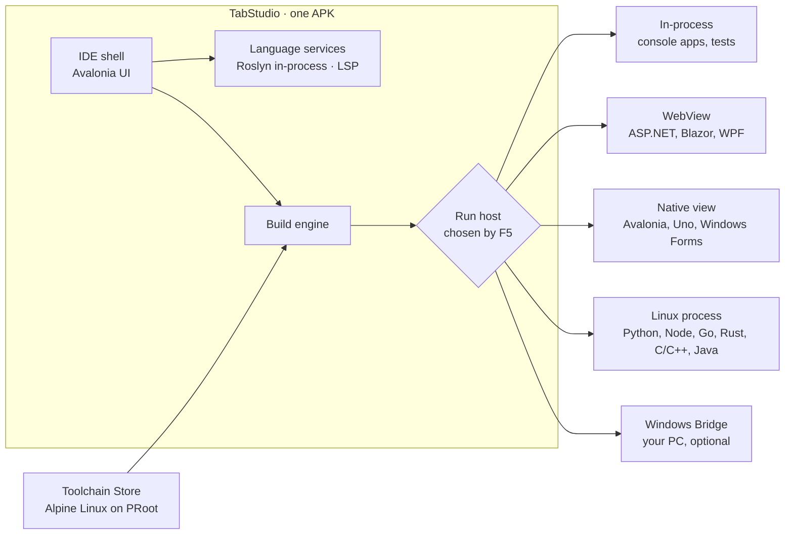

<div align="center">

# TabStudio

**A full IDE for Android tablets.**<br/>
Open a solution, press F5, and it builds, runs and debugs on the tablet itself.

[](LICENSE)
[](https://github.com/yahav2898/tabstudio/actions/workflows/ci.yml)
[](https://github.com/yahav2898/tabstudio/releases/latest)


[**Download**](https://github.com/yahav2898/tabstudio/releases/latest) ·
[עברית](README.he.md) ·
[Architecture](docs/ARCHITECTURE.md) ·
[Roadmap](docs/ROADMAP.md) ·
[Contributing](CONTRIBUTING.md)


</div>

## Contents

- [Overview](#overview)
- [Getting started](#getting-started)
- [Features](#features)
  - [The IDE](#the-ide)
  - [Languages](#languages)
  - [App platforms](#app-platforms)
  - [Every screen at once](#every-screen-at-once)
  - [Projects and repositories](#projects-and-repositories)
  - [GitHub](#github)
  - [AI pair programmer](#ai-pair-programmer)
  - [Built for the device in your hands](#built-for-the-device-in-your-hands)
- [How it works](#how-it-works)
- [Requirements](#requirements)
- [Building from source](#building-from-source)
- [Repository layout](#repository-layout)
- [Contributing](#contributing)
- [License and trademarks](#license-and-trademarks)

## Overview

TabStudio turns an Android tablet into a development machine you would choose to use. It is one app: no Termux, no
root, no companion installs and no cloud account. Your code builds and runs on the tablet, next to the editor.

| | |
| --- | --- |
| **Familiar** | The Visual Studio layout and shortcuts, rebuilt for touch: Solution Explorer, Properties, Error List, Output, a big Run button. |
| **Real tools** | The real C# compiler (Roslyn) in the app, and the official toolchains for Python, Node.js, Go, Rust, C/C++ and Java. |
| **Every workload** | Console, ASP.NET Core and Blazor, Avalonia, Windows Forms, WPF and WinUI, all running on the tablet. |
| **Yours** | Works offline, keeps your code on the device, and is open source under Apache-2.0. |

**Why it exists.** Billions of people own an Android device; far fewer own a computer. For many students a tablet or
phone is the only screen they have, and cloud IDEs stop working when the connection drops, the free tier ends or a
credit card is required. Two things make a real IDE on a tablet possible now: AI assistance has shifted development
toward reading, directing and reviewing, which is what a large touch screen does well; and .NET, Roslyn, clang and
the rest now run on ARM64 and Android. TabStudio is the IDE that puts it together.

## Getting started

1. On the tablet, open the [latest release](https://github.com/yahav2898/tabstudio/releases/latest) and download
   `TabStudio-<version>.apk`.
2. Open the file. Android asks once to allow installs from your browser or file manager.
3. Launch TabStudio, tap **Open the sample** and press **F5**.

From there, try **New project** for a template in any language, **Open from GitHub** with a repository's address, or
**Tools > Toolchain Store** to add a language. Each release installs as an update over the previous one.

<table>
  <tr>
    <td align="center"><br/><sub>Light theme</sub></td>
    <td align="center"><br/><sub>A web app beside its code</sub></td>
    <td align="center"><br/><sub>Portrait</sub></td>
  </tr>
</table>

## Features

### The IDE

- **The layout you already know, on any screen.** Menu bar, toolbar, document tabs, Solution Explorer with
  Properties, Error List, Output and a status bar. An activity bar holds every tool window, with badges for changed
  files, CI, failed tests and the agent's proposals. In portrait and on phones the side bar becomes a drawer, and the
  toolbar and status bar fold their least used buttons into **More** instead of clipping.
- **One search for everything.** **Ctrl+Q** finds files, menu commands with their shortcuts, settings, types and
  members, templates and recent solutions, ranked together.
- **Sized for fingers, quiet for keyboards.** Targets are 34 to 48 pixels tall. A floating touch bar puts Rename,
  Peek, Comment, Run to Cursor, Format and Run one tap away; it stays clear of the line you edit and fades while you
  type on a hardware keyboard, where every Visual Studio shortcut works.
- **Scrolls like a native editor.** A drag follows your finger exactly and a flick glides on Android's own fling
  curve, at the display's full refresh rate, even in files of thousands of lines.
- **Desktop mode.** Connect a monitor over USB-C or HDMI, or a wireless display, and the IDE moves to the big screen
  with your documents, caret and debugger as they were. The tablet becomes a touch companion with Run and debugger
  buttons, a Toolbox and a Properties panel.
- **Light, dark or the system's.** A light theme modeled on Visual Studio Light, the dark one, or follow the
  tablet's setting (**Tools > Theme**). Every color passes WCAG AA.

### Languages

| Language | Build and run | IntelliSense | Debugger |
| --- | --- | --- | --- |
| **C#** | Roslyn in the app, compiled to memory, F5 in under a second | Roslyn: completion, signature help, Quick Info, navigation, rename, quick fixes | Breakpoints, stepping, Locals, Watch, Call Stack, DataTips, exceptions |
| **Python** | CPython from the Toolchain Store | Pyright | debugpy |
| **JavaScript / TypeScript** | Node.js from the Toolchain Store | typescript-language-server | vscode-js-debug, including child processes |
| **Go** | `go build` | gopls | Delve |
| **Rust** | Cargo, with workspace members | rust-analyzer | LLDB |
| **C / C++** | CMake, Make or plain sources, with clang | clangd, from CMake's compilation database | LLDB |
| **Java** | Maven, Gradle or plain sources, OpenJDK | Eclipse JDT LS | java-debug |

- **C# on the tablet.** NuGet packages restore on the device, so real projects build as they are. Test Explorer runs
  xUnit, NUnit and MSTest, and **Live Unit Testing** marks every covered line with a pass, fail or not-covered glyph
  and reruns the affected tests as you type. C# notebooks run cells as you write them.
- **The Toolchain Store.** Every other language installs into a Linux environment inside the app: Alpine Linux run
  with PRoot, with no root and no special permissions. Every package comes from Alpine's mirror and is verified
  against Alpine's signatures before it is installed.
- **Everywhere the same.** Output and program input live in the Output panel, compiler errors land in the Error List
  with links to their lines, **Ctrl+F5** runs without the debugger, and **Ctrl+`** opens a terminal. If a language
  server or debug adapter is missing, the status bar, the editor and F5 offer to install it.
- **More languages through extensions.** VS Code extensions from Open VSX bring grammars, snippets, themes and
  language settings for anything else.

### App platforms

| Workload | How it runs on the tablet |
| --- | --- |
| Console apps and class libraries | Compiled in memory and run in-process |
| ASP.NET Core, Blazor, Razor Pages, MVC | Served on the tablet and previewed live beside the code; WebAssembly included |
| Avalonia | Rendered natively beside the editor, with a live XAML designer |
| Windows Forms | TabStudio's Windows Forms layer, with a touch drag-and-drop designer |
| WPF | OpenSilver, in the web preview, with XAML IntelliSense |
| WinUI 3 and Uno Platform | Uno's Skia renderer, natively on Android |
| Anything Windows-only | The Windows Bridge: built and run on a Windows PC you own, streamed beside your code |

- **Windows Forms.** Apps run in a Windows 10 window with dialogs, menus, grids, data binding and message boxes.
  `Form1.cs` opens in a touch designer: tap a tool and then the form, drag and resize controls on a grid, edit them in
  Properties, and double-tap a button to write its Click handler. The designer writes `Form1.Designer.cs` exactly as
  Visual Studio does. See [what the Forms layer supports](src/TabStudio.Forms/README.md).
- **WPF.** XAML compiles on OpenSilver and runs in the web preview; saving restarts the app. The XAML editor has
  completion, Quick Info, Go to Definition, live errors and a light bulb that adds a missing event handler
  ([completion](docs/wpf/images/wpf-01-xaml-completion.png), [event handler](docs/wpf/images/wpf-02-add-event-handler.png)).
  WPF APIs that need Windows are named in the Error List with a route to the Windows Bridge.
- **WinUI 3 and Uno Platform.** Projects build on the tablet and render natively beside the code; saving XAML or C#
  restarts them.
- **Windows Bridge.** For what truly needs Windows (P/Invoke, COM, .NET Framework, Visual C++), pair a Windows PC with
  a QR code (**File > TabStudio Link > Be a Windows Bridge** on the PC). Projects build and run there and stream into
  a pane beside your code, with touch, keyboard and clipboard going back, errors mapped onto your files, and .NET
  debugging through the same debugger.

### Every screen at once

- **Run on Swarm.** Phones and tablets running TabStudio join your swarm with one scan (**File > Join a Swarm**).
  Choose Swarm in the Run menu and F5 starts the app on all of them; every save updates them all.
- **Debug on any device.** A breakpoint hit on a phone stops in the tablet's debugger with that phone's Locals and
  Call Stack. Pause one device or all of them.
- **Device Matrix.** Every screen side by side: your phones, the App Preview, and virtual devices from a small phone
  to a tablet, in light and dark, left to right and right to left, and with large fonts. A tap on one screen happens
  on all of them.
- **Layout checks.** Each screen is checked after every change for clipped text, off-screen and overlapping controls,
  small touch targets and low contrast. Findings land in the Error List with a picture, one tap from **Fix with Agent**.
- **Recorded UI tests.** Record a few taps on any screen and get a UI test that replays on every device, in Test
  Explorer and in CI.

### Projects and repositories

- **Open from GitHub.** Paste a repository's address; TabStudio downloads it, detects what it is built with, opens its
  main solution and installs the toolchains it needs.
- **Compatibility Doctor.** For every project it shows where it runs on the tablet and why, and fixes what stands in
  the way.
- **Real-world project files.** SDK-style projects, `Directory.Build.props` and `.targets`, project references,
  central package management and multi-targeting are read as MSBuild reads them.

### GitHub

- **Git built in.** Clone, branch, commit, pull and push, and open pull requests.
- **Pull request review.** Description, conversation, changed files and commits in one page; comment on diff lines,
  approve or request changes, merge, or check out the branch. **Review with Claude** drafts comments for you to keep
  or dismiss.
- **GitHub Actions.** Your commit's checks in the status bar, runs with their jobs and steps, logs folded by step and
  scrolled to the first error, re-runs, workflow dispatch, and CI errors in the Error List beside your local ones.

### AI pair programmer

- **Claude, inside the IDE.** The agent sees the whole solution, builds it, runs the tests and fixes what fails.
  Every change arrives as a diff you approve.
- **Fix with Agent.** From an error, a CI failure, a layout finding or a Compatibility Doctor row, one tap hands the
  problem to the agent with its context.
- **Port to cross-platform.** One tap converts a WPF or Windows Forms project into an Avalonia project that runs
  everywhere: a converter rewrites what maps exactly and Claude does the rest, all reviewed as a diff.
- **Sketch to XAML** with the stylus, and **MCP** servers for your own tools.

### Built for the device in your hands

- **Runs on modest tablets.** On a 3 GB tablet TabStudio keeps a full compiler model only of the projects you edit,
  reads .NET metadata from storage, and gives memory back as soon as Android asks.
- **Borrow your phone's power.** With **TabStudio Link**, the same app on a phone or PC becomes a build and language
  server for the tablet over local Wi-Fi, end-to-end encrypted, paired with a QR code.
- **Never loses your place.** Your session, unsaved edits included, is saved as you work and restored when Android
  closes the app.
- **Thermal-aware builds and offline by default.** Builds use fewer cores when the tablet runs hot, and everything
  except downloads, Git remotes and the agent works without a connection.

The order in which features ship is in the [roadmap](docs/ROADMAP.md).

## How it works

TabStudio is one Android app built with .NET 10 and [Avalonia](https://avaloniaui.net). Everything it needs ships in
the APK or is downloaded by the app itself.



- **The shell** is the Visual Studio-style layout, scaled for touch.
- **The language services** run [Roslyn](https://github.com/dotnet/roslyn) inside the app for C#, and language
  servers (LSP) and debug adapters (DAP) for every other language.
- **The build engine** reads project files as MSBuild does and restores NuGet packages on the device. C# compiles
  straight to memory; other languages build with their toolchains.
- **Run hosts** are where programs run: in-process, in a WebView, natively beside the editor, as a Linux process, or
  on a paired Windows PC.

Android restricts what an app may execute, so every design decision starts from the platform's rules. The details
are in the [architecture document](docs/ARCHITECTURE.md).

## Requirements

| | Minimum | Recommended |
| --- | --- | --- |
| Android | 9 (API 28) | 14 or newer |
| CPU | 32-bit or 64-bit ARM | A recent 8-core ARM64 |
| Memory | 3 GB, or 2 GB with TabStudio Link | 8 GB or more for large solutions |
| Storage | 1 GB free | 4 GB free once you add toolchains |
| Input | Touch | A keyboard and trackpad for long sessions |

That covers most tablets sold in the last six years, including school tablets that run 32-bit Android on a 64-bit chip.

## Building from source

You need the [.NET 10 SDK](https://dotnet.microsoft.com/download) with the Android workload
(`dotnet workload install android`), JDK 17 or newer, and the Android SDK (API 36). Any OS works.

```bash
git clone https://github.com/yahav2898/tabstudio.git
cd tabstudio

dotnet test                                                       # run the tests
dotnet run --project src/TabStudio.Desktop                        # the desktop build, for development
dotnet publish src/TabStudio.Android -c Release -f net10.0-android  # the Android APK
```

The desktop build lets contributors work on TabStudio from any computer. The tablet is the product.

## Repository layout

```
src/
  TabStudio.Core/            Workspace model: solutions, projects, detection, the Compatibility Doctor
  TabStudio.Compilation/     Roslyn: diagnostics, IntelliSense, in-memory compilation, running programs
  TabStudio.Packages/        NuGet restore on the device
  TabStudio.Debugging/       The C# debugger: instrumented builds, breakpoints, stepping, inspection
  TabStudio.TestRunner/      xUnit, NUnit and MSTest discovery and execution
  TabStudio.LiveTesting/     Live Unit Testing: coverage, impact analysis, the live test engine
  TabStudio.Notebooks/       C# notebooks: .ipynb and .dib, the kernel, value formatting
  TabStudio.Toolchains/      The Toolchain Store: Alpine Linux on PRoot, packages, processes, the terminal
  TabStudio.LanguageServers/ LSP and DAP clients for every language other than C#
  TabStudio.Extensions/      VS Code extensions from Open VSX
  TabStudio.Web/             Web apps: static web assets, Blazor, .NET on WebAssembly
  TabStudio.Forms/           Windows Forms on Avalonia
  TabStudio.Forms.Design/    The Windows Forms touch designer's model
  TabStudio.Wpf/             WPF on OpenSilver
  TabStudio.Uno/             WinUI and Uno Platform on Skia
  TabStudio.SourceControl/   Git and GitHub: changes, branches, pull requests, Actions
  TabStudio.Agent/           Claude as a coding agent, MCP, sketch to XAML
  TabStudio.Link/            TabStudio Link: pairing, encrypted transport, the remote language service
  TabStudio.Swarm/           Swarm: running, debugging and recording an app on every joined device
  TabStudio.WindowsBridge/   The Windows Bridge protocol, shared by the tablet and the PC
  TabStudio.WindowsBridge.Windows/  The Windows Bridge host that runs on the PC
  TabStudio.App/             The IDE: views and view models, shared by every platform
  TabStudio.Desktop/         Desktop host for development
  TabStudio.Android/         The Android app
tests/                       Tests for every library, and shared test helpers
samples/                     The sample solution bundled with the app
docs/                        Architecture, roadmap, design and release notes
build/                       CI and build scripts
```

## Contributing

TabStudio is built in the open, and one contributor can still shape a whole feature. Start with the
[roadmap](docs/ROADMAP.md), and read [CONTRIBUTING.md](CONTRIBUTING.md) for how the code is organized, how CI works
and what a good pull request looks like.

## Microchip PIC on the tablet

Install **Microchip XC8** (PIC10/12/16/18) or **Microchip XC32** (PIC32) in the Toolchain Store after reading Microchip's licence. The official x86-64 Linux compilers run through Box64 in the tablet's Alpine/PRoot environment, with verified glibc runtimes and device packs. **The compilers are installed by the user under Microchip's licence and are never redistributed.** No PC or licence-manager activation is needed for local builds.

Create **PIC18 Blink (XC8)** or **PIC32 Blink (XC32)**, or open an MPLAB X project with `nbproject/configurations.xml` and its generated makefiles. Builds retain MPLAB's options, populate the Error List, show memory usage and prepare clangd's device headers/builtins. PIC18 Blink uses a real gpsim-supported PIC18F14K22 model for local F5 debugging.

Configure a compatible USB-OTG bootloader/programmer for **Flash**; other devices say **Use the Windows Bridge**. The serial monitor supports CDC-ACM, CH340, CP210x and FTDI. PICkit 4/5 and Snap PIC programming/debugging use the paired PC's MPLAB tools: pymcuprog's documented PIC support is PKOB nano, not those programmers. [Setup, exact device lists, measured ARM64 compiler results and hardware limitations](docs/PIC.md).

## License and trademarks

TabStudio is licensed under the [Apache License 2.0](LICENSE). Third-party software it ships with or downloads, each
under its own licence, is listed in [THIRD-PARTY-NOTICES.md](THIRD-PARTY-NOTICES.md).

TabStudio is an independent project. It is not affiliated with, endorsed by or sponsored by Microsoft. Visual Studio is
a trademark of Microsoft Corporation, used here only to describe the kind of experience TabStudio offers.
