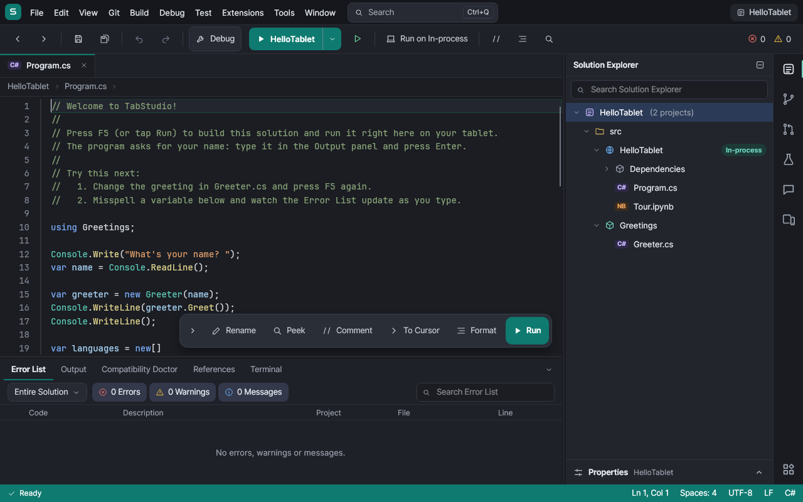
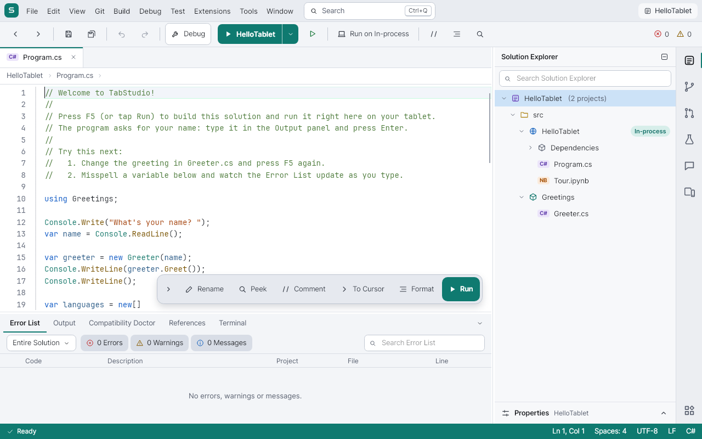
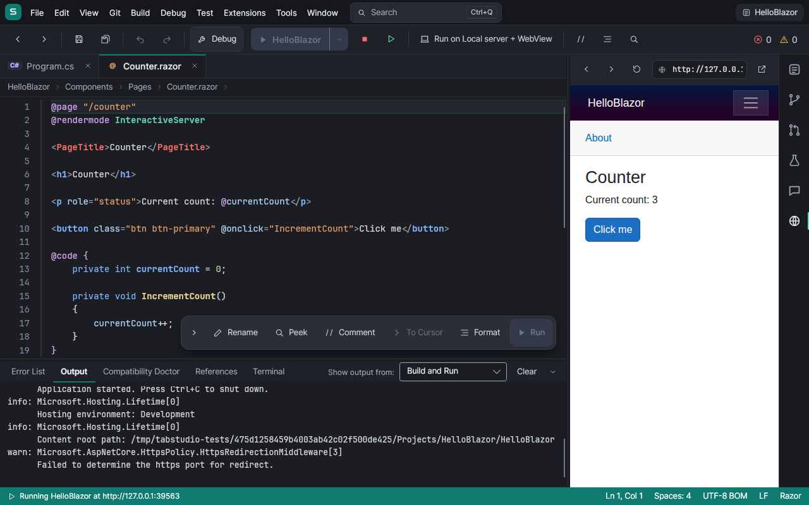
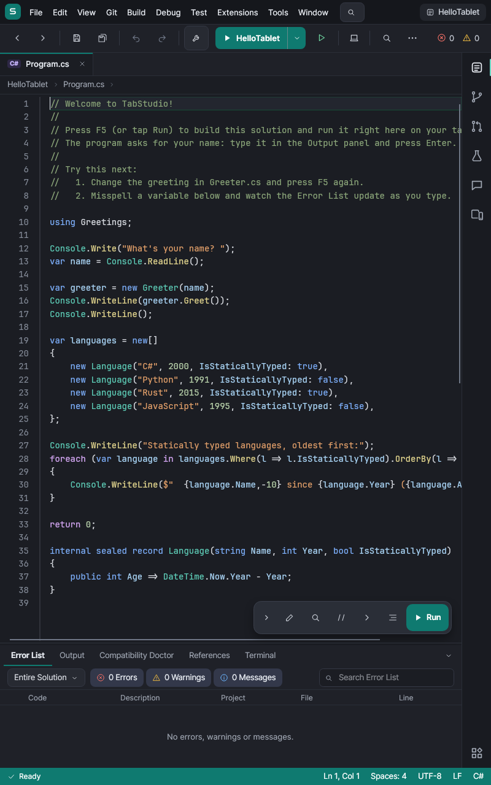
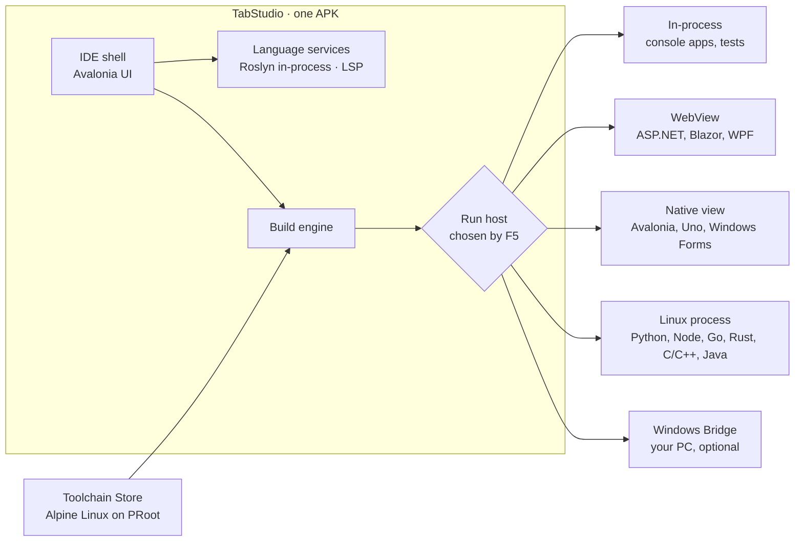

<div align="center">

# TabStudio

**A full IDE for Android tablets.**<br/>
Open a solution, press F5, and it builds, runs and debugs on the tablet itself.

[](LICENSE)
[](https://github.com/yahav2898/tabstudio/actions/workflows/ci.yml)
[](https://github.com/yahav2898/tabstudio/releases/latest)


[**Download**](https://github.com/yahav2898/tabstudio/releases/latest) ·
[עברית](README.he.md) ·
[Documentation](docs/README.md) ·
[Architecture](docs/ARCHITECTURE.md) ·
[Roadmap](docs/ROADMAP.md) ·
[Contributing](CONTRIBUTING.md)



</div>

## Contents

- [Overview](#overview)
- [Getting started](#getting-started)
- [Features](#features)
  - [The IDE](#the-ide)
  - [Languages](#languages)
  - [App platforms](#app-platforms)
  - [Web servers and mobile apps](#web-servers-and-mobile-apps)
  - [Embedded and microcontrollers](#embedded-and-microcontrollers)
  - [Projects and repositories](#projects-and-repositories)
  - [Services and databases](#services-and-databases)
  - [Code together with TabStudio Live](#code-together-with-tabstudio-live)
  - [Every screen at once](#every-screen-at-once)
  - [Remote development over SSH](#remote-development-over-ssh)
  - [GitHub](#github)
  - [AI pair programmer](#ai-pair-programmer)
  - [Offline AI](#offline-ai)
  - [Built for the device in your hands](#built-for-the-device-in-your-hands)
- [How it works](#how-it-works)
- [Requirements](#requirements)
- [Building from source](#building-from-source)
- [Repository layout](#repository-layout)
- [Contributing](#contributing)
- [License and trademarks](#license-and-trademarks)

## Overview

TabStudio turns an Android tablet into a development machine you would choose to use. It is one app: no Termux, no
root, no companion installs and no cloud account. Your code builds and runs on the tablet, next to the editor.

| | |
| --- | --- |
| **Familiar** | The Visual Studio layout and shortcuts, rebuilt for touch: Solution Explorer, Properties, Error List, Output, a big Run button. |
| **Real tools** | The real C# and Visual Basic compiler (Roslyn) in the app, and the official toolchains for Python, Node.js, Go, Rust, C/C++, Java, Kotlin, PHP, Swift and Dart. |
| **Every workload** | Console, ASP.NET Core and Blazor, Avalonia, Windows Forms, WPF and WinUI, and firmware for most microcontrollers, all from the tablet. |
| **Yours** | Works offline, keeps your code on the device, and is open source under Apache-2.0. |

**Why it exists.** Billions of people own an Android device; far fewer own a computer. For many students a tablet or
phone is the only screen they have, and cloud IDEs stop working when the connection drops, the free tier ends or a
credit card is required. Two things make a real IDE on a tablet possible now: AI assistance has shifted development
toward reading, directing and reviewing, which is what a large touch screen does well; and .NET, Roslyn, clang and
the rest now run on ARM64 and Android. TabStudio is the IDE that puts it together.

## Getting started

1. On the tablet, open the [latest release](https://github.com/yahav2898/tabstudio/releases/latest) and download
   `TabStudio-<version>.apk`.
2. Open the file. Android asks once to allow installs from your browser or file manager.
3. Launch TabStudio, tap **Open the sample** and press **F5**.

From there, try **New project** for a template in any language, **Open from GitHub** with a repository's address, or
**Tools > Toolchain Store** to add a language. Each release installs as an update over the previous one.

<table>
  <tr>
    <td align="center"><br/><sub>Light theme</sub></td>
    <td align="center"><br/><sub>A web app beside its code</sub></td>
    <td align="center"><br/><sub>Portrait</sub></td>
  </tr>
</table>

## Features

### The IDE

- **The layout you already know, on any screen.** Menu bar, toolbar, document tabs, Solution Explorer with
  Properties, Error List, Output and a status bar. An activity bar holds every tool window, with badges for changed
  files, CI, failed tests and the agent's proposals. In portrait and on phones the side bar becomes a drawer, and the
  toolbar and status bar fold their least used buttons into **More** instead of clipping.
- **One search for everything.** **Ctrl+Q** finds files, menu commands with their shortcuts, settings, types and
  members, templates and recent solutions, ranked together.
- **Sized for fingers, quiet for keyboards.** Every control that takes a tap is a whole 44-pixel target (48 on a
  phone). A floating touch bar puts Rename, Peek, Comment, Run to Cursor, Format and Run one tap away; it stays clear
  of the line you edit and fades while you type on a hardware keyboard, where every Visual Studio shortcut works.
- **For every hand and every eye.** **Tools > Text Size** goes from Small to Very large and follows Android's font
  size by default. TalkBack names every control and reads the editor's line, the keyboard reaches everything (F6
  moves between panes), every text and icon passes WCAG AA, Remove animations is honored, and right-to-left
  languages mirror the layout.
- **Scrolls like a native editor.** A drag follows your finger exactly and a flick glides on Android's own fling
  curve, at the display's full refresh rate, even in files of thousands of lines.
- **Desktop mode.** Connect a monitor over USB-C or HDMI, or a wireless display, and the IDE moves to the big screen
  with your documents, caret and debugger as they were. The tablet becomes a touch companion with Run and debugger
  buttons, a Toolbox and a Properties panel.
- **Light, dark or the system's.** A light theme modeled on Visual Studio Light, the dark one, or follow the
  tablet's setting (**Tools > Theme**). Every color passes WCAG AA.

### Languages

| Language | Build and run | IntelliSense | Debugger |
| --- | --- | --- | --- |
| **C#** | Roslyn in the app, compiled to memory, F5 in under a second | Roslyn: completion, signature help, Quick Info, navigation, rename, quick fixes | Breakpoints, stepping, Locals, Watch, Call Stack, DataTips, exceptions |
| **Python** | CPython from the Toolchain Store | Pyright | debugpy |
| **JavaScript / TypeScript** | Node.js from the Toolchain Store | typescript-language-server | vscode-js-debug, including child processes |
| **Go** | `go build` | gopls | Delve |
| **Rust** | Cargo, with workspace members | rust-analyzer | LLDB |
| **C / C++** | CMake, Make or plain sources, with clang | clangd, from CMake's compilation database | LLDB |
| **Java** | Maven, Gradle or plain sources, OpenJDK | Eclipse JDT LS | java-debug |
| **Visual Basic** | Roslyn in the app, as C#: console, Windows Forms with `My`, class libraries | Roslyn: completion, signature help, Quick Info, navigation, rename, quick fixes | The C# debugger, Hot Reload and Live Unit Testing |
| **PHP** | PHP 8.5 and Composer; Laravel, Symfony, Slim and plain sites in the web preview | Phpactor | Xdebug, through PHP Debug |
| **Kotlin** | Gradle (Kotlin DSL) or Maven on OpenJDK, `kotlinc` for files and `.kts` scripts | JetBrains' Kotlin LSP | java-debug |
| **Swift** (experimental) | SwiftPM and `swiftc`, from the official toolchain | sourcekit-lsp | LLDB |

- **C# on the tablet.** NuGet packages restore on the device, so real projects build as they are. Test Explorer runs
  xUnit, NUnit and MSTest, and **Live Unit Testing** marks every covered line with a pass, fail or not-covered glyph
  and reruns the affected tests as you type. C# notebooks run cells as you write them.
- **Visual Basic, like C#.** `.vbproj` projects compile in the app with the same IntelliSense, quick fixes,
  navigation, debugger, Hot Reload and Live Unit Testing. `Microsoft.VisualBasic` and the `My` namespace work in
  console and Windows Forms apps, including the Application Framework (`Application.myapp`, `My.Settings`,
  `My.Resources`). Templates: Console App, Windows Forms App and Class Library (Visual Basic).
- **Test Explorer beyond .NET.** Besides xUnit, NUnit and MSTest: pytest (Python, with the test requirements the
  project declares), PHPUnit and Pest, JUnit through Gradle or Maven (Kotlin, Kotlin Multiplatform's JVM tests and
  Java), XCTest and Swift Testing through `swift test`, `go test`, `cargo test`, `dart test` and `flutter test`, and
  Vitest, Jest, Mocha and `node --test` for JavaScript and TypeScript, each run with the project's own runner.
- **C# Hot Reload and Edit and Continue (desktop build).** Tap **Hot Reload** or press **Alt+F10** to apply edits to
  a running console, Avalonia, ASP.NET Core or Blazor Server app without restarting, or let saving apply them. On
  Android, C# edits apply with a quick restart. See [Hot Reload](docs/ARCHITECTURE.md#hot-reload).
- **Time-travel debugging.** **Debug > Start with Recording**, then Step Back (**Shift+F10**), Reverse Continue and a
  timeline show earlier Locals, Watch and Call Stack, even after the program crashed. **When did this change?** finds
  a variable's last write. See [recording details and overhead](docs/features/time-travel.md).
- **The Toolchain Store.** Languages and SDKs install into a Linux environment inside the app: Alpine Linux run
  with PRoot, with no root and no special permissions. Alpine packages are verified against Alpine's signatures;
  SDK components can also use official upstream archives with pinned SHA-256 checks.
- **Everywhere the same.** Output and program input live in the Output panel, compiler errors land in the Error List
  with links to their lines, **Ctrl+F5** runs without the debugger, and **Ctrl+`** opens a terminal. If a language
  server or debug adapter is missing, the status bar, the editor and F5 offer to install it.
- **More languages through extensions.** VS Code extensions from Open VSX bring grammars, snippets, themes and
  language settings for anything else.
- **PHP and Laravel.** Opening a Laravel app runs `composer install`, creates `.env` and its key, and F5 applies the
  migrations, builds the Vite assets and serves `php artisan serve` in the web preview, with the database `.env` names
  offered in Services and Xdebug stopping in your controllers. See [PHP and Laravel](docs/features/laravel.md).
- **Kotlin beyond Android.** Ktor and Spring Boot servers open in the web preview, console apps read their input in
  the Output panel, and Kotlin breakpoints stop through the Java debugger. JetBrains' Kotlin language server is
  proprietary freeware, shown with its licence before it installs.
- **Swift (experimental).** The official Swift toolchain runs in a glibc environment beside Alpine: SwiftPM packages
  and Vapor apps build, run, test and debug. See [status and limits](docs/features/swift.md).
- **Flutter and Dart (experimental).** The Flutter toolchain runs in its own Linux environment. `pubspec.yaml`
  projects get `flutter pub get`, Dart IntelliSense and debugging, and the templates run in the web preview with hot
  restart. Deploying Flutter apps to Android is not verified yet. See [status and limits](docs/features/flutter.md).

### App platforms

| Workload | How it runs on the tablet |
| --- | --- |
| Console apps and class libraries | Compiled in memory and run in-process |
| ASP.NET Core, Blazor, Razor Pages, MVC | Served on the tablet and previewed live beside the code; WebAssembly included |
| Avalonia | Rendered natively beside the editor, with a live XAML designer |
| Windows Forms | TabStudio's Windows Forms layer, with a touch drag-and-drop designer |
| WPF | OpenSilver, in the web preview, with XAML IntelliSense |
| WinUI 3 and Uno Platform | Uno's Skia renderer, natively on Android |
| Classic .NET Framework WPF and Windows Forms | Read as MSBuild reads the old project format, and run on the paths above |
| Anything Windows-only | The Windows Bridge: built and run on a Windows PC you own, streamed beside your code |

- **Windows Forms.** Apps run in a Windows 10 window with dialogs, menus, grids, data binding and message boxes.
  `Form1.cs` opens in a touch designer: tap a tool and then the form, drag and resize controls on a grid, edit them in
  Properties, and double-tap a button to write its Click handler. The designer writes `Form1.Designer.cs` exactly as
  Visual Studio does. See [what the Forms layer supports](src/TabStudio.Forms/README.md).
  `Form1.vb` designs the same way: the designer writes `Form1.Designer.vb` as Visual Studio does, and double-tapping a
  button writes a `Handles Button1.Click` handler. See [the Visual Basic designer](docs/features/vb-winforms-designer.md).
- **WPF.** XAML compiles on OpenSilver and runs in the web preview; saving restarts the app. The XAML editor has
  completion, Quick Info, Go to Definition, live errors and a light bulb that adds a missing event handler
  ([completion](docs/images/wpf/xaml-completion.png), [event handler](docs/images/wpf/add-event-handler.png)).
  WPF APIs that need Windows are named in the Error List with a route to the Windows Bridge.
- **Classic .NET Framework projects.** The old project format most tutorials and student projects on GitHub use
  (`App.config`, a `Properties` folder, `TargetFrameworkVersion` v4.x) runs on the tablet like a modern one. What
  truly needs Windows says why, in one message, and **Upgrade project** converts it to an SDK-style project as a
  reviewed diff.
- **WinUI 3 and Uno Platform.** Projects build on the tablet and render natively beside the code; saving XAML or C#
  restarts them.
- **Windows Bridge.** For what truly needs Windows (P/Invoke, COM, Visual C++), pair a Windows PC with
  a QR code (**File > TabStudio Link > Be a Windows Bridge** on the PC). Projects build and run there and stream into
  a pane beside your code, with touch, keyboard and clipboard going back, errors mapped onto your files, and .NET
  debugging through the same debugger.

### Web servers and mobile apps

- **Any server, previewed.** A program in any toolchain that listens on a port opens in the web preview beside the
  code, or in the device's browser.
- **Android apps.** The **Android SDK** toolchain brings OpenJDK, Gradle and the SDK tools. In an **Android App
  (Kotlin)**, F5 builds the APK, installs and launches it, with Kotlin and Java IntelliSense, compiler errors in the
  Error List, and Logcat.
- **Capacitor apps.** F5 runs the web part, and **Run Android App** builds and installs the native app.
- **iOS without a Mac.** **Build for iOS…** writes a GitHub Actions workflow for you to review, and **Run iOS
  Workflow…** builds the IPA in the cloud. An Apple Developer account and signing secrets are required.
- [Setup and limits](docs/features/mobile.md).

### Embedded and microcontrollers

- **Firmware projects as they are.** PlatformIO, Arduino, STM32Cube, ESP-IDF, Zephyr, Raspberry Pi Pico SDK and
  embedded Rust projects build with their own tools on the tablet. ARM, RISC-V and AVR GCC, PlatformIO Core and the
  Arduino CLI come from the Toolchain Store, pinned and verified.
- **Microchip PIC.** Install **Microchip XC8** (PIC10/12/16/18) or **XC32** (PIC32) under Microchip's licence; the
  official compilers run on the tablet with no PC and no licence activation. MPLAB X projects open as they are, F5
  debugs PIC18 code in the gpsim simulator, and **Flash** programs a supported USB-OTG bootloader or programmer.
- **Upload over USB.** The USB device Android grants is carried into the standard upload tools, so esptool, picotool,
  BOSSA, OpenOCD, probe-rs and the others run unmodified: ESP32, Raspberry Pi Pico (UF2 copied to BOOTSEL without
  mounting a disk), Arduino, STM32, nRF, CH32, MSP430, Teensy and AVR UPDI. Uploads are checked against the image and
  read back where the route allows.
- **Debug on the chip.** probe-rs and OpenOCD drive TabStudio's debugger: breakpoints, stepping, the call stack, a
  register browser built from SVD files, and RTT and defmt logs in the Output panel.
- **Understand the firmware.** A memory treemap and the size change of every build, crashes decoded to their source
  line, stack budgets, pin checks and register-aware quick fixes.
- **Production work.** Back up and compare flash, program a batch of boards with per-board verification, and upload
  over Wi-Fi to ArduinoOTA boards. The serial monitor speaks CDC-ACM, CH340, CP210x and FTDI.
- **Honest coverage.** CI verifies builds, debugging on emulated Cortex-M, RISC-V and AVR, and every USB route against
  recorded transcripts. The [embedded guide](docs/features/embedded.md) lists each board, probe and bootloader with
  its evidence, including which were checked on physical hardware; see also the [PIC guide](docs/features/pic.md).

### Projects and repositories

- **Open from GitHub.** Paste a repository's address; TabStudio downloads it, detects what it is built with, opens its
  main solution and selects its build, run and debug plans.
- **Automatic setup.** Opening a Python, Node.js, PHP, Kotlin or Swift repository installs its toolchain and packages
  once per manifest change, with progress and cancel: the Python version the project asks for in a virtual
  environment, the system libraries that packages need to compile, `npm ci` when there is a lockfile,
  `composer install` and a Laravel app's `.env` and key, and `swift package resolve`. A failure is one clear message, with
  the full log a tap away. **Set projects up when they open** in Tools turns it off.
- **Static web sites.** A folder with `index.html` opens as a site. F5 serves it in the web preview, saved HTML
  reloads and saved CSS applies without losing the page's state, with HTML, CSS and JSON IntelliSense.
- **Compatibility Doctor.** For every project it shows where it runs on the tablet and why, and fixes what stands in
  the way.
- **Real-world project files.** SDK-style projects, `Directory.Build.props`, `.targets` and the files they import,
  `Directory.Packages.props`, project references, central package management and multi-targeting are read as MSBuild
  reads them. Projects compile against the projects their references reference, get the `InternalsVisibleTo` and
  other assembly attributes the SDK generates, and are strong-name signed with their key files. Source generators
  load with dependencies from anywhere in their package, and a generator that fails shows in the Error List. Build
  Solution builds in dependency order and reports each error once.
- **Honest about what cannot run here.** An Aspire AppHost is explained in the Compatibility Doctor and skipped by
  Build with the reason: it starts the app's projects and containers on a computer.
- **Tested on real repositories.** CI opens 42 public repositories pinned to commits, builds and runs them in the
  IDE, and holds each to an error baseline that only goes down: .NET solutions such as MediatR, CleanArchitecture,
  Polly, eShopOnWeb, SimplCommerce, Conduit and Avalonia.Samples, classic Windows Forms and WPF tutorials, Visual Basic
  Windows Forms and console projects, and Node, Python, Java, Go, Rust and C projects such as Next.js, Spring and Gin
  apps, PHP (Laravel, BookStack, Symfony), Kotlin (Ktor, Spring Boot) and Swift (Vapor, Swift Argument Parser) projects.
  The embedded workflow does the same for 11 PlatformIO, Arduino, STM32Cube, ESP-IDF, Zephyr, Pico SDK and embedded
  Rust projects, Marlin among them.

### Services and databases

- **Containers without root (0.21 candidate).** **View > Containers** pulls real Linux OCI images, runs their
  entrypoints under PRoot, and shows ports, logs and an exec terminal. Services tries Compose images for F5 before
  a named native fallback. The local terminal has a `docker` command subset. See
  [compatibility, limits and verification](docs/features/containers.md).
- **Backing services without Docker.** **View > Services** reads Compose files and devcontainer references and runs
  PostgreSQL, Redis and Valkey, MySQL (through MariaDB), RabbitMQ, nginx, Mailpit, MinIO and MongoDB as native processes
  on the tablet, with health, logs and preview links. A service starts when you start it or when the run configuration
  points at it, and the app receives its connection settings. A Laravel app's `.env` database is offered the same
  way. Each workspace keeps its own data. See
  [the services guide](docs/features/services.md).
- **Connect.** SQLite files, PostgreSQL and SQL Server. Connection strings are discovered in the solution's
  `appsettings*.json` and user secrets, and saved ones are encrypted with an Android Keystore key.
- **Browse and query.** Databases, schemas, tables, views, columns, keys and indexes. SQL tabs complete from the
  connected schema, and **Ctrl+Enter** runs the selection, with sortable results, CSV and JSON copying, multiple
  result sets and timings.
- **Edit data.** Page through a table and change cells; each update is checked against the row as it was read.
- **EF Core.** List DbContexts and migrations, add a migration and update the database, built in memory on the
  tablet.
- [Setup and limits](docs/features/database.md).

### Code together with TabStudio Live

- **Share with a scan.** **File > Share Session** shows a QR code; another tablet or phone with TabStudio scans it
  (**File > Join Live Session**) and joins over the same Wi-Fi. No account, no cloud and no internet; the connection
  is end-to-end encrypted, and guests see only the shared workspace.
- **Type at the same time.** Every open document is shared as it is typed, and edits made at once merge. Each
  participant's caret and selection show in their color with their name, avatars on the tabs show who has a file
  open, and Undo takes back only your own edits. A dropped connection reconnects and merges what was typed offline.
- **Follow.** Tap a participant to see their file, selection and scrolling, until you type or tap.
- **Run and debug together.** The host's Output, Terminal, Error List and breakpoints are everyone's; when the
  program pauses, every device shows the same statement, call stack and locals, and the host decides who may step.
- **Classroom.** One presenter and up to 32 devices that follow by default, with raised hands and control handed to a
  student. The host chooses who edits and who only watches, and can remove anyone. See [the guide](docs/features/live.md).

### Every screen at once

- **Run on Swarm.** Phones and tablets running TabStudio join your swarm with one scan (**File > Join a Swarm**).
  Choose Swarm in the Run menu and F5 starts the app on all of them; every save updates them all.
- **Debug on any device.** A breakpoint hit on a phone stops in the tablet's debugger with that phone's Locals and
  Call Stack. Pause one device or all of them.
- **Device Matrix.** Every screen side by side: your phones, the App Preview, and virtual devices from a small phone
  to a tablet, in light and dark, left to right and right to left, and with large fonts. A tap on one screen happens
  on all of them.
- **Layout checks.** Each screen is checked after every change for clipped text, off-screen and overlapping controls,
  small touch targets and low contrast. Findings land in the Error List with a picture, one tap from **Fix with Agent**.
- **Recorded UI tests.** Record a few taps on any screen and get a UI test that replays on every device, in Test
  Explorer and in CI.

### Remote development over SSH

- **Open a folder on your server.** **File > Open Remote Folder (SSH)** saves a host or imports `~/.ssh/config`.
  The device's key is generated inside Android Keystore and never leaves it.
- **Work as if it were local.** Solution Explorer, editing and search over SFTP, saves with conflict detection, a
  remote terminal, F5 and Build through the folder's saved commands, and remote web ports forwarded into the web
  preview.
- **Publish to server.** An ASP.NET Core project is published, uploaded as a new release and its systemd service
  restarted.
- [Setup, publishing and limits](docs/features/remote-ssh.md).

### GitHub

- **Git built in.** Clone, branch, commit, pull and push, and open pull requests.
- **Pull request review.** Description, conversation, changed files and commits in one page; comment on diff lines,
  approve or request changes, merge, or check out the branch. **Review with Claude** drafts comments for you to keep
  or dismiss.
- **GitHub Actions.** Your commit's checks in the status bar, runs with their jobs and steps, logs folded by step and
  scrolled to the first error, re-runs, workflow dispatch, and CI errors in the Error List beside your local ones.

### AI pair programmer

- **Claude, inside the IDE.** The agent sees the whole solution, builds it, runs the tests and fixes what fails.
  Every change arrives as a diff you approve.
- **Fix with Agent.** From an error, a CI failure, a layout finding or a Compatibility Doctor row, one tap hands the
  problem to the agent with its context.
- **Port to Avalonia.** Use the Compatibility Doctor, Solution Explorer context menu or Project menu to
  convert a C# WPF or Windows Forms project into a sibling Avalonia project; the original stays unchanged. The
  summary links structured port notes to source lines, can send them to the agent as one task of proposed
  changes, and offers undo. F5 runs the converted project. See [porting behavior and limits](docs/features/porting.md).
- **Sketch to XAML** with the stylus, and **MCP** servers for your own tools.

### Offline AI

- **Local mode.** Choose a GGUF model in **Agent settings**, accept its licence and download it. Chat, explanations,
  fixes and test generation then run on the tablet with the same Keep and Undo proposals, and nothing leaves the
  device.
- **Inline completions.** Ghost text in any language: **Tab** accepts, **Escape** dismisses. Completions pause when
  the tablet is hot or low on battery.
- **Models.** Qwen2.5-Coder 1.5B and 3B and Qwen2.5 0.5B, pinned and verified by SHA-256, with their size, memory
  and speed on this device shown before you download. Each model's own licence applies. Requires a 64-bit build.
- [Runtime measurements](docs/features/local-ai.md).

### Built for the device in your hands

- **Runs on modest tablets.** On a 3 GB tablet TabStudio keeps a full compiler model only of the projects you edit,
  reads .NET metadata from storage, and gives memory back as soon as Android asks.
- **Borrow your phone's power.** With **TabStudio Link**, the same app on a phone or PC becomes a build and language
  server for the tablet over local Wi-Fi, end-to-end encrypted, paired with a QR code.
- **Never loses your place.** Your session, unsaved edits included, is saved as you work and restored when Android
  closes the app.
- **Thermal-aware builds and offline by default.** Builds use fewer cores when the tablet runs hot, and everything
  except downloads, Git remotes and cloud agent mode works without a connection.

The order in which features ship is in the [roadmap](docs/ROADMAP.md).

## How it works

TabStudio is one Android app built with .NET 10 and [Avalonia](https://avaloniaui.net). Everything it needs ships in
the APK or is downloaded by the app itself.



- **The shell** is the Visual Studio-style layout, scaled for touch.
- **The language services** run [Roslyn](https://github.com/dotnet/roslyn) inside the app for C#, and language
  servers (LSP) and debug adapters (DAP) for every other language.
- **The build engine** reads project files as MSBuild does and restores NuGet packages on the device. C# compiles
  straight to memory; other languages build with their toolchains.
- **Run hosts** are where programs run: in-process, in a WebView, natively beside the editor, as a Linux process, or
  on a paired Windows PC.

Android restricts what an app may execute, so every design decision starts from the platform's rules. The details
are in the [architecture document](docs/ARCHITECTURE.md).

## Requirements

| | Minimum | Recommended |
| --- | --- | --- |
| Android | 9 (API 28) | 14 or newer |
| CPU | 32-bit or 64-bit ARM | A recent 8-core ARM64 |
| Memory | 3 GB, or 2 GB with TabStudio Link | 8 GB or more for large solutions |
| Storage | 1 GB free | 4 GB free once you add toolchains |
| Input | Touch | A keyboard and trackpad for long sessions |

That covers most tablets sold in the last six years, including school tablets that run 32-bit Android on a 64-bit chip.

## Building from source

You need the [.NET 10 SDK](https://dotnet.microsoft.com/download) with the Android workload
(`dotnet workload install android`), JDK 17 or newer, and the Android SDK (API 36). Any OS works.

```bash
git clone https://github.com/yahav2898/tabstudio.git
cd tabstudio

dotnet test                                                       # run the tests
dotnet run --project src/TabStudio.Desktop                        # the desktop build, for development
dotnet publish src/TabStudio.Android -c Release -f net10.0-android  # the Android APK
```

The desktop build lets contributors work on TabStudio from any computer. The tablet is the product.

## Repository layout

```
src/
  TabStudio.Core/            Workspace model: solutions, projects, detection, the Compatibility Doctor
  TabStudio.Compilation/     Roslyn: diagnostics, IntelliSense, in-memory compilation, running programs
  TabStudio.Packages/        NuGet restore on the device
  TabStudio.Database/        SQLite, PostgreSQL and SQL Server connections, schema, queries and table editing
  TabStudio.Debugging/       The C# debugger: instrumented builds, breakpoints, stepping, inspection
  TabStudio.TestRunner/      xUnit, NUnit and MSTest discovery and execution
  TabStudio.LiveTesting/     Live Unit Testing: coverage, impact analysis, the live test engine
  TabStudio.Notebooks/       C# notebooks: .ipynb and .dib, the kernel, value formatting
  TabStudio.Toolchains/      Alpine/PRoot toolchains, verified SDK downloads, processes and the terminal
  TabStudio.Services/        Compose and devcontainer backing services run natively on Alpine/PRoot
  TabStudio.LanguageServers/ LSP and DAP clients for every language other than C#
  TabStudio.Extensions/      VS Code extensions from Open VSX
  TabStudio.Web/             Web apps: static web assets, Blazor, .NET on WebAssembly
  TabStudio.Forms/           Windows Forms on Avalonia
  TabStudio.Forms.Design/    The Windows Forms touch designer's model
  TabStudio.Wpf/             WPF on OpenSilver
  TabStudio.Porting/         WPF and Windows Forms conversion to sibling Avalonia projects and port notes
  TabStudio.Uno/             WinUI and Uno Platform on Skia
  TabStudio.SourceControl/   Git and GitHub: changes, branches, pull requests, Actions
  TabStudio.Remote/          SSH.NET, device keys, SFTP source caches, remote shells and server publishing
  TabStudio.Agent/           Cloud and offline coding agents, MCP, sketch to XAML
  TabStudio.Link/            TabStudio Link: pairing, encrypted transport, the remote language service
  TabStudio.Live/            TabStudio Live: shared documents (a text CRDT), sessions, follow and shared debugging
  TabStudio.Swarm/           Swarm: running, debugging and recording an app on every joined device
  TabStudio.WindowsBridge/   The Windows Bridge protocol, shared by the tablet and the PC
  TabStudio.WindowsBridge.Windows/  The Windows Bridge host that runs on the PC
  TabStudio.App/             The IDE: views and view models, shared by every platform
  TabStudio.Desktop/         Desktop host for development
  TabStudio.Android/         The Android app
tests/                       Tests for every library, and shared test helpers
native/                      Native code built into the APK, such as the llama.cpp bridge for offline AI
samples/                     The sample solution bundled with the app
docs/                        Feature guides, architecture, roadmap, design and release notes (start at docs/README.md)
build/                       CI and build scripts
```

## Contributing

TabStudio is built in the open, and one contributor can still shape a whole feature. Start with the
[roadmap](docs/ROADMAP.md), and read [CONTRIBUTING.md](CONTRIBUTING.md) for how the code is organized, how CI works
and what a good pull request looks like.

## License and trademarks

TabStudio is licensed under the [Apache License 2.0](LICENSE). Third-party software it ships with or downloads, each
under its own licence, is listed in [THIRD-PARTY-NOTICES.md](THIRD-PARTY-NOTICES.md).

TabStudio is an independent project. It is not affiliated with, endorsed by or sponsored by Microsoft. Visual Studio is
a trademark of Microsoft Corporation, used here only to describe the kind of experience TabStudio offers.

