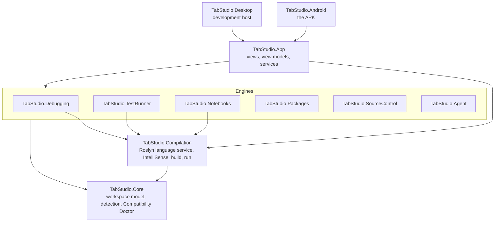
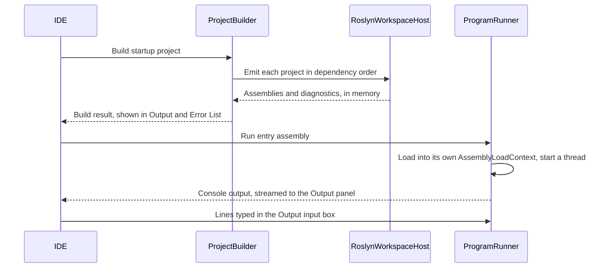

# Architecture

This document explains how TabStudio is put together: the layers of the code, what happens when you open a
solution and press F5, how the debugger, Test Explorer, notebooks and Git work without the tools they normally
need, and the Android rules every design decision starts from.

## Layers

Dependencies point down only. Each layer has one job:

| Project | Responsibility | Depends on |
| --- | --- | --- |
| `TabStudio.Core` | Reads solutions (`.sln`, `.slnx`) and projects (`.csproj`, `.vbproj`, `.fsproj`, `.vcxproj`) into an immutable workspace model, detects the technology stack of any folder, and decides where each project can run. | Nothing but the .NET base library |
| `TabStudio.Compilation` | The C# language service: a live Roslyn model of the workspace, diagnostics, classification, IntelliSense (completion, Quick Info, signature help, navigation, references, rename, code actions, document symbols), in-memory builds and running programs in-process. | Core, Roslyn |
| `TabStudio.Packages` | NuGet restore on the device: version resolution as NuGet does it, downloads from nuget.org or local feeds, the global packages folder and asset selection. | Core, NuGet.Versioning, NuGet.Frameworks |
| `TabStudio.Debugging` | The debugger: builds programs with statement hooks, and pauses, steps and inspects them. | Compilation |
| `TabStudio.TestRunner` | Test discovery and execution for xUnit, NUnit and MSTest, in-process and without runner packages. | Compilation |
| `TabStudio.Notebooks` | C# notebooks: the `.ipynb` and `.dib` formats, a C# kernel and rich value formatting. | Compilation |
| `TabStudio.SourceControl` | Git without a Git installation: changes found by hashing, `.gitignore`, and commits, pulls, merges, branches and pull requests through GitHub's API. | Core |
| `TabStudio.Agent` | Claude as a coding agent: the Messages API with streaming and prompt caching, tools over the workspace, Model Context Protocol servers, and sketch to XAML. | Core |
| `TabStudio.App` | The IDE: Avalonia views, view models, editor integration and app services. Platform-neutral. | Core and every engine, Avalonia |
| `TabStudio.Android` | The Android entry point: activity, manifest, icons, platform services such as thermal status. | App |
| `TabStudio.Desktop` | A desktop window around the same app, so contributors can work from any computer. | App |

Core, Compilation and the engines have no UI dependency and are covered by unit tests. The App is tested headlessly with
Avalonia's headless platform, including screenshots of the real views.

## Opening a workspace

1. **Loading.** `WorkspaceLoader` takes a solution file, a project file or a folder. A folder opens its
   top-level solution if it has one, otherwise every project under it, otherwise it opens as a plain folder.
   `ProjectParser` evaluates the parts of MSBuild that matter for editing and building: properties (including
   conditions and `$(Property)` expansion), `Directory.Build.props`, SDKs, target frameworks, package and
   project references, and `Compile` items with globs. The result is an immutable `Workspace` with a tree for
   the Solution Explorer.
2. **Detection.** `StackDetector` reads marker files (`global.json`, `package.json`, `Cargo.toml`, `go.mod`,
   `CMakeLists.txt`, `foundry.toml`, `Move.toml` and more) to list every technology in the repository.
   `CompatibilityDoctor` turns each project's kind into a run host and an explanation.
3. **Packages.** Projects that use NuGet packages (directly or through a project they reference) are restored
   in the background as soon as the workspace opens, and again when a project file is saved. Builds wait for
   the restore, and IntelliSense sees the packages as soon as they are on the device.
4. **Language service.** `RoslynWorkspaceHost` mirrors every C# project into a Roslyn `AdhocWorkspace`,
   with project references, implicit global usings and the .NET 10 reference assemblies bundled in the app.
   From then on the editor sends every edit to the host, and the host answers questions about it: which
   diagnostics a file has, how to color it, and how to compile a project. Roslyn reuses its compilations
   between edits, so these answers stay fast as you type.

## Pressing F5

- **Build.** Once any package restore in progress has finished, `ProjectBuilder` emits the startup project and
  the projects it references, dependencies first, as assemblies with portable PDBs in memory. Nothing is
  written to disk.
- **Safety.** A program runs inside TabStudio's own process, so `InProcessSafetyAnalyzer` rejects calls that
  would close the IDE, such as `Environment.Exit`, before the program starts (diagnostics `TS1001` and
  `TS1002`).
- **Run.** `ProgramRunner` loads the program and its package assemblies into its own `AssemblyLoadContext`,
  redirects the console to the Output panel and starts `Main` on a dedicated thread with a 16 MB stack. Console input comes from the
  Output panel's input box. Stopping a program detaches its console immediately.

## NuGet packages

`PackageRestorer` does what `dotnet restore` does, without the SDK:

- **Resolution** follows NuGet's rules: the lowest version in a range wins, the nearest reference wins along a
  path (with NU1605 for a downgrade), and conflicting paths settle on the lowest version that satisfies both
  (NU1107 when none does). Central package versions from `Directory.Packages.props` are honoured.
- **Sources** are NuGet V3 feeds (nuget.org by default) and local folders. Packages are installed into a
  global packages folder in NuGet's layout, verified and extracted safely, and shared by every project.
- **Assets** come from `ref/` or `lib/` for `net10.0` with NuGet's fallback rules. Packages that the framework
  already provides are pruned, so their assemblies always come from .NET itself.
- **No-op restores** are instant: the inputs are hashed, and an unchanged project reuses its last result.
  Offline, versions already on the device are used.
- **Shared frameworks.** A project on the Web SDK, or with a `FrameworkReference` to `Microsoft.AspNetCore.App`,
  gets ASP.NET Core the way a self-contained app does: its targeting pack (`Microsoft.AspNetCore.App.Ref`) to
  compile against and the runtime pack for the device's processor to run with, both from NuGet. The packs'
  assemblies are IL, so the Linux pack serves Android too.

## Web apps

`WebAppHost` serves an ASP.NET Core app from inside TabStudio. It runs the app like any program, with the
arguments the .NET host passes in development (`--urls` on a free local port, `--contentRoot` and
`--environment Development`), and waits until the port accepts connections. ASP.NET Core and the app's
packages load into the program's own load context, isolated from TabStudio's copies.

To stop the app gracefully, the host it builds is captured the way `WebApplicationFactory` captures it: the
hosting library announces each host on the `Microsoft.Extensions.Hosting` diagnostic listener, and stopping
calls that host's `StopAsync`. The server closes its port, the app's shutdown code runs and `Main` returns.

In the IDE, F5 on a web project serves it and opens the web preview in the side bar: Android's system WebView
inside the layout (a native control host), or the system browser where there is no embedded one. The first
`Project` profile of `Properties/launchSettings.json` gives the first page, the environment and extra
arguments. Saving one of the app's source files while it runs rebuilds it and starts it again on the same
port, and the preview reloads where it was; a change under `wwwroot` only reloads the page.

## Debugging

A debugger normally attaches to the runtime through a debugging API, which a .NET app on Android cannot do to
itself. TabStudio's debugger works inside the program instead:

- **Instrumented builds.** `DebugBuilder` rewrites the syntax trees before compiling: every statement gets a
  hook on the same line (`if (Step(f, id)) Break(f, id, locals)`), and every method body records its frame
  and reports exceptions from an exception filter, which runs while the stack is still intact. Line numbers in
  stack traces are identical with and without the hooks.
- **Pausing** blocks the program's thread inside the hook until the IDE says continue or step. Breakpoints,
  conditions and hit counts, Step Into, Over and Out, Run to Cursor and Break All are decisions the hook makes
  from the session's state.
- **Inspecting.** The hook passes the statement's locals, which `DebugValue` formats and expands lazily.
  The call stack is an `AsyncLocal` chain of frames, so it follows `await` across threads and projects.
- **Unhandled exceptions** break at the throwing line with the exception and the call stack, before anything
  unwinds.
- **In the IDE**, F5 debugs and Ctrl+F5 runs without the debugger. Breakpoints are anchored to their lines, so
  they follow edits, move to the statement they bind to, and are saved with the session. Locals, Watch and
  Call Stack fill the bottom dock while paused, and DataTips evaluate the expression under the pointer or a
  long press. Package code is not instrumented, so stepping stays in your own code.

## Tests

`TestSession` discovers xUnit, NUnit and MSTest tests by reflection on the built assemblies, recognising each
framework by its attribute type names, so no runner or adapter package is needed. It runs them in-process with
each framework's lifecycle (constructors and fixtures for xUnit, set-ups and tear-downs for NUnit and MSTest),
every kind of data source, timeouts and cancellation, and reports results with stack traces trimmed to the
user's code. `SourceTestDiscoverer` finds the same tests in source, with matching ids, so the Test Explorer can
list tests before the first build.

In the IDE, the Test Explorer lists tests from source as soon as the workspace opens and again on every save,
runs them through the normal build, and loads one `TestSession` per changed build, since Android cannot unload
assemblies. Results stream into the tree as each test finishes, and saving a file marks the results it may
have changed as stale.

## Notebooks

The C# kernel compiles each cell as a Roslyn script submission chained to the previous cell, emits it to
memory and runs it, so variables, functions and types carry from cell to cell. It does not use Roslyn's
scripting package, which needs assembly file paths that apps on Android do not have. Values are formatted
into text, HTML and tables. Notebooks are read and written as `.ipynb` (Jupyter and VS Code) and `.dib`
(Polyglot Notebooks), preserving unchanged cells byte for byte.

## Source control

Git normally needs the `git` executable, and Android does not allow an app to run one it downloaded. TabStudio
talks to GitHub instead:

- **Linked folders.** Cloning a repository records its owner, branch and the hash of every file of the commit
  in `.tabstudio/sync.json`. Large repositories download as one archive; files the archive lacks or changes
  are fetched one by one.
- **Changes** are found by computing each file's Git blob hash and comparing it with the commit's. A cache of
  sizes and modification times, with Git's guard against "racy" files, keeps this fast.
- **Committing** creates blobs, a tree and a commit with GitHub's Git data API and moves the branch, which is
  committing and pushing in one step. A push that is not a fast-forward is refused, and you pull first.
- **Pulling** applies GitHub's changes file by file. Files changed on both sides are merged with a three-way
  line merge (Myers' diff, as Git uses); conflicts get Git-style markers and can be settled by choosing a side.
- **Branches, pull requests and publishing** a folder as a new repository are GitHub API calls.
- **In the IDE**, the Git Changes window lists changes with checkboxes, commits and pushes them in one step,
  shows inline diffs, and settles conflicts by choosing a side. Signing in takes a personal access token,
  which GitHub checks before it is kept in the app's private storage.

## The agent

`AgentSession` runs Claude in a loop: Claude answers, asks for tools, gets their results and continues until
it is done. Its tools list, read and search the workspace, edit, create and delete files, compile, and run
tests. Tools from Model Context Protocol servers are added over the Streamable HTTP transport.

- **Every change is a proposal.** Edits go into a `ChangeSet` overlay rather than onto disk. The agent reads
  its own proposals back as if they were applied, and the IDE shows each one as a diff to keep or undo.
- **Compiling proposals.** `RoslynWorkspaceHost.CreateSnapshot` forks the live Roslyn solution with the
  proposed files: edited, new and deleted. The agent's diagnostics and test runs use the fork, so the agent
  can check its work before the user has accepted any of it, and the editors are never touched.
- **Costs.** The system prompt, the tool definitions and the conversation so far are marked for prompt
  caching, so each step of a long session re-reads them from the cache.

## In the IDE

`TabStudio.App` puts the engines behind a Visual Studio layout. `WorkspaceViewModel` owns the open workspace
and is split into partial classes by concern (`.Build`, `.Debugging`, `.Tests`, `.Git`, `.IntelliSense`,
`.Agent`, `.Web` and so on), each with the view models of its tool windows.

- **Tool windows.** The side bar holds Solution Explorer with Properties, Git Changes, Test Explorer, the web
  preview and the agent, one at a time, chosen with tabs at its bottom (`SideBarPanel`). The bottom dock holds
  the Error List, Output, the Compatibility Doctor, References, and Locals, Watch and Call Stack while
  debugging (`BottomPanel`).
- **The editor.** `CodeEditorView` is AvaloniaEdit with Roslyn's classifications and squiggles, split into
  partial files: completion, Parameter Info, Quick Info, quick actions, Peek Definition, the context menu,
  breakpoints and DataTips, and test commands. Its popups render in the window's overlay layer, placed
  against the text view. IntelliSense goes through `ILanguageFeatures`, so the editor never touches Roslyn.
- **Shortcuts.** Single keys are Avalonia key bindings on the shell. Two-key chords such as Ctrl+R, Ctrl+R and
  Ctrl+R, A share one `KeyChordMap` that sees keys before the focused control, so editor and shell chords with
  the same first key work together.
- **Touch.** Every action has a target of at least 44 pixels: the floating action bar over the editor (a
  debug bar while debugging), long presses for context menus, Quick Info and DataTips, and tabs that wrap when
  the side bar is narrow. On Android the editor takes the keyboard focus by itself only while a hardware
  keyboard is in use, so opening a file by touch does not cover the screen with the on-screen keyboard.
- **Tests of the UI.** The App's tests drive the real views on Avalonia's headless platform: typing into the
  editor, pressing chords, tapping and long-pressing, and saving screenshots that CI publishes.

## Run hosts

The Compatibility Doctor gives every project a run host, and F5 uses it:

| Run host | Used for |
| --- | --- |
| In-process | Console apps and tests, compiled to memory and run inside TabStudio |
| WebView | ASP.NET Core apps, served on the device by `WebAppHost` and shown in the web preview; Blazor and WebAssembly front ends |
| Android view | Avalonia and Uno apps, rendered natively in a pane |
| Windows Bridge | Anything that needs Windows, built and run on a PC you pair, and streamed to the tablet |

## Platform rules

Android limits what an app may execute and how. TabStudio is designed around those limits instead of
working around them, so it runs on stock Android with no root and no special permissions.

- **No executing downloaded files.** Since Android 10, an app may not `exec()` files in its own writable
  storage (the W^X rule). TabStudio never does: C# compiles to managed assemblies that the .NET runtime in the
  app loads directly, and native toolchains run only from locations Android permits, such as the app's
  native library directory or loaded in-process as shared libraries.
- **No Linux VM.** Android's Virtualization Framework is reserved for system and privileged apps, so
  TabStudio does not rely on a virtual machine or on a Linux user space such as proot.
- **One process, one console.** Programs share TabStudio's process. The console is redirected for one
  program at a time, and programs are isolated in their own load contexts.
- **Thermal limits.** Tablets throttle when hot. TabStudio reads Android's thermal status and compiles on
  fewer threads while the device is warm, so the UI stays responsive.

## Memory and CPU budget

TabStudio has to be useful on a 3 GB tablet, not only on a flagship. Most of its memory goes to the .NET
runtime and UI (a fixed cost) and to Roslyn's model of the solution (which grows with the code), so the
design keeps the second part proportional to what you are actually editing:

- **Device profiles.** At startup TabStudio reads total memory, core count and Android's low-RAM flag and
  picks a profile. The profile decides how much stays warm: live analysis for open files only or for the
  whole solution, how many threads background work may use, and the size of render caches.
- **Memory-mapped metadata.** The .NET reference assemblies are stored as files and memory-mapped, so their
  pages are clean, shared and evictable instead of living on the managed heap.
- **Skeleton references.** Only projects with open documents keep a full Roslyn compilation. The projects
  they depend on are referenced through compact metadata-only images, cached on disk by content and made
  again when their code changes. Go to Definition still finds the source behind an image, and builds always
  compile every project in full.
- **Memory pressure.** When Android reports memory pressure (`onTrimMemory`), TabStudio drops caches it can
  rebuild: semantic models of closed files, syntax highlighting state and old output.
- **Session restore.** The open documents, unsaved edits and layout are saved as you work, so if Android
  closes TabStudio in the background, it reopens where you left it.
- **TabStudio Link.** The language service and build engine sit behind one interface, so they can also run on
  another device you own, with the tablet showing only the IDE.
- **Background work stays in the background.** Analysis runs at below-normal priority and yields to typing,
  and builds use fewer threads while the device is warm.

## Key decisions

| Decision | Why |
| --- | --- |
| C# and Avalonia for the whole app, not Kotlin | The IDE, its compiler and the programs it runs share one runtime, so Roslyn runs in-process and a program can be loaded the moment it compiles. Avalonia renders the same UI on Android and on the desktop, which is how the app is tested in CI. |
| Roslyn in-process instead of a language server | No process to start or talk to, and the same compilations serve highlighting, diagnostics and builds. |
| Its own project system instead of MSBuild | MSBuild needs the .NET SDK, which does not run on Android. TabStudio evaluates the parts of project files that editing and building need. |
| In-memory builds | The edit-run loop never waits for the disk, and builds reuse the editor's warm compilations. |
| A debugger built into the program | .NET's debugging interfaces are not available to an app debugging code in its own process on Android. Statement hooks give breakpoints, stepping and inspection with nothing but the compiler. |
| Git through GitHub's API | Android forbids running downloaded executables, and a reimplementation of Git's network protocol would duplicate what GitHub already offers over HTTPS. |

## Code conventions

See [CONTRIBUTING.md](../CONTRIBUTING.md) for code style, tests and how CI reports results.
