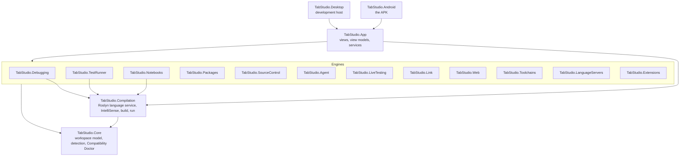
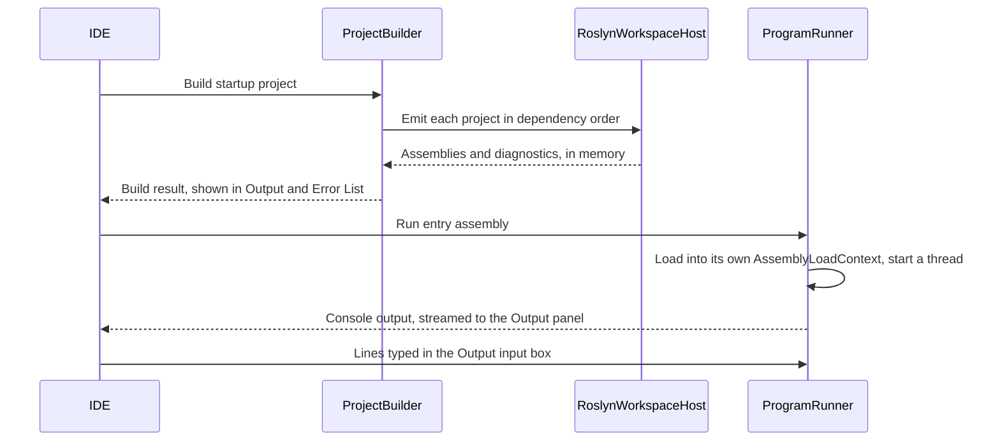

# Architecture

This document explains how TabStudio is put together: the layers of the code, what happens when you open a
solution and press F5, how the debugger, Test Explorer, notebooks and Git work without the tools they normally
need, and the Android rules every design decision starts from.

## Layers

Dependencies point down only. Each layer has one job:

| Project | Responsibility | Depends on |
| --- | --- | --- |
| `TabStudio.Core` | Reads solutions (`.sln`, `.slnx`) and projects (`.csproj`, `.vbproj`, `.fsproj`, `.vcxproj`) into an immutable workspace model, detects the technology stack of any folder, and decides where each project can run. | Nothing but the .NET base library |
| `TabStudio.Compilation` | The C# language service: a live Roslyn model of the workspace, diagnostics, classification, IntelliSense (completion, Quick Info, signature help, navigation, references, rename, code actions, document symbols), in-memory builds and running programs in-process. | Core, Roslyn |
| `TabStudio.Packages` | NuGet restore on the device: version resolution as NuGet does it, downloads from nuget.org or local feeds, the global packages folder and asset selection. | Core, NuGet.Versioning, NuGet.Frameworks |
| `TabStudio.Debugging` | The debugger: builds programs with statement hooks, and pauses, steps and inspects them. | Compilation |
| `TabStudio.TestRunner` | Test discovery and execution for xUnit, NUnit and MSTest, in-process and without runner packages. | Compilation |
| `TabStudio.Notebooks` | C# notebooks: the `.ipynb` and `.dib` formats, a C# kernel and rich value formatting. | Compilation |
| `TabStudio.SourceControl` | Git without a Git installation: changes found by hashing, `.gitignore`, and commits, pulls, merges, branches and pull requests through GitHub's API. | Core |
| `TabStudio.LiveTesting` | Live Unit Testing: coverage instrumentation, per-test attribution, coverage builds, impact analysis and the live test engine. | Compilation, Debugging, TestRunner |
| `TabStudio.Link` | TabStudio Link: pairing, the TLS transport, QR codes, discovery, and the language protocol a host answers for a tablet. | Compilation, Debugging, LiveTesting |
| `TabStudio.Web` | What a web app serves beyond its code: static web assets, scoped CSS, Blazor's scripts, and a host for .NET apps on WebAssembly. | Compilation, Packages |
| `TabStudio.Wpf` | OpenSilver's in-process XAML compiler, WPF template and browser startup, on the WebAssembly host. | Compilation, Packages, Web |
| `TabStudio.Toolchains` | The Toolchain Store: the catalog, Alpine Linux on PRoot, verified Alpine packages, processes and pseudo terminals, toolchain projects and the terminal emulator. | `TabStudio.Core` |
| `TabStudio.Forms` | Windows Forms on Avalonia: `System.Windows.Forms` and `System.Drawing`, run in the app preview. | Avalonia |
| `TabStudio.Forms.Design` | The Windows Forms designer's model: reads and writes `InitializeComponent`, the Toolbox and properties. | `TabStudio.Forms`, Roslyn |
| `TabStudio.Swarm` | Swarm: the coordinator and members, deployment with cached attachments, the web gateway, the debug agent. | `TabStudio.Link`, `TabStudio.Debugging`, `TabStudio.Compilation` |
| `TabStudio.LanguageServers` | Language Server Protocol and Debug Adapter Protocol clients, server and adapter registry, launch configurations. | Nothing but the .NET base library |
| `TabStudio.Extensions` | VS Code extensions from Open VSX: install and verify, and their grammars, language configurations, snippets and themes. | Nothing but the .NET base library |
| `TabStudio.Agent` | Claude as a coding agent: the Messages API with streaming and prompt caching, tools over the workspace, Model Context Protocol servers, and sketch to XAML. | Core |
| `TabStudio.Uno` | Uno and WinUI XAML templates and in-process Skia preview host. | Core, Compilation |
| `TabStudio.App` | The IDE: Avalonia views, view models, editor integration and app services. Platform-neutral. | Core and every engine, Avalonia |
| `TabStudio.Android` | The Android entry point: activity, manifest, icons, platform services such as thermal status. | App |
| `TabStudio.Desktop` | A desktop window around the same app, so contributors can work from any computer. | App |

Core, Compilation and the engines have no UI dependency and are covered by unit tests. The App is tested headlessly with
Avalonia's headless platform, including screenshots of the real views.

## Opening a workspace

1. **Loading.** `WorkspaceLoader` takes a solution file, a project file or a folder. A folder opens its
   top-level solution if it has one, otherwise every project under it, otherwise it opens as a plain folder.
   `ProjectParser` evaluates the parts of MSBuild that matter for editing and building: properties (including
   conditions and `$(Property)` expansion), `Directory.Build.props`, SDKs, target frameworks, package and
   project references, and `Compile` items with globs. The result is an immutable `Workspace` with a tree for
   the Solution Explorer.
2. **Detection.** `StackDetector` reads marker files (`global.json`, `package.json`, `Cargo.toml`, `go.mod`,
   `CMakeLists.txt`, `foundry.toml`, `Move.toml` and more) to list every technology in the repository.
   `CompatibilityDoctor` turns each project's kind into a run host and an explanation.
3. **Packages.** Projects that use NuGet packages (directly or through a project they reference) are restored
   in the background as soon as the workspace opens, and again when a project file is saved. Builds wait for
   the restore, and IntelliSense sees the packages as soon as they are on the device.
4. **Language service.** `RoslynWorkspaceHost` mirrors every C# project into a Roslyn `AdhocWorkspace`,
   with project references, implicit global usings and the .NET 10 reference assemblies bundled in the app.
   From then on the editor sends every edit to the host, and the host answers questions about it: which
   diagnostics a file has, how to color it, and how to compile a project. Roslyn reuses its compilations
   between edits, so these answers stay fast as you type.

## Pressing F5

- **Build.** Once any package restore in progress has finished, `ProjectBuilder` emits the startup project and
  the projects it references, dependencies first, as assemblies with portable PDBs in memory. Nothing is
  written to disk.
- **Safety.** A program runs inside TabStudio's own process, so `InProcessSafetyAnalyzer` rejects calls that
  would close the IDE, such as `Environment.Exit`, before the program starts (diagnostics `TS1001` and
  `TS1002`).
- **Run.** `ProgramRunner` loads the program and its package assemblies into its own `AssemblyLoadContext`,
  redirects the console to the Output panel and starts `Main` on a dedicated thread with a 16 MB stack. Console input comes from the
  Output panel's input box. Stopping a program detaches its console immediately.

## NuGet packages

`PackageRestorer` does what `dotnet restore` does, without the SDK:

- **Resolution** follows NuGet's rules: the lowest version in a range wins, the nearest reference wins along a
  path (with NU1605 for a downgrade), and conflicting paths settle on the lowest version that satisfies both
  (NU1107 when none does). Central package versions from `Directory.Packages.props` are honoured.
- **Sources** are NuGet V3 feeds (nuget.org by default) and local folders. Packages are installed into a
  global packages folder in NuGet's layout, verified and extracted safely, and shared by every project.
- **Assets** come from `ref/` or `lib/` for `net10.0` with NuGet's fallback rules. Packages that the framework
  already provides are pruned, so their assemblies always come from .NET itself.
- **No-op restores** are instant: the inputs are hashed, and an unchanged project reuses its last result.
  Offline, versions already on the device are used.
- **Shared frameworks.** A project on the Web SDK, or with a `FrameworkReference` to `Microsoft.AspNetCore.App`,
  gets ASP.NET Core the way a self-contained app does: its targeting pack (`Microsoft.AspNetCore.App.Ref`) to
  compile against and the runtime pack for the device's processor to run with, both from NuGet. The packs'
  assemblies are IL, so the Linux pack serves Android too.

## Source generators

Roslyn runs source generators as part of every compilation in `RoslynWorkspaceHost`, so IntelliSense, live
errors, builds and the debugger all see the code they generate.

- **Where they come from.** A package's `analyzers/dotnet/cs` folder, with the folder for the highest Roslyn
  version that is not newer than the compiler's, as the SDK picks them. .NET's own generators (behind
  `[GeneratedRegex]`, `[JsonSerializable]`, `[LibraryImport]`) come from `Microsoft.NETCore.App.Ref`, which is
  downloaded the first time code uses one of those attributes; ASP.NET Core's come with its targeting pack.
- **Loading.** `AnalyzerLoader` gives each folder its own `AssemblyLoadContext`, with Roslyn and its
  dependencies shared from the app.
- **Build properties.** A generated global `.editorconfig` hands generators the project's MSBuild properties,
  as the SDK does. `SdkGenerators` applies the SDK's other rules: ASP.NET Core's request delegate generator and
  the configuration binding generator stay off unless the project turns them on, and generators may put
  interceptors only in the namespaces the SDK and the project allow.
- **Avalonia XAML.** Avalonia compiles XAML after the C# compiler, a step TabStudio does not have, so its own
  generator, `AvaloniaXamlGenerator`, takes the place of Avalonia's: it puts each `.axaml` file into the assembly
  as text, generates `InitializeComponent` and the fields of `x:Name` elements, and intercepts
  `AvaloniaXamlLoader.Load(this)` so that the XAML is loaded at run time. XAML that is not well-formed is an
  error naming the file.

## Web apps

`WebAppHost` serves an ASP.NET Core app from inside TabStudio. It runs the app like any program, with the
arguments the .NET host passes in development (`--urls` on a free local port, `--contentRoot` and
`--environment Development`), and waits until the port accepts connections. ASP.NET Core and the app's
packages load into the program's own load context, isolated from TabStudio's copies.

To stop the app gracefully, the host it builds is captured the way `WebApplicationFactory` captures it: the
hosting library announces each host on the `Microsoft.Extensions.Hosting` diagnostic listener, and stopping
calls that host's `StopAsync`. The server closes its port, the app's shutdown code runs and `Main` returns.

In the IDE, F5 on a web project serves it and opens the web preview in the side bar: Android's system WebView
inside the layout (a native control host), or the system browser where there is no embedded one. The first
`Project` profile of `Properties/launchSettings.json` gives the first page, the environment and extra
arguments. Saving one of the app's source files while it runs rebuilds it and starts it again on the same
port, and the preview reloads where it was; a change under `wwwroot` only reloads the page.

### Blazor and Razor

- **The Razor compiler** is the .NET SDK's own Razor source generator, vendored in
  `src/TabStudio.Compilation/Razor/Compiler` from SDK 10.0.113 (see its NOTICE.txt; refresh it with
  `build/razor/update-razor-compiler.sh` when Microsoft.CodeAnalysis moves). It gets the `.razor` and `.cshtml` files
  as additional files with the analyzer config the Razor SDK writes, so components, pages and views compile as they
  do with the SDK, and `#line` mappings put errors on the right Razor line, live and in builds.
- **`TabStudio.Web`** serves what the SDK would publish: static web assets with development manifests for
  `MapStaticAssets`, `_content/<library>` files, scoped CSS bundles, JavaScript initializers and Blazor's scripts.
- **Interactive Server components** run in-process like any web app. Android cannot unload an earlier run's
  assemblies, and Blazor finds component types by assembly name, so `ServerComponentTypes` fills Blazor's type caches
  with the current run's types.
- **`WebAssemblyAppHost`** serves any .NET 10 browser app to the web preview: the app's IL, the browser-wasm runtime
  pack from NuGet, and the boot configuration inlined into `dotnet.js`. Blazor WebAssembly uses it, and so will
  OpenSilver and Uno.

## Avalonia apps

`AvaloniaAppHost` shows an Avalonia app inside TabStudio's own window, so it renders natively beside the code:

- **One Avalonia.** The app's assemblies load into their own context, but Avalonia, SkiaSharp and HarfBuzz come
  from TabStudio, so the app's controls are TabStudio's types, drawn by the same renderer on the UI thread. The
  app's own copy of Avalonia from NuGet is only compiled against; other libraries, such as control packages
  TabStudio does not have, load from the app's packages.
- **Starting the app.** The app's `App` class starts as on a phone, with a single-view lifetime, and sets its
  main view in `OnFrameworkInitializationCompleted`, as Avalonia's cross-platform template does. An app written
  for the desktop only sets a window; then the window's content is shown, with a new instance of the view model
  named after it, and the preview says so.
- **XAML at run time.** The XAML the generator embedded is loaded with Avalonia's run-time XAML loader.
  Restarted apps are new assemblies with the same types, and the earlier ones stay loaded because the code the
  loader emitted references them; `RuntimeXamlTypes` takes them out of the loader's list before each start, so
  XAML gets the new build's types.
- **Isolation.** The view sits in a `ThemeVariantScope` with the app's styles and resources, so the app's theme
  never changes the IDE's. Its console output goes to the Output panel, and an exception its code does not
  handle on the UI thread ends the app, not TabStudio.

In the IDE, F5 on an Avalonia project shows it in the app preview in the side bar, filling the pane or in a
phone or tablet frame. Saving one of its files rebuilds it and starts it again.

**The XAML designer.** An `.axaml` file of an Avalonia app opens with its preview beside the code (Design,
split or XAML, side by side or stacked), rendered a moment after typing stops. It does not run the app:
`XamlDesignBuilds` builds the project in the background and loads that build, and `XamlPreviewRenderer` compiles
the XAML being typed against it in Avalonia's design mode. The view's own class is created without loading the
XAML compiled into it, so what appears is exactly the text in the editor; `Design.DataContext`, `d:DesignWidth`
and `d:DesignHeight` apply, or a new instance of the `x:DataType` view model. A window shows its content, and
styles and resource dictionaries show their `Design.PreviewWith`. Errors keep the last good preview, with the
line they are on. The project is built again only when one of its files is saved.

**Sketch to XAML.** The designer's Sketch pad turns a drawing into the view's XAML: the drawing goes to Claude as an
image (`SketchToXaml` in the agent engine, with the user's own API key), and `XamlContentEdit` puts the answer in
as the root element's content, keeping its property elements and every other character of the file, as one edit
that Undo takes back.

## WinUI and Uno apps

`TabStudio.Uno` hosts Uno Platform's native Skia renderer in-process. Uno.Sdk projects restore their implicit
packages; WinUI 3 projects restore against Uno instead of the Windows App SDK (TS7001). Uno's XAML generator
runs in the Roslyn workspace with its additional files and SDK properties. Generator errors and C# errors in
its output map back to the originating XAML element in the Error List.

F5 and Ctrl+F5 show the app beside the editor without the debugger. Saving XAML or C# rebuilds and restarts it.
Uno runs once per session on its own dispatcher and renderer threads; each app build has its own load context.
The generated host is compiled against the restored runtime as `Uno.UI.Runtime.Skia.Headless`, Uno's declared
friend assembly. Frames cross into Avalonia as premultiplied BGRA pixels, and input travels back to Uno.
Android and the desktop IDE share SkiaSharp 3.119 with Avalonia 11, including matching native assets; they do
not load competing Skia ABIs. The emulator self test creates the WinUI template and reads its Uno window title.

Windows-only APIs still need Windows Bridge, and Uno reports unsupported WinUI APIs in the Error List. A
session supports one Uno version and one running Uno preview. Swarm screens, layout inspection and recorded UI
tests are not implemented for Uno: the existing inspectors require an Avalonia visual tree, while this preview
is a bitmap of Uno's tree. Changing Uno versions requires restarting TabStudio. App assemblies remain loaded
on Android, whose runtime cannot unload them.

## Windows Forms apps

`TabStudio.Forms` is the `System.Windows.Forms` and `System.Drawing` API implemented on Avalonia, with the names,
signatures, defaults and event order of Windows Forms on .NET, so code written in Visual Studio compiles unchanged. A
project with `<UseWindowsForms>true</UseWindowsForms>` or a `-windows` target compiles against it instead of the Windows
Desktop SDK, with the SDK's global usings and a generated `ApplicationConfiguration`. F5 runs the app in the app
preview inside a Windows 10 window: `Application.Run` runs its message loop on its own UI thread, `Show` and
`ShowDialog` open more windows, closing the main form ends the run, and an unhandled exception ends only the app. A
member that cannot work on a tablet throws `NotSupportedException` naming the member and what to use instead.

`TabStudio.Forms.Design` is the designer's model. It reads `InitializeComponent` with Roslyn, never running the app's
code, edits a model of the controls, and writes changes back in the file's own style the way Visual Studio does,
keeping statements it does not understand. The IDE draws the model with the Forms layer on a canvas with handles, a
grid and a Toolbox, and the Properties panel edits it, Events included.

## WPF apps

C# projects with `<UseWPF>true</UseWPF>` compile against OpenSilver 3.3.3 instead of the Windows Desktop pack.
`TabStudio.Compilation/Wpf` supplies typed `x:Name` fields and the first-pass `InitializeComponent` while editing;
`TabStudio.Wpf` runs OpenSilver's own second-pass XAML compiler before emitting the application. F5 prepares and
serves a .NET WebAssembly browser host in the web preview. The window attaches before its first forced layout;
saving rebuilds and reloads the page, and the host forwards console output, uncaught exceptions and window closure.
An unhandled input exception releases stranded mouse capture so later clicks still reach the app.
Android installs a `WebChromeClient`, so OpenSilver's `MessageBox` alert/confirm calls show the native browser dialogs.
The .NET 10 preview needs an up-to-date Android System WebView. CI uses Android 15 (API 35) to exercise the
rendered WPF page; the API 29 image's Chrome 74 cannot run this browser runtime.
The device self test starts through `SelfTestInstrumentation`, so its existing desktop mouse checks retain
Android's input injection permission through their adb instrumentation source.

`Wpf/Editing` in Compilation reads the project's actual types and current additional-document text for completion,
Quick Info, definitions, live XAML errors and missing-handler fixes. `DocumentViewModel.Xaml.cs` attaches it through
the editor's language-feature interface, synchronizes unsaved XAML and code-behind, and rejects stale analysis.
The existing workspace edit path applies handler fixes, preserving open documents' unsaved changes and Undo.
These XAML queries use the local Roslyn host; they are unavailable while a TabStudio Link host owns compilation.
The shipped catalog compares WPF 10 with OpenSilver: TS7004 names missing APIs and points to the Windows Bridge,
TS7005 warns about APIs marked not implemented, and TS7006 explains window settings ignored by the web preview.
The preview has no C# debugger, WPF 3D or native modal windows; XAML rename and Find All References are not provided.
Library tests cover the editing engine, headless IDE tests capture completion and the handler light bulb, and
`SelfTest.Wpf.cs` creates the template, presses F5 and reads rendered page text on Android after the Windows Forms
and design checks and before Swarm, retaining every existing self-test step.

## Debugging

A debugger normally attaches to the runtime through a debugging API, which a .NET app on Android cannot do to
itself. TabStudio's debugger works inside the program instead:

- **Instrumented builds.** `DebugBuilder` rewrites the syntax trees before compiling: every statement gets a
  hook on the same line (`if (Step(f, id)) Break(f, id, locals)`), and every method body records its frame
  and reports exceptions from an exception filter, which runs while the stack is still intact. Line numbers in
  stack traces are identical with and without the hooks.
- **Pausing** blocks the program's thread inside the hook until the IDE says continue or step. Breakpoints,
  conditions and hit counts, Step Into, Over and Out, Run to Cursor and Break All are decisions the hook makes
  from the session's state.
- **Inspecting.** The hook passes the statement's locals, which `DebugValue` formats and expands lazily.
  The call stack is an `AsyncLocal` chain of frames, so it follows `await` across threads and projects.
- **Unhandled exceptions** break at the throwing line with the exception and the call stack, before anything
  unwinds.
- **In the IDE**, F5 debugs and Ctrl+F5 runs without the debugger. Breakpoints are anchored to their lines, so
  they follow edits, move to the statement they bind to, and are saved with the session. Locals, Watch and
  Call Stack fill the bottom dock while paused, and DataTips evaluate the expression under the pointer or a
  long press. Package code is not instrumented, so stepping stays in your own code.

## Tests

`TestSession` discovers xUnit, NUnit and MSTest tests by reflection on the built assemblies, recognising each
framework by its attribute type names, so no runner or adapter package is needed. It runs them in-process with
each framework's lifecycle (constructors and fixtures for xUnit, set-ups and tear-downs for NUnit and MSTest),
every kind of data source, timeouts and cancellation, and reports results with stack traces trimmed to the
user's code. `SourceTestDiscoverer` finds the same tests in source, with matching ids, so the Test Explorer can
list tests before the first build.

In the IDE, the Test Explorer lists tests from source as soon as the workspace opens and again on every save,
runs them through the normal build, and loads one `TestSession` per changed build, since Android cannot unload
assemblies. Results stream into the tree as each test finishes, and saving a file marks the results it may
have changed as stale.

### Live Unit Testing

`TabStudio.LiveTesting` needs no profiler, which Android does not offer:

- **Instrumentation.** A syntax rewriter adds a hit to each statement of the product projects a test project
  references, keeping line numbers identical to the source, with a small hit table per assembly. Test projects
  are never instrumented.
- **Attribution.** `ITestThreadHook` in TestRunner tells the hit tables which test is running, through an
  `AsyncLocal`, so coverage follows async code. Coverage is kept per member, so it survives lines moving.
- **Impact.** `ImpactAnalyzer` compares an edit's members with the last build's: only the tests that ran an edited
  member run again, with new and changed tests; a change outside members, or unknown coverage, runs them all.
- **Running.** `CoverageBuilder` rebuilds only changed projects; `LiveTestEngine` runs one build and test run at a
  time, gives way to builds, debugging and Test Explorer, and waits while the device is hot.
- **In the IDE**, a margin beside the breakpoints draws each line's state from `CoverageIndex`, and markers follow
  the text as you type and dim until their tests run again.

## Notebooks

The C# kernel compiles each cell as a Roslyn script submission chained to the previous cell, emits it to
memory and runs it, so variables, functions and types carry from cell to cell. It does not use Roslyn's
scripting package, which needs assembly file paths that apps on Android do not have. Values are formatted
into text, HTML and tables. Notebooks are read and written as `.ipynb` (Jupyter and VS Code) and `.dib`
(Polyglot Notebooks), preserving unchanged cells byte for byte.

## Source control

Git normally needs the `git` executable, and Android does not allow an app to run one it downloaded. TabStudio
talks to GitHub instead:

- **Linked folders.** Cloning a repository records its owner, branch and the hash of every file of the commit
  in `.tabstudio/sync.json`. Large repositories download as one archive; files the archive lacks or changes
  are fetched one by one.
- **Changes** are found by computing each file's Git blob hash and comparing it with the commit's. A cache of
  sizes and modification times, with Git's guard against "racy" files, keeps this fast.
- **Committing** creates blobs, a tree and a commit with GitHub's Git data API and moves the branch, which is
  committing and pushing in one step. A push that is not a fast-forward is refused, and you pull first.
- **Pulling** applies GitHub's changes file by file. Files changed on both sides are merged with a three-way
  line merge (Myers' diff, as Git uses); conflicts get Git-style markers and can be settled by choosing a side.
- **Branches, pull requests and publishing** a folder as a new repository are GitHub API calls.
- **In the IDE**, the Git Changes window lists changes with checkboxes, commits and pushes them in one step,
  shows inline diffs, and settles conflicts by choosing a side. Signing in takes a personal access token,
  which GitHub checks before it is kept in the app's private storage.

### Pull request review

- **`GitHubClient`'s PullRequests, Reviews and GraphQL partials** list, read and merge pull requests, read file
  versions at any commit, and post review comments, replies and reviews. Resolving threads, marking a draft ready
  and adding to a pending review exist only in GitHub's GraphQL API, so those few calls use it.
- **A pull request is a document** (`ViewModels/PullRequests/`, `Views/PullRequests/`): its page, and a diff per
  file built on `DiffView`. Comments are written into a pending review, so nothing is posted until Finish Review.
- **Conversations inside an editor** take room under their line with a spacer element (`ReviewSpacerGenerator`)
  and are drawn by an overlay (`ReviewAdorner`) outside the text area, so typing in a reply never reaches the code.
- **Review with Claude** (`TabStudio.Agent/PullRequestReviewer.cs`) sends the numbered diff with one tool,
  `report_review`; findings become drafts on diff lines that the user keeps, edits or dismisses.

### GitHub Actions

A tablet cannot receive webhooks, so CI is polled, and polled politely:

- **`GitHubClient`'s Actions, Checks, Workflows and Logs partials** read check runs, commit statuses, runs,
  jobs and steps, and call re-run, re-run failed jobs, cancel and workflow dispatch. Every read sends the
  ETag GitHub gave last time; a `304 Not Modified` reuses the cached answer and does not count against the
  rate limit, whose headers the client records.
- **`CiMonitor`** (in the app) watches the linked commit: every 12 s while something runs, every 90 s when
  nothing does, four times slower when under a tenth of the rate limit is left, and not at all while the
  app is in the background. A commit, push, pull or branch switch refreshes it at once.
- **Job logs** come from a redirect that must be followed without the token. A large log is streamed, and
  only its head and tail are kept, so memory stays bounded; `CiLog` folds logs by step and `##[group]`, colours `##[error]` and
  `##[warning]`, keeps ANSI colours and hides timestamps.
- **CI's errors** come from check-run annotations and from compiler lines in failed steps' logs
  (`CompilerMessage`), mapped onto workspace files and added to the Error List with the check and commit
  that reported them.
- **Run workflow** reads the workflow file through the contents API, and `WorkflowFile` turns its
  `workflow_dispatch` inputs into a form.

## TabStudio Link

A tablet with little memory can hand its language service to a stronger device running TabStudio: a phone, another
tablet or a PC. Programs, tests and the debugger still run on the tablet; the host only compiles.

- **Transport.** TLS 1.3 (1.2 on Android 9) through `SslStream`. Each device has a self-signed ECDSA P-256
  certificate, and each checks the other's, pinned by the SHA-256 of its public key. Messages are length-prefixed
  JSON frames (source-generated) with request ids, cancellation, notifications and binary attachments for
  assemblies and PDBs.
- **Pairing.** The host shows a QR code (`tabstudio-link://`, drawn by the library's own encoder) with its address,
  fingerprint and a one-time 8-character code; typing the address and code works too. Both sides prove they know the
  code with HMACs over the handshake, keyed by PBKDF2-SHA256, so a man in the middle learns nothing he can use in the
  20 seconds a handshake lasts. The code works once, expires after 10 minutes and is replaced after a wrong guess.
  Paired devices are remembered by fingerprint; a UDP broadcast finds a paired host again after its address changed,
  and TLS still checks the fingerprint.
- **The language protocol.** The host keeps a mirror of the tablet's workspace, indexed by file hash, so only changed
  files travel. A path map rewrites paths between the two devices, PDBs included, so diagnostics, IntelliSense,
  builds, debug builds, Live Unit Testing's coverage builds and the agent's snapshot checks all come back in the
  tablet's terms. The tablet sends its coverage slots with each coverage build, so hits from a host-built assembly
  land where the tablet's own builds would put them.
- **Falling back.** `LinkedLanguageService` sends work to `RemoteLanguageService` while a host is connected and to
  the local service otherwise. Unsaved edits are kept on both sides, so losing the host costs nothing but speed, and
  the link comes back by itself.
- **What pairing grants.** The host runs the analyzers and source generators of the tablet's packages, so pairing
  gives the tablet code execution on the host; the host's Link window says so, and asks to pair only tablets you own. Mirror paths
  are validated, so a tablet cannot write outside its own mirror folder.

## Toolchains

`TabStudio.Toolchains` runs languages other than C# from the Toolchain Store. Its catalog (`toolchains.json`)
describes each toolchain: the Alpine packages it needs, its setup steps (an archive such as a debug adapter, or a
command such as `npm install --global`), its project files, how F5 runs a project, and the language server and debug
adapter it brings.

- **The Linux environment.** On Android, the first install unpacks Alpine Linux's minimal root file system into the
  app's storage. `ProotRuntime` runs its programs with PRoot, which Termux also ships: Android lets an app execute
  files only from its native library folder, so PRoot and its loader ship there as `libproot.so` and
  `libproot-loader.so`, and the loader maps each program into memory itself. Nothing from the app's writable
  storage is ever executed by the system, and children and grandchildren of a program work the same way. Programs
  see Alpine as `/`, run as a simulated root user, and see TabStudio's projects folder and each open workspace at
  their own paths, so paths in their output are files the IDE opens. On a computer, `HostRuntime` runs the
  computer's own programs from the PATH.
- **Packages.** `AlpinePackageManager` downloads, resolves and installs Alpine packages itself, so downloads show
  progress and survive a dropped connection. The repository index is verified against Alpine's keys, and each
  package against the index entry that lists it, before anything is unpacked.
- **Processes.** Programs are children of TabStudio's process, started with pipes or a pseudo terminal, and are
  killed with their whole process tree when stopped, as Android 12 and later expect.
- **Projects.** `ToolchainProjectDetector` finds projects from the catalog's manifests and source-file rules.
  F5 and Ctrl+F5 run them with their console in the Output panel; problem matchers turn tracebacks and compiler
  output into Error List entries and links.
- **The terminal.** `TerminalEmulator` turns what programs write to a pseudo terminal into styled character cells,
  as xterm does, for the Terminal panel to draw.
- **Language servers and debug adapters.** `ToolchainServerLauncher` implements `IServerProcessLauncher` over the
  toolchain runtime, so Pyright, typescript-language-server, debugpy and vscode-js-debug start inside the Linux
  environment and paths are translated between the device and the environment. A missing server or adapter offers
  to install the toolchain that brings it. For F5, a project's run plan becomes a DAP launch configuration, and the
  program's input and output stay in the Output panel through its adapter's terminal or runtime streams.

### Go

Every `go.mod`, including nested modules, is a startup project; vendor and cache folders are ignored. A root
`package main` or a single `cmd/name` command builds with `go build -gcflags=all=-N -l` into `.tabstudio/bin/app`.
With several commands, the active source selects the package. F5 and Ctrl+F5 build the whole package, including
sibling files, and Go compiler locations become Error List links.

Alpine installs Go, gopls and Delve from its verified package index; desktops use PATH. gopls supplies completion,
diagnostics and navigation. Delve serves DAP over loopback TCP on a computer and a Unix socket in a private app-cache directory on Android.
The socket directory is shared into PRoot and removed with the debug session. Launches use `mode: exec`, remote
output and stdin inherited from the runtime process; user input never enters the DAP stream. Real-tool IDE and emulator tests cover the
console template, compiler errors, a breakpoint and Locals.

The APK's PRoot includes a thread-wait patch: Linux permits one thread to collect debugger events for a sibling
thread's ptracees, which Delve needs. `__WNOTHREAD` still limits waits to the calling thread, and ptrace control
requests remain restricted to the original tracing thread. A native CI fixture checks blocking and nonblocking
waits, exit status and those ownership boundaries before the emulator exercises Delve itself.

### Rust

Cargo packages, virtual workspaces and their members are startup projects. Alpine installs Rust, Cargo,
rust-analyzer, Rust sources and LLDB with lldb-dap; desktops use PATH. Cargo builds with
`--message-format=json-render-diagnostics`: structured primary spans populate the Error List, and reported
executable artifacts determine the run path, including custom target directories. With several binaries, choose
a member startup project or open the binary's main source. rust-analyzer supplies IntelliSense and navigation.

F5 uses LLDB DAP. Desktop programs use `runInTerminal`; on Android, LLDB launches within its own PRoot trace tree
so emulated ptrace can see the debuggee. A private FIFO created through Android's C library carries Output-panel
input, while DAP events carry program output. Real-tool IDE and emulator tests cover the template, a breakpoint
and Locals, with Watch and Call Stack checked in the IDE.

## Swarm

`TabStudio.Swarm` runs the app being built on every device that joins the tablet's swarm. Devices join through
TabStudio Link's pairing (a `tabstudio-link://swarm?` invitation, TLS 1.3 with pinned certificates), as members of a
host that accepts several clients. The tablet is the coordinator:

- **Running.** F5 builds once and sends the build to every member; attachments are cached by hash, so later runs send
  only what changed. Avalonia apps run full screen on each device, console apps stream their output back with stdin
  from the tablet, and web apps are served once by the tablet. A failing device never stops the others.
- **Web apps.** Each device's web view opens the app through a gateway on the device's own loopback address. Every
  connection travels inside the swarm's Link connection, so nothing listens on the Wi-Fi. A per-run secret in the
  first URL is swapped for an `HttpOnly`, `SameSite=Strict` cookie, and requests without it are refused.
- **Debugging.** A debug agent on each device reports breakpoints and pauses to the tablet's debugger, which shows the
  device's Locals and Call Stack and can pause every device at once.
- **Screens.** Everything that shows the app is an `IAppScreen` (`TabStudio.App/Swarm/AppScreens.cs`): a device's
  preview, the tablet's App Preview, virtual devices of any size, theme, direction and font scale, and the web
  preview. Screens report a person's input, replay input as real taps and keys, take pictures, list their elements
  (`ElementPaths` names them the same way for capture, replay, mirroring and findings) and check their own layout.
- **Layout checks.** An `ILayoutInspector` looks for clipped text, off-screen and overlapping controls, small touch
  targets and low contrast (SWRM001 to SWRM005, see [layout-checks.md](layout-checks.md)) whenever a screen changes,
  and the findings go to the Error List with a picture of each screen.
- **Recorded UI tests.** A recording becomes an xUnit test in an Avalonia.Headless project with a generated driver,
  which replays per screen in Test Explorer and with `dotnet test`.

## Language servers and debug adapters

`TabStudio.LanguageServers` speaks the Language Server Protocol (3.17) and the Debug Adapter Protocol, so every
language with a server or an adapter gets the editor and the debugger C# has. One server runs per language and
workspace folder, started when a file of its language opens and restarted if it crashes. In the IDE, files Roslyn does
not own are served by their server through the same completion, Quick Info, signature help, squiggles, navigation,
rename, formatting, code actions, symbols and folding the C# editor uses; a debug adapter session drives the same
breakpoints, Locals, Watch, Call Stack and DataTips. `.tabstudio/settings.json` configures servers per folder and
`.tabstudio/launch.json` holds launch configurations in VS Code's format. Servers and adapters start through
`IServerProcessLauncher`, which the Toolchain Store implements on the tablet.

## Extensions

`TabStudio.Extensions` installs VS Code extensions from Open VSX (or a company's own registry) and from `.vsix` files,
after checking each package against Open VSX's SHA-256 and Ed25519 signature, and refusing paths that leave the
extension's folder. Their declarative contributions work in the editor: TextMate grammars (with injections and
embedded languages) through TextMateSharp, language configurations (comments, brackets, auto-closing and surrounding
pairs, indentation, folding, word pattern), snippets with VS Code's syntax, color themes for the editor and file icon
themes. Contributions that need the extension's own code are installed and shown as such on its details page.

## The agent

`AgentSession` runs Claude in a loop: Claude answers, asks for tools, gets their results and continues until
it is done. Its tools list, read and search the workspace, edit, create and delete files, compile, and run
tests. Tools from Model Context Protocol servers are added over the Streamable HTTP transport.

- **Every change is a proposal.** Edits go into a `ChangeSet` overlay rather than onto disk. The agent reads
  its own proposals back as if they were applied, and the IDE shows each one as a diff to keep or undo.
- **Compiling proposals.** `RoslynWorkspaceHost.CreateSnapshot` forks the live Roslyn solution with the
  proposed files: edited, new and deleted. The agent's diagnostics and test runs use the fork, so the agent
  can check its work before the user has accepted any of it, and the editors are never touched.
- **Costs.** The system prompt, the tool definitions and the conversation so far are marked for prompt
  caching, so each step of a long session re-reads them from the cache.

## In the IDE

`TabStudio.App` puts the engines behind a Visual Studio layout. `WorkspaceViewModel` owns the open workspace
and is split into partial classes by concern (`.Build`, `.Debugging`, `.Tests`, `.Git`, `.IntelliSense`,
`.Agent`, `.Web` and so on), each with the view models of its tool windows.

- **Tool windows.** The side bar holds Solution Explorer with Properties, Git Changes, Test Explorer, the web
  preview and the agent, one at a time, chosen with tabs at its bottom (`SideBarPanel`). The bottom dock holds
  the Error List, Output, the Compatibility Doctor, References, and Locals, Watch and Call Stack while
  debugging (`BottomPanel`).
- **The editor.** `CodeEditorView` is AvaloniaEdit with Roslyn's classifications and squiggles, split into
  partial files: completion, Parameter Info, Quick Info, quick actions, Peek Definition, the context menu,
  breakpoints and DataTips, and test commands. Its popups render in the window's overlay layer, placed
  against the text view. IntelliSense goes through `ILanguageFeatures`, so the editor never touches Roslyn.
- **Shortcuts.** Single keys are Avalonia key bindings on the shell. Two-key chords such as Ctrl+R, Ctrl+R and
  Ctrl+R, A share one `KeyChordMap` that sees keys before the focused control, so editor and shell chords with
  the same first key work together.
- **Touch.** Every action has a target of at least 44 pixels: the floating action bar over the editor (a
  debug bar while debugging), long presses for context menus, Quick Info and DataTips, and tabs that wrap when
  the side bar is narrow. On Android the editor takes the keyboard focus by itself only while a hardware
  keyboard is in use, so opening a file by touch does not cover the screen with the on-screen keyboard.
- **Tests of the UI.** The App's tests drive the real views on Avalonia's headless platform: typing into the
  editor, pressing chords, tapping and long-pressing, and saving screenshots that CI publishes.

## Desktop mode

When an external display connects, the IDE moves to it and the tablet becomes its touch companion.

- **Displays.** `IExternalDisplayService` reports presentation displays. On Android, `AndroidExternalDisplays` uses
  DisplayManager's presentation category and shows the IDE in an `android.app.Presentation` hosting a second
  `AvaloniaView`, with a density context for the chosen size. Two Avalonia roots run side by side in one process.
- **Moving, not rebuilding.** `PageHost` keeps the workspace's views alive, and `DesktopScreenPresenter` moves the
  `Ide` panel between the two windows synchronously, so editors keep their caret, scroll, selection and undo. The
  window the IDE leaves runs one layout pass while the IDE is in no window; otherwise its layout queue still holds the
  moved controls and fails on its next pass.
- **Input.** Android gives keys to the tablet's focused window, and Avalonia's single keyboard focus delivers them
  to the editor on the display. The mouse uses pointer capture (`View.requestPointerCapture`): relative motion moves
  `DesktopCursor`, TabStudio draws its own pointer in the display's overlay layer, and moves, buttons and the wheel
  are sent to the display's view at that position. Touching the tablet releases capture. `DesktopTouchpad` turns a
  touchpad's fingers into moves, scrolls and clicks. Where Android itself routes the pointer to the display, its
  hover moves are passed on and TabStudio's pointer stays hidden.
- **The companion.** `DesktopModeViewModel` drives the tablet's side: Run and debugger buttons, a Toolbox from
  `Toolbox/<Framework>.json` that inserts at the caret, and a Properties panel that reads and edits the XAML element
  at the caret (`XamlMarkup`, `XamlEdits`) as undoable edits. Without a hardware keyboard, `DesktopTypingRelay` turns
  the on-screen keyboard's changes in a typing bar into keys for the editor on the display.
- `InputModality.PrefersKeyboard` is inherited on the display, so keyboard-first behaviour applies there and the
  floating touch buttons stay on the tablet.

## Run hosts

The Compatibility Doctor gives every project a run host, and F5 uses it:

| Run host | Used for |
| --- | --- |
| In-process | Console apps and tests, compiled to memory and run inside TabStudio |
| WebView | ASP.NET Core apps, served on the device by `WebAppHost` and shown in the web preview; Blazor and WebAssembly front ends |
| Android view | Avalonia and Uno apps, rendered natively in a pane |
| Windows Bridge | Anything that needs Windows, built and run on a PC you pair, and streamed to the tablet |

## Platform rules

Android limits what an app may execute and how. TabStudio is designed around those limits instead of
working around them, so it runs on stock Android with no root and no special permissions.

- **No executing downloaded files.** Since Android 10, an app may not `exec()` files in its own writable
  storage (the W^X rule). TabStudio never does: C# compiles to managed assemblies that the .NET runtime in the
  app loads directly, and the toolchains' programs are mapped into memory by PRoot's loader, which runs from the
  app's native library directory.
- **No Linux VM.** Android's Virtualization Framework is reserved for system and privileged apps, so
  toolchains run in a Linux user space instead: Alpine Linux under PRoot, which needs no root and no special
  permissions (see [Toolchains](#toolchains)).
- **One process, one console.** .NET programs share TabStudio's process. The console is redirected for one
  program at a time, and programs are isolated in their own load contexts. Toolchain programs run as child
  processes in the Linux environment.
- **Thermal limits.** Tablets throttle when hot. TabStudio reads Android's thermal status and compiles on
  fewer threads while the device is warm, so the UI stays responsive.

## Memory and CPU budget

TabStudio has to be useful on a 3 GB tablet, not only on a flagship. Most of its memory goes to the .NET
runtime and UI (a fixed cost) and to Roslyn's model of the solution (which grows with the code), so the
design keeps the second part proportional to what you are actually editing:

- **Device profiles.** At startup TabStudio reads total memory, core count and Android's low-RAM flag and
  picks a profile. The profile decides how much stays warm: live analysis for open files only or for the
  whole solution, how many threads background work may use, and the size of render caches.
- **Memory-mapped metadata.** The .NET reference assemblies are stored as files and memory-mapped, so their
  pages are clean, shared and evictable instead of living on the managed heap.
- **Skeleton references.** Only projects with open documents keep a full Roslyn compilation. The projects
  they depend on are referenced through compact metadata-only images, cached on disk by content and made
  again when their code changes. Go to Definition still finds the source behind an image, and builds always
  compile every project in full.
- **Memory pressure.** When Android reports memory pressure (`onTrimMemory`), TabStudio drops caches it can
  rebuild: semantic models of closed files, syntax highlighting state and old output.
- **Session restore.** The open documents, unsaved edits and layout are saved as you work, so if Android
  closes TabStudio in the background, it reopens where you left it.
- **TabStudio Link.** The language service and build engine sit behind one interface, so they can also run on
  another device you own, with the tablet showing only the IDE.
- **Background work stays in the background.** Analysis runs at below-normal priority and yields to typing,
  and builds use fewer threads while the device is warm.

## Key decisions

| Decision | Why |
| --- | --- |
| C# and Avalonia for the whole app, not Kotlin | The IDE, its compiler and the programs it runs share one runtime, so Roslyn runs in-process and a program can be loaded the moment it compiles. Avalonia renders the same UI on Android and on the desktop, which is how the app is tested in CI. |
| Roslyn in-process instead of a language server | No process to start or talk to, and the same compilations serve highlighting, diagnostics and builds. |
| Its own project system instead of MSBuild | MSBuild needs the .NET SDK, which does not run on Android. TabStudio evaluates the parts of project files that editing and building need. |
| In-memory builds | The edit-run loop never waits for the disk, and builds reuse the editor's warm compilations. |
| A debugger built into the program | .NET's debugging interfaces are not available to an app debugging code in its own process on Android. Statement hooks give breakpoints, stepping and inspection with nothing but the compiler. |
| Git through GitHub's API | Android forbids running downloaded executables, and a reimplementation of Git's network protocol would duplicate what GitHub already offers over HTTPS. |

## Code conventions

See [CONTRIBUTING.md](../CONTRIBUTING.md) for code style, tests and how CI reports results.
