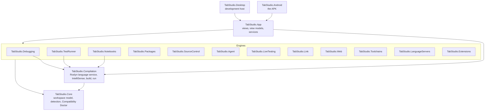
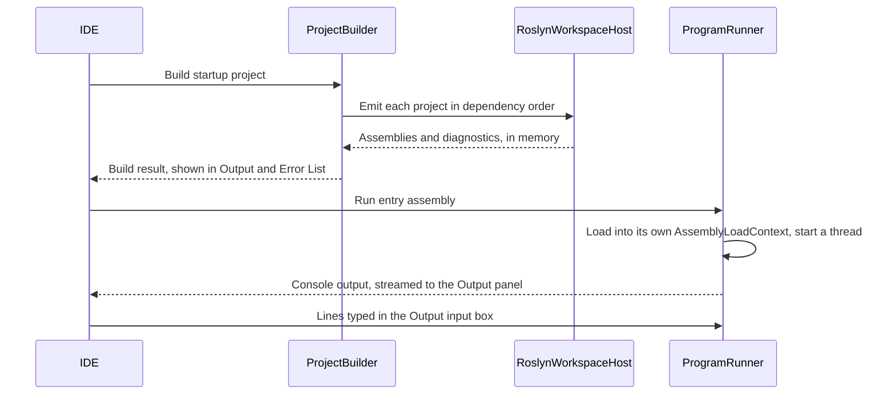

# Architecture

This document explains how TabStudio is put together: the layers of the code, what happens when you open a
solution and press F5, how the debugger, Test Explorer, notebooks and Git work without the tools they normally
need, and the Android rules every design decision starts from.

## Layers



Dependencies point down only. Each layer has one job:

| Project | Responsibility | Depends on |
| --- | --- | --- |
| `TabStudio.Database` | SQLite, PostgreSQL and SQL Server schema readers, SQL execution, exports, paging, optimistic cell updates and configuration discovery. No UI or compiler dependency. | Microsoft.Data.Sqlite, Npgsql, Microsoft.Data.SqlClient |
| `TabStudio.Core` | Reads solutions (`.sln`, `.slnx`) and projects (`.csproj`, `.vbproj`, `.fsproj`, `.vcxproj`) into an immutable workspace model, detects the technology stack of any folder, and decides where each project can run. | Nothing but the .NET base library |
| `TabStudio.Compilation` | The C# language service: a live Roslyn model of the workspace, diagnostics, classification, IntelliSense (completion, Quick Info, signature help, navigation, references, rename, code actions, document symbols), in-memory builds and running programs in-process. | Core, Roslyn |
| `TabStudio.Packages` | NuGet restore on the device: version resolution as NuGet does it, downloads from nuget.org or local feeds, the global packages folder and asset selection. | Core, NuGet.Versioning, NuGet.Frameworks |
| `TabStudio.Debugging` | The debugger: builds programs with statement hooks, and pauses, steps and inspects them. | Compilation |
| `TabStudio.TestRunner` | Test discovery and execution for xUnit, NUnit and MSTest, in-process and without runner packages. | Compilation |
| `TabStudio.Notebooks` | C# notebooks: the `.ipynb` and `.dib` formats, a C# kernel and rich value formatting. | Compilation |
| `TabStudio.SourceControl` | Git without a Git installation: changes found by hashing, `.gitignore`, and commits, pulls, merges, branches and pull requests through GitHub's API. | Core |
| `TabStudio.LiveTesting` | Live Unit Testing: coverage instrumentation, per-test attribution, coverage builds, impact analysis and the live test engine. | Compilation, Debugging, TestRunner |
| `TabStudio.Link` | TabStudio Link: pairing, the TLS transport, QR codes, discovery, and the language protocol a host answers for a tablet. | Compilation, Debugging, LiveTesting |
| `TabStudio.Web` | What a web app serves beyond its code: static web assets, scoped CSS, Blazor's scripts, and a host for .NET apps on WebAssembly. | Compilation, Packages |
| `TabStudio.Wpf` | OpenSilver's in-process XAML compiler, WPF template and browser startup, on the WebAssembly host. | Compilation, Packages, Web |
| `TabStudio.Porting` | Converts saved C# WPF and Windows Forms projects into sibling Avalonia projects, with generated support files and structured port notes. | Core, Roslyn |
| `TabStudio.Remote` | SSH.NET connections, platform signing, SFTP source caches, remote processes, forwarding and publishing. | `TabStudio.Toolchains` |
| `TabStudio.Services` | Compose/devcontainer parsing, native service mappings, persistent data, dependency scheduling, health, per-service logs and connection rewriting. | `TabStudio.Toolchains` |
| `TabStudio.Toolchains` | The Toolchain Store: the catalog, Alpine Linux on PRoot, verified Alpine packages, processes and pseudo terminals, toolchain projects and the terminal emulator. | `TabStudio.Core` |
| `TabStudio.Forms` | Windows Forms on Avalonia: `System.Windows.Forms` and `System.Drawing`, run in the app preview; drawing on bitmaps is rasterized with Skia. | Avalonia, SkiaSharp |
| `TabStudio.Forms.Design` | The Windows Forms designer's model: reads and writes `InitializeComponent`, the Toolbox and properties. | `TabStudio.Forms`, Roslyn |
| `TabStudio.Swarm` | Swarm: the coordinator and members, deployment with cached attachments, the web gateway, the debug agent. | `TabStudio.Link`, `TabStudio.Debugging`, `TabStudio.Compilation` |
| `TabStudio.Live` | TabStudio Live: the text CRDT, per-participant undo, the session protocol, the host and guest sessions, shared files and permissions. | `TabStudio.Link`, `TabStudio.Swarm` (debug records), `TabStudio.Core` |
| `TabStudio.LanguageServers` | Language Server Protocol and Debug Adapter Protocol clients, server and adapter registry, launch configurations. | Nothing but the .NET base library |
| `TabStudio.Extensions` | VS Code extensions from Open VSX: install and verify, and their grammars, language configurations, snippets and themes. | Nothing but the .NET base library |
| `TabStudio.Agent` | Claude as a coding agent: the Messages API with streaming and prompt caching, tools over the workspace, Model Context Protocol servers, and sketch to XAML. | Core |
| `TabStudio.Uno` | Uno and WinUI XAML templates and in-process Skia preview host. | Core, Compilation |
| `TabStudio.App` | The IDE: Avalonia views, view models, editor integration and app services. Platform-neutral. | Core and every engine, Avalonia |
| `TabStudio.Android` | The Android entry point: activity, manifest, icons, platform services such as thermal status. | App |
| `TabStudio.Desktop` | A desktop window around the same app, so contributors can work from any computer. | App |

Core, Compilation and the engines have no UI dependency and are covered by unit tests. The App is tested headlessly with
Avalonia's headless platform, including screenshots of the real views.

## Opening a workspace

1. **Loading.** `WorkspaceLoader` takes a solution file, a project file or a folder. A folder opens its
   top-level solution if it has one, otherwise every project under it, otherwise it opens as a plain folder.
   `ProjectParser` evaluates a project in MSBuild's order: `Directory.Build.props`, the packages' props,
   `Directory.Packages.props`, the project, the SDK's targets, the packages' targets and
   `Directory.Build.targets`, with the global properties Visual Studio uses (`Debug`, `AnyCPU`) and, for a
   multi-targeted project, the inner build of its first framework. `MsBuildExpressions` evaluates conditions
   and property functions as MSBuild does (`$([MSBuild]::...)`, `System.IO.Path`, string and version members),
   so every property gets the value the SDK gives it. Items come from every imported file, and
   `TargetItems` runs the item groups of targets that run before the compiler (a package that turns `.resx`
   files into `AdditionalFiles`, for example), so generators see what they see in a real build. The result is
   an immutable `Workspace` with a tree for the Solution Explorer; the startup project is the one Visual
   Studio users pick (a desktop head before a browser head, the server rather than its hosted Blazor
   WebAssembly client).
2. **Detection.** `StackDetector` reads marker files (`global.json`, `package.json`, `Cargo.toml`, `go.mod`,
   `CMakeLists.txt`, `foundry.toml`, `Move.toml` and more) to list every technology in the repository.
   `CompatibilityDoctor` turns each project's kind into a run host and an explanation.
3. **Packages.** Projects that use NuGet packages (directly or through a project they reference) are restored
   in the background as soon as the workspace opens, and again when a project file is saved. Builds wait for
   the restore, and IntelliSense sees the packages as soon as they are on the device.
4. **Language service.** `RoslynWorkspaceHost` mirrors every C# project into a Roslyn `AdhocWorkspace`,
   with project references, implicit global usings and the .NET 10 reference assemblies bundled in the app.
   From then on the editor sends every edit to the host, and the host answers questions about it: which
   diagnostics a file has, how to color it, and how to compile a project. Roslyn reuses its compilations
   between edits, so these answers stay fast as you type.

## Pressing F5



- **Build.** Once any package restore in progress has finished, `ProjectBuilder` emits the startup project and
  the projects it references, dependencies first, as assemblies with portable PDBs in memory. Nothing is
  written to disk.
- **Safety.** A program runs inside TabStudio's own process, so `InProcessSafetyAnalyzer` rejects calls that
  would close the IDE, such as `Environment.Exit`, before the program starts (diagnostics `TS1001` and
  `TS1002`).
- **Run.** `ProgramRunner` loads the program and its package assemblies into its own `AssemblyLoadContext`,
  redirects the console to the Output panel and starts `Main` on a dedicated thread with a 16 MB stack. Console input comes from the
  Output panel's input box. Stopping a program detaches its console immediately.

## NuGet packages

`PackageRestorer` does what `dotnet restore` does, without the SDK:

- **Resolution** follows NuGet's rules: the lowest version in a range wins, the nearest reference wins along a
  path (with NU1605 for a downgrade), and conflicting paths settle on the lowest version that satisfies both
  (NU1107 when none does). Central package versions from `Directory.Packages.props` are honoured.
- **Sources** are NuGet V3 feeds (nuget.org by default) and local folders. Packages are installed into a
  global packages folder in NuGet's layout, verified and extracted safely, and shared by every project.
- **Assets** come from `ref/` or `lib/` for `net10.0` with NuGet's fallback rules. Packages that the framework
  already provides are pruned, so their assemblies always come from .NET itself.
- **RID-specific assets.** Programs run with what the .NET host would pick for the device's runtime identifier:
  `android-arm64` on a tablet (`RuntimeGraph.DeviceRuntimeIdentifier`), the host's portable RID such as `linux-x64`
  elsewhere. `RuntimeGraph` walks the RID graph breadth-first as NuGet does (`android-arm64`, `linux-bionic-arm64`,
  `linux-arm64`, `linux`, `unix-arm64`, `unix`, `any`), from a shipped subset of the SDK's portable graph merged with
  the packages' `runtime.json` files. A `runtimes/{rid}/lib/{tfm}/` folder (nearest framework first, then nearest
  RID) replaces the package's `lib/` group, so Microsoft.Data.SqlClient and System.Data.SqlClient run with their
  `runtimes/unix/` implementations rather than their "not supported on this platform" stubs; a `_._` there means
  nothing for that RID. Code still compiles against `ref/` or `lib/`, as with the SDK. The nearest
  `runtimes/{rid}/native/` folder gives the native libraries (`RestoreResult.NativeLibraries`); programs get both
  lists as `RestoreResult.RuntimeFiles`.
- **Native libraries.** The program's load context (`ProgramLoadContext`, and the test runner's and notebooks'
  contexts) resolves `[DllImport]` and `NativeLibrary.Load` through `PackageNativeLibraries`, probing the name with
  `lib` and `.so`/`.dylib`/`.dll`. A library TabStudio already has mapped, such as its own `libSkiaSharp.so` or
  `libe_sqlite3.so`, is reused rather than loaded a second time; on Android the APK's own copy (built for Bionic)
  comes next, because packages' `linux-arm64` builds need glibc. Package libraries load from the global packages
  folder in private app storage: Android's W^X rule forbids `exec()` there, not `dlopen`, so nothing is copied.
  Swarm devices get the managed assemblies only, and WebAssembly apps never get native files.
- **No-op restores** are instant: the inputs are hashed, and an unchanged project reuses its last result.
  Offline, versions already on the device are used.
- **Shared frameworks.** A project on the Web SDK, or with a `FrameworkReference` to `Microsoft.AspNetCore.App`,
  gets ASP.NET Core the way a self-contained app does: its targeting pack (`Microsoft.AspNetCore.App.Ref`) to
  compile against and the runtime pack for the device's processor to run with, both from NuGet. The packs'
  assemblies are IL, so the Linux pack serves Android too.

## Source generators

Roslyn runs source generators as part of every compilation in `RoslynWorkspaceHost`, so IntelliSense, live
errors, builds and the debugger all see the code they generate.

- **Where they come from.** Every assembly under a package's `analyzers` folder, as the SDK picks them
  (`AssetSelector.SelectAnalyzers`): C# or language-neutral ones, never `vb`, and when the package has `roslynX.Y`
  folders anywhere in the path, only those of the highest version the compiler supports across the whole package
  (Riok.Mapperly ships `analyzers/roslyn5.0/dotnet/cs`). A package whose generators all need a newer compiler is a
  TS3006 warning. .NET's own generators (behind
  `[GeneratedRegex]`, `[JsonSerializable]`, `[LibraryImport]`) come from `Microsoft.NETCore.App.Ref`, which is
  downloaded the first time code uses one of those attributes; ASP.NET Core's come with its targeting pack.
- **Loading.** `AnalyzerLoader` gives each folder its own `AssemblyLoadContext`, with Roslyn and its
  dependencies shared from the app.
- **One copy of each.** When .NET and a package both bring an analyzer assembly of the same file name, such as
  `Microsoft.Extensions.Logging.Generators.dll` from ASP.NET Core and from Microsoft.Extensions.Logging.Abstractions,
  only the one with the higher assembly version runs, .NET's on a tie, as the SDK's `ResolvePackageFileConflicts`
  leaves it. Running both would generate every member twice (CS0102, CS0111, CS0229).
- **Generators built from the repository.** A `ProjectReference` with `OutputItemType="Analyzer"`, as Mediator,
  Terminal.Gui, Spectre.Console, Dock and StronglyTypedId reference their own generators, gives the project a
  `ProjectGeneratorReference`. The first time Roslyn asks for its generators, the referenced project is compiled
  from the workspace's own compilation of it (its sources as edited, its restored packages, its embedded resources)
  together with the projects it compiles against, emitted into memory, and loaded into a `GeneratorLoadContext` of
  its own: the project assemblies from their images, Roslyn shared with the app as `AnalyzerLoader` shares it, the
  .NET libraries from the app's runtime, and anything else from the generator project's restored packages. An edit
  to the generator project, or to a project it compiles against, gives the projects that use it a new reference, so
  their next compilation runs the edited generator; a build is reused while what it was made from is unchanged.
  `ReferenceOutputAssembly` alone decides whether the project is also compiled against: left at `true`, it is both,
  as StronglyTypedId's attributes project is. A project referenced only as a generator is not part of the program
  and is not in its build order.
- **Packages' props and targets.** The restore records each package's `build` and `buildTransitive` files as
  NuGet imports them (`buildTransitive` in place of `build` for a package referenced through another, the nearest
  target framework's folder, props before the project and targets after it). `ProjectParser.WithPackageBuildFiles`
  evaluates what generators need from them: `CompilerVisibleProperty`, `CompilerVisibleItemMetadata`, `Using` items
  (ReactiveUI's global usings), `AdditionalFiles` and the interceptor namespaces their targets add.
- **Build properties.** A generated global `.editorconfig` hands generators the project's MSBuild properties as
  `build_property.*` (empty when unset, as the SDK writes them) and each additional file's metadata as
  `build_metadata.*`; Avalonia's `.axaml` files are additional files with `SourceItemGroup=AvaloniaXaml`. `SdkGenerators` applies the SDK's other rules: ASP.NET Core's request delegate generator and
  the configuration binding generator stay off unless the project turns them on, and generators may put
  interceptors only in the namespaces the SDK and the project allow.
- **Avalonia XAML.** Avalonia compiles XAML after the C# compiler, a step TabStudio does not have, so its own
  generator, `AvaloniaXamlGenerator`, takes the place of Avalonia's: it puts each `.axaml` file into the assembly
  as text, generates `InitializeComponent` and the fields of `x:Name` elements, and intercepts
  `AvaloniaXamlLoader.Load(this)` so that the XAML is loaded at run time. XAML that is not well-formed is an
  error naming the file; a class that is not `partial` gets no generated part, as with Avalonia's own generator.
- **Failures.** A generator that throws is a warning that names it (CS8785), never a reason for the build to
  stop; the code it would have generated is then missing, and the errors that follow say where. A generator
  project that does not compile, or that references the project using it, is one warning for that project
  (TS2006) that names the generator project and gives its first error.

## Web apps

`WebAppHost` serves an ASP.NET Core app from inside TabStudio. It runs the app like any program, with the
arguments the .NET host passes in development (`--urls` on a free local port, `--contentRoot` and
`--environment Development`), and waits until the port accepts connections. ASP.NET Core and the app's
packages load into the program's own load context, isolated from TabStudio's copies.

To stop the app gracefully, the host it builds is captured the way `WebApplicationFactory` captures it: the
hosting library announces each host on the `Microsoft.Extensions.Hosting` diagnostic listener, and stopping
calls that host's `StopAsync`. The server closes its port, the app's shutdown code runs and `Main` returns.

In the IDE, F5 on a web project serves it and opens the web preview in the side bar: Android's system WebView
inside the layout (a native control host), or the system browser where there is no embedded one. The first
`Project` profile of `Properties/launchSettings.json` gives the first page, the environment and extra
arguments. Saving one of the app's source files while it runs rebuilds it and starts it again on the same
port, and the preview reloads where it was; a change under `wwwroot` only reloads the page.

### Blazor and Razor

- **The Razor compiler** is the .NET SDK's own Razor source generator, vendored in
  `src/TabStudio.Compilation/Razor/Compiler` from SDK 10.0.113 (see its NOTICE.txt; refresh it with
  `build/razor/update-razor-compiler.sh` when Microsoft.CodeAnalysis moves). It gets the `.razor` and `.cshtml` files
  as additional files with the analyzer config the Razor SDK writes, so components, pages and views compile as they
  do with the SDK, and `#line` mappings put errors on the right Razor line, live and in builds.
- **`TabStudio.Web`** serves what the SDK would publish: static web assets with development manifests for
  `MapStaticAssets`, `_content/<library>` files, scoped CSS bundles, JavaScript initializers and Blazor's scripts.
- **Interactive Server components** run in-process like any web app. Android cannot unload an earlier run's
  assemblies, and Blazor finds component types by assembly name, so `ServerComponentTypes` fills Blazor's type caches
  with the current run's types.
- **`WebAssemblyAppHost`** serves any .NET 10 browser app to the web preview: the app's IL, the browser-wasm runtime
  pack from NuGet, and the boot configuration inlined into `dotnet.js`. Blazor WebAssembly uses it, and so will
  OpenSilver and Uno.

## Avalonia apps

`AvaloniaAppHost` shows an Avalonia app inside TabStudio's own window, so it renders natively beside the code:

- **One Avalonia.** The app's assemblies load into their own context, but Avalonia, SkiaSharp and HarfBuzz come
  from TabStudio, so the app's controls are TabStudio's types, drawn by the same renderer on the UI thread. The
  app's own copy of Avalonia from NuGet is only compiled against; other libraries, such as control packages
  TabStudio does not have, load from the app's packages.
- **Starting the app.** The app's `App` class starts as on a phone, with a single-view lifetime, and sets its
  main view in `OnFrameworkInitializationCompleted`, as Avalonia's cross-platform template does. An app written
  for the desktop only sets a window; then the window's content is shown, with a new instance of the view model
  named after it, and the preview says so.
- **XAML at run time.** The XAML the generator embedded is loaded with Avalonia's run-time XAML loader.
  Restarted apps are new assemblies with the same types, and the earlier ones stay loaded because the code the
  loader emitted references them; `RuntimeXamlTypes` takes them out of the loader's list before each start, so
  XAML gets the new build's types.
- **Isolation.** The view sits in a `ThemeVariantScope` with the app's styles and resources, so the app's theme
  never changes the IDE's. Its console output goes to the Output panel, and an exception its code does not
  handle on the UI thread ends the app, not TabStudio.

In the IDE, F5 on an Avalonia project shows it in the app preview in the side bar, filling the pane or in a
phone or tablet frame. Saving one of its files rebuilds it and starts it again.

**The XAML designer.** An `.axaml` file of an Avalonia app opens with its preview beside the code (Design,
split or XAML, side by side or stacked), rendered a moment after typing stops. It does not run the app:
`XamlDesignBuilds` builds the project in the background and loads that build, and `XamlPreviewRenderer` compiles
the XAML being typed against it in Avalonia's design mode. The view's own class is created without loading the
XAML compiled into it, so what appears is exactly the text in the editor; `Design.DataContext`, `d:DesignWidth`
and `d:DesignHeight` apply, or a new instance of the `x:DataType` view model. A window shows its content, and
styles and resource dictionaries show their `Design.PreviewWith`. Errors keep the last good preview, with the
line they are on. The project is built again only when one of its files is saved.

**Sketch to XAML.** The designer's Sketch pad turns a drawing into the view's XAML: the drawing goes to Claude as an
image (`SketchToXaml` in the agent engine, with the user's own API key), and `XamlContentEdit` puts the answer in
as the root element's content, keeping its property elements and every other character of the file, as one edit
that Undo takes back.

## WinUI and Uno apps

`TabStudio.Uno` hosts Uno Platform's native Skia renderer in-process. Uno.Sdk projects restore their implicit
packages; WinUI 3 projects restore against Uno instead of the Windows App SDK (TS7001). Uno's XAML generator
runs in the Roslyn workspace with its additional files and SDK properties. Generator errors and C# errors in
its output map back to the originating XAML element in the Error List.

F5 and Ctrl+F5 show the app beside the editor without the debugger. Saving XAML or C# rebuilds and restarts it.
Uno runs once per session on its own dispatcher and renderer threads; each app build has its own load context.
The generated host is compiled against the restored runtime as `Uno.UI.Runtime.Skia.Headless`, Uno's declared
friend assembly. Frames cross into Avalonia as premultiplied BGRA pixels, and input travels back to Uno.
Android and the desktop IDE share SkiaSharp 3.119 with Avalonia 11, including matching native assets; they do
not load competing Skia ABIs. The emulator self test creates the WinUI template and reads its Uno window title.

Windows-only APIs still need Windows Bridge, and Uno reports unsupported WinUI APIs in the Error List. A
session supports one Uno version and one running Uno preview. Swarm screens, layout inspection and recorded UI
tests are not implemented for Uno: the existing inspectors require an Avalonia visual tree, while this preview
is a bitmap of Uno's tree. Changing Uno versions requires restarting TabStudio. App assemblies remain loaded
on Android, whose runtime cannot unload them.

## Windows Forms apps

`TabStudio.Forms` is the `System.Windows.Forms` and `System.Drawing` API implemented on Avalonia, with the names,
signatures, defaults and event order of Windows Forms on .NET, so code written in Visual Studio compiles unchanged. A
project with `<UseWindowsForms>true</UseWindowsForms>` or a `-windows` target compiles against it instead of the Windows
Desktop SDK, with the SDK's global usings and a generated `ApplicationConfiguration`. F5 runs the app in the app
preview inside a Windows 10 window: `Application.Run` runs its message loop on its own UI thread, `Show` and
`ShowDialog` open more windows, closing the main form ends the run, and an unhandled exception ends only the app. A
member that cannot work on a tablet throws `NotSupportedException` naming the member and what to use instead; the
few that remain are listed, with the reason, in `src/TabStudio.Forms/README.md`.

Drawing is recorded, not executed: every `Graphics` operation adds a command (shapes as path data with a `PenSpec` or
`BrushSpec`, text, images, clears) to a display list, with the transform, clip and edge mode in force. On a control the
list is the window's frame, which the app preview draws with Avalonia; shapes in it are drawn by `SkiaPainter` through
a custom draw operation, so a window and a bitmap paint shapes with the same code. On a bitmap
(`Graphics.FromImage`), the list belongs to the image's `ImageBuffer` and is rasterized into its pixels when anything
reads them (`GetPixel`, `LockBits`, `Save`, drawing the image, `Flush`, disposing the `Graphics`): `BitmapRasterizer`
renders it into a CPU `RenderTargetBitmap` that keeps the earlier pixels. GDI+'s conventions are reproduced there:
pixel centers at whole coordinates (shapes move by half a pixel, 0.49 when aliased so Skia rounds as GDI+ does), pen
caps and anchors drawn as shapes, path gradients as triangle meshes, hatch brushes from Windows' own 8 by 8 patterns.
`tests/TabStudio.Forms.Tests/Drawing` compares 21 scenes with pictures GDI+ drew on a Windows runner
(`build/gdiplus-references`), within a tolerance for antialiasing. A `.resx` that holds more than strings is compiled by
`WindowsFormsResources` into a `.resources` file whose header names `FormsResourceReader`, which `ResourceManager`
uses to turn values back into a `Bitmap`, an `Icon` or an `ImageListStreamer`; the image list's data is taken out of
the .NET Framework's serialized form at build time, so nothing runs the binary formatter. `Clipboard` images go
through `IFormsPresenter`: the IDE hands them to Avalonia's clipboard on the desktop and to `AndroidImageClipboard` (a
content provider serving the PNG) on the tablet.

`TabStudio.Forms.Design` is the designer's model. It reads `InitializeComponent` with Roslyn, never running the app's
code, edits a model of the controls, and writes changes back in the file's own style the way Visual Studio does,
keeping statements it does not understand. The IDE draws the model with the Forms layer on a canvas with handles, a
grid and a Toolbox, and the Properties panel edits it, Events included.

## WPF apps

C# projects with `<UseWPF>true</UseWPF>` compile against OpenSilver 3.3.3 instead of the Windows Desktop pack.
`TabStudio.Compilation/Wpf` supplies typed `x:Name` fields and the first-pass `InitializeComponent` while editing;
`TabStudio.Wpf` runs OpenSilver's own second-pass XAML compiler before emitting the application. F5 prepares and
serves a .NET WebAssembly browser host in the web preview. The window attaches before its first forced layout;
saving rebuilds and reloads the page, and the host forwards console output, uncaught exceptions and window closure.
An unhandled input exception releases stranded mouse capture so later clicks still reach the app.

**Fit, 100% and Fill.** The window keeps its declared `Width` and `Height`, and the web preview's toolbar chooses how
it shows: Fit (the default) scales it down until all of it is in view and never up, 100% shows it at its size with the
page scrolling, and Fill gives it the pane's size, as before. The choice is remembered per project
(`PreviewZoomStore`) and reaches the page in its address (`?tabstudio-view=fit`); where the browser runs script, it
switches in place. `wpf.js` applies it with the browser's own page zoom, the viewport meta tag's width and scale, so
OpenSilver's layout, text measuring and pointer positions never see a scale and the browser maps every touch to the
right control at every zoom; a CSS transform on the window would break OpenSilver's pointer math and text measuring.
Two fingers pinch to zoom and pan (`touch-action: pinch-zoom` on the window), and a finger the browser takes for a
pinch is released in the app without a click. The math is `PreviewLayoutCalculator` in Core, which the page mirrors
and the IDE test compares with it. On Android the WebView honors the viewport tag only while the preview shows a WPF
app (`IZoomableWebView`).
Android installs a `WebChromeClient`, so OpenSilver's `MessageBox` alert/confirm calls show the native browser dialogs.
The .NET 10 preview needs an up-to-date Android System WebView. CI uses Android 15 (API 35) to exercise the
rendered WPF page; the API 29 image's Chrome 74 cannot run this browser runtime.
The device self test starts through `SelfTestInstrumentation`, so its existing desktop mouse checks retain
Android's input injection permission through their adb instrumentation source.

`Wpf/Editing` in Compilation reads the project's actual types and current additional-document text for completion,
Quick Info, definitions, live XAML errors and missing-handler fixes. `DocumentViewModel.Xaml.cs` attaches it through
the editor's language-feature interface, synchronizes unsaved XAML and code-behind, and rejects stale analysis.
The existing workspace edit path applies handler fixes, preserving open documents' unsaved changes and Undo.
These XAML queries use the local Roslyn host; they are unavailable while a TabStudio Link host owns compilation.
The shipped catalog compares WPF 10 with OpenSilver: TS7004 names missing APIs and points to the Windows Bridge,
TS7005 warns about APIs marked not implemented, and TS7006 explains window settings ignored by the web preview.
The preview has no C# debugger, WPF 3D or native modal windows; XAML rename and Find All References are not provided.
Library tests cover the editing engine, headless IDE tests capture completion and the handler light bulb, and
`SelfTest.Wpf.cs` creates the template, presses F5 and reads rendered page text on Android after the Windows Forms
and design checks and before Swarm, retaining every existing self-test step.

The manual combined device self test installs Python, Node.js, Go, Rust, C/C++ and Java serially through the
shared Toolchain Manager. CI runs three independent shards: managed owns Go/Rust, UI owns the app previews and
input checks, and native owns Python/Node/C/C++/Java. Each installs only its own tools. UI restores its Avalonia
workspace for scrolling and desktop input. Native checks the Android
JIT capability boundary and runs all 200 process/GC checks before any package preparation. Package downloads use at most four
streams; every package is verified before the serial apk operation, and each batch measures shared disk usage
once. Each shard awaits its package operations before using the tools, observes cancellation on every exit,
and retains every assertion under its own 15-minute launch-to-verdict limit. A required aggregate passes only
when all three shards pass. CI permits one retry only for named failures outside the merged feature tests and
keeps first-attempt logs and `FLAKY.txt` as artifacts for both pushes and pull requests.

## Port to Avalonia

`TabStudio.Porting` reads a project's saved files into `PortSource`. `AvaloniaPorter` dispatches to the WPF or
Windows Forms converter: XAML/designer mappings and Roslyn code rewriting produce a `PortResult` in memory,
including the Avalonia project and runtime support files. Unsupported or approximate mappings produce `PortNote`
records with the original file, line, what changed and why. Writing the result uses a separate target directory;
the original project is never rewritten.

`WorkspaceViewModel.Porting` connects the Compatibility Doctor, Project menu and Solution Explorer action to the
dialog. It adds the converted project through `SolutionFileEditor`, reloads the workspace, starts package restore
and selects the result for F5. The summary links notes to their source lines and sends them as one agent task of
proposed changes. Undo removes the solution entry and moves the converted folder, including subsequent edits,
to app trash before restoring the previous startup project. See [PORTING.md](features/porting.md) for conversion limits.

## Debugging

A debugger normally attaches to the runtime through a debugging API, which a .NET app on Android cannot do to
itself. TabStudio's debugger works inside the program instead:

- **Instrumented builds.** `DebugBuilder` rewrites the syntax trees before compiling: every statement gets a
  hook on the same line (`if (Step(f, id)) Break(f, id, locals)`), and every method body records its frame
  and reports exceptions from an exception filter, which runs while the stack is still intact. Line numbers in
  stack traces are identical with and without the hooks.
- **Pausing** blocks the program's thread inside the hook until the IDE says continue or step. Breakpoints,
  conditions and hit counts, Step Into, Over and Out, Run to Cursor and Break All are decisions the hook makes
  from the session's state.
- **Inspecting.** The hook passes the statement's locals, which `DebugValue` formats and expands lazily.
  The call stack is an `AsyncLocal` chain of frames, so it follows `await` across threads and projects.
- **Unhandled exceptions** break at the throwing line with the exception and the call stack, before anything
  unwinds.
- **In the IDE**, F5 debugs and Ctrl+F5 runs without the debugger. Breakpoints are anchored to their lines, so
  they follow edits, move to the statement they bind to, and are saved with the session. Locals, Watch and
  Call Stack fill the bottom dock while paused, and DataTips evaluate the expression under the pointer or a
  long press. Package code is not instrumented, so stepping stays in your own code.

## Hot Reload

`TabStudio.Compilation/HotReload` uses Roslyn's public Edit and Continue emission APIs, not a rebuild-and-restart
approximation. `CompiledAssembly.HotReloadCompilation` retains the exact Debug compilation that emitted its PE
and portable PDB (including source generators or debugger instrumentation). It is excluded from JSON, so Link and
Swarm's wire format is unchanged. `HotReloadBaseline` owns `ModuleMetadata`, the PE and PDB readers and the chained
`EmitBaseline`. Its debug-information provider reads the EnC local-slot, lambda/closure and state-machine blobs;
its local-signature provider reads the original method bodies. `EmitDifference` produces metadata, IL and PDB
deltas. A prepared baseline advances only after `MetadataUpdater.ApplyUpdate` accepts its delta.

`ProgramRunner.Loaded`, `DebugSession.Loaded` and `AvaloniaAppHost.EntryAssembly` identify the exact assembly of
this run. A `HotReloadSession` checks its MVID and resolves referenced project assemblies in that same load
context. Every changed project is validated before any deltas are applied. A runtime failure invalidates the
session: cross-assembly ApplyUpdate is not transactional, so the user must restart rather than retry a potentially
partial update. Disposing the run releases its retained compilations, PE/PDB readers and baselines. CoreCLR debug
runs use a non-collectible context when metadata updates are enabled; Mono cannot unload assemblies in any case.

**Commands and refresh.** The toolbar, **Debug > Apply C# Hot Reload** and **Alt+F10** build the current editor
buffers, including unsaved edits, without changing the running/paused IDE state. **Debug > Hot Reload C# on Save**
is opt-in. When it is off, live apps retain their existing restart-on-save behavior. F5/Continue while paused
prepares the same instrumented build and only resumes after the edits succeed. A rude edit or compile error keeps
the app/paused frame alive. The status bar and Output explain the problem; rude edits expose **Restart to apply
edits**. Stop, restart and workspace disposal invalidate outstanding update work.

After ApplyUpdate, the host discovers assemblies' `MetadataUpdateHandlerAttribute`s, calls every `ClearCache`
before any `UpdateApplication` (including ASP.NET Core routing/reflection caches and Blazor's renderer handler),
then refreshes the preview. Avalonia creates fresh main content from the **same** loaded assembly; application
static state survives, while the recreated view and its view model start fresh. A web preview reloads its current
page; the server, its port and its application state remain alive.

**Runtime activation.** Desktop capability is checked with `MetadataUpdater.IsSupported`.
`Directory.Build.props` sets `MetadataUpdaterSupport=true`, and the desktop launch profile and CI set
`DOTNET_MODIFIABLE_ASSEMBLIES=debug` before startup. A manually launched desktop host needs the same environment.

Android explicitly sets `AndroidUseInterpreter=false`. In the .NET 10 Android SDK this is a global packaging
choice: the interpreter APK does not contain the normal JIT. The supported per-assembly `MtouchInterpreter`
configuration belongs to Apple targets, not Android. We do not ship a custom Mono runtime to change that boundary.
See Microsoft's [Android build properties](https://learn.microsoft.com/en-us/dotnet/android/building-apps/build-properties#androiduseinterpreter).
The upstream [mixed-runtime discussion](https://github.com/dotnet/runtime/issues/106491) describes this limitation.
The IDE, Roslyn, IntelliSense and editor therefore retain JIT execution. Local Android C# Hot Reload and Edit and
Continue are deferred in 0.15; ordinary debugging, recording, Continue and restart-on-save remain available.
The command is disabled, no Android update probe runs, and unsupported-runtime messages direct the user to restart.
TabStudio Link provides compilation services and does not add a remote Hot Reload execution protocol.

The previous interpreter startup settings in `build/android/hot-reload.env` are packaged only when
`TabStudioInterpreterBenchmark=true`. The runtime comparison builds both modes from the same source, clears
app data, and measures real F5-to-input and C# completion-popup latency on the same emulator. It records the
first request and warm samples separately, including baseline failures; the production JIT measurement must pass.
This opt-in diagnostic setting is absent from production APK builds. Inference uses the original native backend,
without reverse-callback workarounds for the removed global interpreter.

**Supported scope and rude edits.** Method, constructor, operator and accessor bodies, expression-bodied getters
and top-level statements can be updated. For lambdas, local functions, async methods and iterators, only changes
that preserve syntax topology, lambda/local-function signatures and variable/capture names and types are accepted,
with a new-to-old syntax map preserving their identity. Roslyn's IDE rude-edit service is internal;
`EmitDifference` assumes its caller has validated
the edits. Our conservative analyzer therefore rejects changes to declarations, signatures, fields/initializers,
attributes/imports, file/project sets and embedded resources, and forwards Roslyn's further EnC diagnostics.
Instrumented debugging also requires stable method/statement ids and local slots; successful updates refresh
the source map and rebind breakpoints. Structural changes offer a restart instead of risking a bad delta.

ApplyUpdate does **not** move an active frame's instruction pointer or re-execute Main. Existing invocations
finish their original IL and locals; later invocations use the new code. At a breakpoint before a helper call,
editing that helper changes the output on Continue without a restart. A change to an already executing method
itself appears on its next invocation. Startup/DI registration changes require a restart to execute again.
The desktop host supports local console, Avalonia, ASP.NET Core and server-rendered/interactive-server Blazor. Standalone
Blazor WebAssembly and WebAssembly/Auto client components run in a different browser Mono instance whose boot
configuration currently disables metadata updates; these, remote Link/Swarm/Bridge runs and Release user builds
still require a restart. An unsupported target/runtime reports this explicitly.

**Verification.** Compilation tests exercise metadata/IL/PDB emission, async and lambda edits, rude edits, failed
and abandoned generations and real ApplyUpdate across multiple generations with an existing delegate and static
state. App tests drive unsaved console edits, save updates, Edit and Continue, the shortcut and an Avalonia view
refresh in the same loaded assembly. Desktop tests call ApplyUpdate across multiple generations with static state
preserved. The Android self test verifies that local Hot Reload is unavailable and the interpreter startup
environment is absent, then runs all 200 process/GC assertions before the toolchain checks. Separate managed,
UI and native emulator shards retain the other feature assertions, including nonempty real local-inference text.

Run the feature's tests on CoreCLR with:

```sh
DOTNET_MODIFIABLE_ASSEMBLIES=debug dotnet test tests/TabStudio.Compilation.Tests --filter FullyQualifiedName~HotReload
DOTNET_MODIFIABLE_ASSEMBLIES=debug dotnet test tests/TabStudio.App.Tests --filter FullyQualifiedName~HotReload
```
### C# recording and history

`DebugSession(build, RecordingOptions)` opts into `DebugRecording`; an ordinary session has no recorder or ring.
The default is a 64 MiB binary ring, configurable under **Debug > Recording Buffer** (1–512 MiB in the UI).
`OnStep` requests the existing locals payload at every sequence point while recording. The rewriter also wraps
boxable assignments, initializers and increments in typed value-preserving `Write` / `PostWrite` hooks, so a write
of an unchanged value is still an event, including the last statement of a function. The runtime sink contract is
version 2; slot 8 is the optional write delegate. No delegate means the generic hook returns its original result
without allocating a recording payload.

Each format-v1 record contains a version byte, sequence number, managed thread id, actual-breakpoint-hit flag,
optional written path, and logical frames (invocation id, method/statement ids, shallow named values).
Write-expression sites live separately on each `DebugMethod`; negative statement ids in records select those
locations, preserving loop incrementor locations without introducing extra breakpoint or coverage targets.
Integers use 7-bit encoding where appropriate; strings use BinaryWriter's length-prefixed UTF-8. All source
locations come from the original debug map. Records are independent snapshots: eviction never leaves a delta
without its baseline. The ring wraps byte ranges and evicts complete records. The index is bounded by retained
record count and periodically compacted; transient encoding/decoding and active-frame state are additional memory.
Oversized events are dropped with a visible counter. Weak object identities do not keep the debuggee alive.
Scalar values and full strings are copied; objects have an identity and their primitive/string fields,
including private fields, captured without property getters, collection enumeration or user `ToString`.

The live engine pause stays separate from `HistoricalPause`. Navigation is allowed only while paused or exited;
it never mutates program memory or replays I/O. Step Back follows invocation identities over child calls (also
across await continuations); Back Into and the timeline can inspect every retained event. Reverse Continue uses
breakpoint hits whose conditions matched, plus a derivable unhandled exception's faulty write. Division operands
and null receivers are recorded as conservative symbol paths; ambiguous/unsupported causes are not guessed.
The UI retains the recording after disposing the finished session, and marks inspector trees and stack frames
historical. F5 resumes the actual live pause. A new run clears the previous history.

`RecordingFormatTests`, `RecordingTests`, App command tests, a dark/light `debug-06-recording-timeline` screenshot,
and `SelfTest.RecordSampleAsync` cover the wire format, wrapping/eviction, write semantics, navigation, crash cause,
and history on the Android emulator. See [time-travel debugging](features/time-travel.md) for usage, limits and the
reproducible overhead measurement.

## Tests

`TestSession` discovers xUnit, NUnit and MSTest tests by reflection on the built assemblies, recognising each
framework by its attribute type names, so no runner or adapter package is needed. It runs them in-process with
each framework's lifecycle (constructors and fixtures for xUnit, set-ups and tear-downs for NUnit and MSTest),
every kind of data source, timeouts and cancellation, and reports results with stack traces trimmed to the
user's code. `SourceTestDiscoverer` finds the same tests in source, with matching ids, so the Test Explorer can
list tests before the first build.

In the IDE, the Test Explorer lists tests from source as soon as the workspace opens and again on every save,
runs them through the normal build, and loads one `TestSession` per changed build, since Android cannot unload
assemblies. Results stream into the tree as each test finishes, and saving a file marks the results it may
have changed as stale.

### Live Unit Testing

`TabStudio.LiveTesting` needs no profiler, which Android does not offer:

- **Instrumentation.** A syntax rewriter adds a hit to each statement of the product projects a test project
  references, keeping line numbers identical to the source, with a small hit table per assembly. Test projects
  are never instrumented.
- **Attribution.** `ITestThreadHook` in TestRunner tells the hit tables which test is running, through an
  `AsyncLocal`, so coverage follows async code. Coverage is kept per member, so it survives lines moving.
- **Impact.** `ImpactAnalyzer` compares an edit's members with the last build's: only the tests that ran an edited
  member run again, with new and changed tests; a change outside members, or unknown coverage, runs them all.
- **Running.** `CoverageBuilder` rebuilds only changed projects; `LiveTestEngine` runs one build and test run at a
  time, gives way to builds, debugging and Test Explorer, and waits while the device is hot.
- **In the IDE**, a margin beside the breakpoints draws each line's state from `CoverageIndex`, and markers follow
  the text as you type and dim until their tests run again.

## Notebooks

The C# kernel compiles each cell as a Roslyn script submission chained to the previous cell, emits it to
memory and runs it, so variables, functions and types carry from cell to cell. It does not use Roslyn's
scripting package, which needs assembly file paths that apps on Android do not have. Values are formatted
into text, HTML and tables. Notebooks are read and written as `.ipynb` (Jupyter and VS Code) and `.dib`
(Polyglot Notebooks), preserving unchanged cells byte for byte.

## Source control

Git normally needs the `git` executable, and Android does not allow an app to run one it downloaded. TabStudio
talks to GitHub instead:

- **Linked folders.** Cloning a repository records its owner, branch and the hash of every file of the commit
  in `.tabstudio/sync.json`. Large repositories download as one archive; files the archive lacks or changes
  are fetched one by one.
- **Changes** are found by computing each file's Git blob hash and comparing it with the commit's. A cache of
  sizes and modification times, with Git's guard against "racy" files, keeps this fast.
- **Committing** creates blobs, a tree and a commit with GitHub's Git data API and moves the branch, which is
  committing and pushing in one step. A push that is not a fast-forward is refused, and you pull first.
- **Pulling** applies GitHub's changes file by file. Files changed on both sides are merged with a three-way
  line merge (Myers' diff, as Git uses); conflicts get Git-style markers and can be settled by choosing a side.
- **Branches, pull requests and publishing** a folder as a new repository are GitHub API calls.
- **In the IDE**, the Git Changes window lists changes with checkboxes, commits and pushes them in one step,
  shows inline diffs, and settles conflicts by choosing a side. Signing in takes a personal access token,
  which GitHub checks before it is kept in the app's private storage.

### Pull request review

- **`GitHubClient`'s PullRequests, Reviews and GraphQL partials** list, read and merge pull requests, read file
  versions at any commit, and post review comments, replies and reviews. Resolving threads, marking a draft ready
  and adding to a pending review exist only in GitHub's GraphQL API, so those few calls use it.
- **A pull request is a document** (`ViewModels/PullRequests/`, `Views/PullRequests/`): its page, and a diff per
  file built on `DiffView`. Comments are written into a pending review, so nothing is posted until Finish Review.
- **Conversations inside an editor** take room under their line with a spacer element (`ReviewSpacerGenerator`)
  and are drawn by an overlay (`ReviewAdorner`) outside the text area, so typing in a reply never reaches the code.
- **Review with Claude** (`TabStudio.Agent/PullRequestReviewer.cs`) sends the numbered diff with one tool,
  `report_review`; findings become drafts on diff lines that the user keeps, edits or dismisses.

### GitHub Actions

A tablet cannot receive webhooks, so CI is polled, and polled politely:

- **`GitHubClient`'s Actions, Checks, Workflows and Logs partials** read check runs, commit statuses, runs,
  jobs and steps, and call re-run, re-run failed jobs, cancel and workflow dispatch. Every read sends the
  ETag GitHub gave last time; a `304 Not Modified` reuses the cached answer and does not count against the
  rate limit, whose headers the client records.
- **`CiMonitor`** (in the app) watches the linked commit: every 12 s while something runs, every 90 s when
  nothing does, four times slower when under a tenth of the rate limit is left, and not at all while the
  app is in the background. A commit, push, pull or branch switch refreshes it at once.
- **Job logs** come from a redirect that must be followed without the token. A large log is streamed, and
  only its head and tail are kept, so memory stays bounded; `CiLog` folds logs by step and `##[group]`, colours `##[error]` and
  `##[warning]`, keeps ANSI colours and hides timestamps.
- **CI's errors** come from check-run annotations and from compiler lines in failed steps' logs
  (`CompilerMessage`), mapped onto workspace files and added to the Error List with the check and commit
  that reported them.
- **Run workflow** reads the workflow file through the contents API, and `WorkflowFile` turns its
  `workflow_dispatch` inputs into a form.

## TabStudio Link

A tablet with little memory can hand its language service to a stronger device running TabStudio: a phone, another
tablet or a PC. Programs, tests and the debugger still run on the tablet; the host only compiles.

- **Transport.** TLS 1.3 (1.2 on Android 9) through `SslStream`. Each device has a self-signed ECDSA P-256
  certificate, and each checks the other's, pinned by the SHA-256 of its public key. Messages are length-prefixed
  JSON frames (source-generated) with request ids, cancellation, notifications and binary attachments for
  assemblies and PDBs.
- **Pairing.** The host shows a QR code (`tabstudio-link://`, drawn by the library's own encoder) with its address,
  fingerprint and a one-time 8-character code; typing the address and code works too. Both sides prove they know the
  code with HMACs over the handshake, keyed by PBKDF2-SHA256, so a man in the middle learns nothing he can use in the
  20 seconds a handshake lasts. The code works once, expires after 10 minutes and is replaced after a wrong guess.
  Paired devices are remembered by fingerprint; a UDP broadcast finds a paired host again after its address changed,
  and TLS still checks the fingerprint.
- **The language protocol.** The host keeps a mirror of the tablet's workspace, indexed by file hash, so only changed
  files travel. A path map rewrites paths between the two devices, PDBs included, so diagnostics, IntelliSense,
  builds, debug builds, Live Unit Testing's coverage builds and the agent's snapshot checks all come back in the
  tablet's terms. The tablet sends its coverage slots with each coverage build, so hits from a host-built assembly
  land where the tablet's own builds would put them.
- **Falling back.** `LinkedLanguageService` sends work to `RemoteLanguageService` while a host is connected and to
  the local service otherwise. Unsaved edits are kept on both sides, so losing the host costs nothing but speed, and
  the link comes back by itself.
- **What pairing grants.** The host runs the analyzers and source generators of the tablet's packages, so pairing
  gives the tablet code execution on the host; the host's Link window says so, and asks to pair only tablets you own. Mirror paths
  are validated, so a tablet cannot write outside its own mirror folder.

## SSH remote development

`TabStudio.Remote` depends on Core/Toolchains and SSH.NET. `SshConnection` owns separately authenticated SSH and SFTP
clients with the same pinned SHA256 server fingerprint. Unknown fingerprints require a first-use prompt; changed
fingerprints abort before authentication. `ISshKeyStore` is injected by the platform: `AndroidSshKeyStore` generates
RSA keys inside Android Keystore and supplies non-exportable RSA SHA-2 signing callbacks through `SigningKeySource`;
`FileSshKeyStore` supplies the desktop implementation. No private keys enter host or publish profiles.

`RemoteWorkspace` maps an absolute remote root to a device cache used by the existing workspace loader, explorer,
editor and search. It bounds traversal, excludes links/generated directories, persists downloaded content baselines,
checks conflicts before saves and replaces uploaded files through OpenSSH POSIX rename. `DocumentViewModel` awaits
its external-save callback before marking a remote document clean. Failed uploads keep edits dirty. Cache markers
prevent reopened/disconnected remote folders from falling back to local builds or terminals. Literal content search
uses the source cache and navigates matches through the normal document navigation service.

`SshRuntime` adapts SSH exec channels and ShellStream PTYs to `ToolchainProcess`, reusing OutputProcess and the
Terminal emulator. F5/Build are routed through the remote folder's saved shell commands; diagnostic paths map back
to source cache files. `PortForward` binds only device loopback and forwards to remote loopback, with ownership tied
to the workspace. `RemoteExplorerViewModel` exposes hosts, config import, profiles, search, refresh and forwarding.

Publishing invokes the local SDK (offering Alpine dotnet10-sdk installation on tablets), stages successful publish
output with SFTP into a new release directory, switches `current` atomically, restarts the configured systemd unit
and restores the old link on activation failure. The unit and scoped sudo policy are server-admin prerequisites.
See [REMOTE_SSH.md](features/remote-ssh.md) for protocol/import limits and operational setup. CI's SSH integration job runs
library and App tests against an OpenSSH container; Android self-test exercises the native signing provider.

## Toolchains

`TabStudio.Toolchains` runs languages other than C# from the Toolchain Store. Its catalog (`toolchains.json`)
describes each toolchain: the Alpine packages it needs, its setup steps (an archive such as a debug adapter, or a
command such as `npm install --global`), its project files, how F5 runs a project, and the language server and debug
adapter it brings.

- **The Linux environment.** On Android, the first install unpacks Alpine Linux's minimal root file system into the
  app's storage. `ProotRuntime` runs its programs with PRoot, which Termux also ships: Android lets an app execute
  files only from its native library folder, so PRoot and its loader ship there as `libproot.so` and
  `libproot-loader.so`, and the loader maps each program into memory itself. Nothing from the app's writable
  storage is ever executed by the system, and children and grandchildren of a program work the same way. Programs
  see Alpine as `/`, run as a simulated root user, and see TabStudio's projects folder and each open workspace at
  their own paths, so paths in their output are files the IDE opens. On a computer, `HostRuntime` runs the
  computer's own programs from the PATH.
- **Packages.** `AlpinePackageManager` downloads, resolves and installs Alpine packages itself, so downloads show
  progress and survive a dropped connection. The repository index is verified against Alpine's keys, and each
  package against the index entry that lists it, before anything is unpacked.
- **Processes.** Programs are children of TabStudio's process, started with pipes or a pseudo terminal, and are
  killed with their whole process tree when stopped, as Android 12 and later expect.
- **Projects.** `ToolchainProjectDetector` finds projects from the catalog's manifests and source-file rules.
  F5 and Ctrl+F5 run them with their console in the Output panel; problem matchers turn tracebacks and compiler
  output into Error List entries and links.
- **The terminal.** `TerminalEmulator` turns what programs write to a pseudo terminal into styled character cells,
  as xterm does, for the Terminal panel to draw.
- **Language servers and debug adapters.** `ToolchainServerLauncher` implements `IServerProcessLauncher` over the
  toolchain runtime, so Pyright, typescript-language-server, debugpy and vscode-js-debug start inside the Linux
  environment and paths are translated between the device and the environment. A missing server or adapter offers
  to install the toolchain that brings it. For F5, a project's run plan becomes a DAP launch configuration, and the
  program's input and output stay in the Output panel through its adapter's terminal or runtime streams.

### Repository setup and static web sites

After project detection, `WorkspaceViewModel.ProjectSetup` queues the detected toolchains and their package
installs when **Set projects up when they open** is enabled, the default. `ProjectSetupStore` atomically keeps
the setting and successful manifest/lock-file fingerprints in `State/project-setup.json`. Python uses a project
`.venv`; a fresh npm install uses `npm ci` when a lock file is available, while a changed manifest can update its
install and lock. `NodeWorkspaces.DependencyOwner` shares installation at a declared workspace root without
removing member run targets. F5 awaits setup; saves during installation queue another pass, and status-bar/Output
progress is cancellable. Remote workspaces and unrelated .NET-only workspaces do not start this setup path.

**Python versions and native packages.** Before creating a project's `.venv`, `PythonVersionRequest` reads the
version the project asks for, from the first of `.python-version`, `runtime.txt`, `pyproject.toml`'s
`requires-python` (or Poetry's `python`), `Pipfile`'s `[requires]` and a `Dockerfile`'s `FROM python:X`, as a
`PythonVersionRange`. Within it, `PythonWheels` reads the pinned releases of `requirements.txt` from PyPI's JSON API
and finds the newest Python on which each installs from a wheel for this platform (musl on the tablet), since a
package with platform wheels only up to some version is compiled on newer ones: microblog's pins resolve to 3.11.
`PythonVersionChoice` takes the toolchain's own Python when it fits and otherwise creates the environment with
`uv venv --seed --python 3.X`, installing Alpine's `uv` on first use; uv installs that CPython (its musl builds on the
tablet). An environment left with another version by an install that never succeeded is created again; one that
installed is never replaced. When pip has to compile a package and the build fails, `PipFailure` reads which package
failed and what was missing (a compiler, Python's headers, `pg_config`, a named header), and the setup installs
`build-base`, `python3-dev` and the packages `Python/python-build-packages.json` lists for that package or header
(psycopg2: `libpq-dev`; mysqlclient: `mariadb-dev`; lxml: `libxml2-dev`, `libxslt-dev`; Pillow: `libjpeg-turbo-dev`,
`zlib-dev`; cffi: `libffi-dev`; cryptography: `openssl-dev`), then runs pip once more. pip's own output goes to the
**Project Setup** log of the Output panel; Build and Run shows the commands and one message that names the package,
the cause, what TabStudio did and what helps, and the notice over the editor opens the full log.

**Output colors.** `OutputClassifier` colors each line of a program's or build's output by what it says, per
toolchain, not by the stream it came on: Cargo, pip and Gradle write progress to standard error. Compiler
diagnostics (`error:`, `warning:`, `error[E0308]:` and their excerpt lines), build tools' levels (`[ERROR]`,
`npm ERR!`, `FAILURE:`), log levels, Python tracebacks, Rust and Go panics and JVM and Node.js exceptions are errors or
warnings; everything else is ordinary output. `StreamClassifier` splits arbitrary pieces of a stream into lines, so a
prompt without a line break still appears at once.

`StaticSiteDetector` recognizes an `index.html` folder without a .NET project or a Node package that runs the site.
The app adds a `StaticWebSite` startup project. F5 starts `StaticSiteServer` from `TabStudio.Web` on loopback and
opens the existing web preview. Its injected script receives server-sent events from save notifications: linked
stylesheets are replaced after the new sheet loads, preserving page state; other changes and unmatched stylesheets
reload the page. Stop closes the listener and event streams.

The Node.js catalog setup installs `vscode-langservers-extracted@4.10.0`. Its HTML, CSS and JSON stdio servers are
registered as additional Node tools and launched through `ToolchainServerLauncher`, using the built-in LSP
configuration for completion, formatting and scoped validation settings. Static sites request Node.js for these
servers even though serving the site itself does not need Node.

### Go

Every `go.mod`, including nested modules, is a startup project; vendor and cache folders are ignored. A root
`package main` or a single `cmd/name` command builds with `go build -gcflags=all=-N -l` into `.tabstudio/bin/app`.
With several commands, the active source selects the package. F5 and Ctrl+F5 build the whole package, including
sibling files, and Go compiler locations become Error List links.

Alpine installs Go, gopls and Delve from its verified package index; desktops use PATH. gopls supplies completion,
diagnostics and navigation. Delve serves DAP over loopback TCP on a computer and a Unix socket in a private app-cache directory on Android.
The socket directory is shared into PRoot and removed with the debug session. Launches use `mode: exec`, remote
output and stdin inherited from the runtime process; user input never enters the DAP stream. Real-tool IDE and emulator tests cover the
console template, compiler errors, a breakpoint and Locals.

The APK's PRoot includes a thread-wait patch: Linux permits one thread to collect debugger events for a sibling
thread's ptracees, which Delve needs. `__WNOTHREAD` still limits waits to the calling thread, and ptrace control
requests remain restricted to the original tracing thread. A native CI fixture checks blocking and nonblocking
waits, exit status and those ownership boundaries before the emulator exercises Delve itself.

### Rust

Cargo packages, virtual workspaces and their members are startup projects. Alpine installs Rust, Cargo,
rust-analyzer, Rust sources and LLDB with lldb-dap; desktops use PATH. Cargo builds with
`--message-format=json-render-diagnostics`: structured primary spans populate the Error List, and reported
executable artifacts determine the run path, including custom target directories. With several binaries, choose
a member startup project or open the binary's main source. rust-analyzer supplies IntelliSense and navigation.
A Makefile beside `Cargo.toml` that only wraps Cargo (fd's `cargo build --release` target, say) is not a C/C++
project, and a run is named after the binary Cargo built (`fd`), not the package or a build file.

F5 uses LLDB DAP. Desktop programs use `runInTerminal`; on Android, LLDB launches within its own PRoot trace tree
so emulated ptrace can see the debuggee. A private FIFO created through Android's C library carries Output-panel
input, while DAP events carry program output. Real-tool IDE and emulator tests cover the template, a breakpoint
and Locals, with Watch and Call Stack checked in the IDE.

### C and C++

CMake projects, Makefiles and standalone `.c`/`.cpp` programs are startup projects; headers and build output are
excluded. `MakefileWrapper` reads a Makefile's recipes and variables: one that only runs `cargo`, `npm`, `go`,
`dotnet` and similar tools, and never a C compiler, object rules or C sources, wraps that tool and is not a C/C++
project. In a folder with both, a language's own manifest comes before a Makefile, so it is the default startup
project. Programs are named after their target or binary (`RunPlan.ProgramName`), never `Makefile` or `pom.xml`. Alpine installs Clang, build-base (including make), CMake, clangd and LLDB with lldb-dap; desktops use
PATH. CMake configures a Debug build, exports `compile_commands.json` for clangd and reports executable artifacts
through its codemodel file API. Of several targets, the one a `.tabstudio/launch.json` configuration's `program`
names runs, else the one the active source belongs to, else the only one the top-level `CMakeLists.txt` defines
(cJSON's `cJSON_test`, not its tests and fuzzers). Makefile projects need no special run target: the unique
executable at the root or in `bin`, `build` or `out` runs, else the one a launch configuration names, else the only
one at the root. When no program can be chosen, the run ends with one line that names the executables and how to
choose one, and reports no exit code. Standalone files use their language's compiler with debug information. Compiler locations become
Error List links.

F5 uses LLDB DAP. Desktop programs use `runInTerminal`; on Android, LLDB launches within the same PRoot trace tree
as its debuggee and reads Output-panel input from a private FIFO created through Android's C library. Program
output arrives as DAP events. Real-tool IDE and emulator tests cover the CMake template, a breakpoint and Locals;
the IDE test also checks clangd, Watch and Call Stack.

### Java

Maven (`pom.xml`), both Gradle DSLs and standalone Java sources are startup projects. Alpine installs OpenJDK 21
and JDT LS, adding Maven or Gradle only when the selected project needs that command; desktops use PATH. Maven
copies runtime dependencies, Gradle records `sourceSets.main.runtimeClasspath` through an init script, and
standalone sources compile with `javac -g`. The main class runs directly in Java with Output-panel input.
javac and Maven locations populate the Error List. Choose a member manifest for a multi-module build; several
main classes need explicit selection.

On Android, JVM launchers preload the APK's small musl-compatible mapping shim. It separates an anonymous
allocation from an adjacent thread-stack VMA before retrying an `EACCES` executable-memory request, leaving
SELinux to authorize the actual protection change. It never retries a range containing the current stack pointer.

JDT LS uses a per-project cache outside the imported source tree, shared into PRoot. Initialization loads the
SHA-256-pinned java-debug extension bundle. F5 calls `vscode.java.startDebugSession` through LSP, connects DAP to
its returned port and uses the run plan's main class and classpath. `runInTerminal` supplies console I/O. Real-tool
IDE and emulator tests cover the Maven template, a breakpoint and Locals; additional IDE tests cover both Gradle
DSLs and standalone sources.

## Local listeners and mobile builds

`ListeningPorts` parses Linux TCP/TCP6 LISTEN rows and associates socket inodes with the launched process tree.
PRoot shares the Android network namespace. `ProcessPortWatcher` also parses complete stdout/stderr lines for
local HTTP URLs and explicit listen messages, preserving chunks and deduplicating ports. Android may deny the
socket tables; output is the fallback. `OutputProcess` wires both normal and adapter-launched programs to the
workspace notice. Its actions use the existing `WebPreviewViewModel` or platform URI launcher.

`GradleAndroidProject` recognizes settings.gradle(.kts) roots with the Android application plugin in Gradle
files or a version catalog, excluding comments, dependency folders and JVM-only projects. `MobileTemplates`
provides the exact Kotlin template compiled by the ARM64 Alpine CI job. Capacitor remains a Node startup project;
its Android command builds the web app, adds/syncs Android and follows the same Gradle path. Android diagnostic
locations become Error List entries. The runtime plan prefers a repository wrapper and overrides Maven's x86
AAPT2 on Linux. The Store filters architecture-specific setup steps before downloading and checking fingerprints.

The Android head implements `IAndroidAppInstaller` using a PackageInstaller session, an explicit callback receiver,
REQUEST_INSTALL_PACKAGES and the system's unknown-source/installation confirmations. Success is awaited before
launch. Cancellation abandons an incomplete session. Logcat cannot read another UID on an unprivileged device:
`AndroidLogcatRelay` generates a debug-only ContentProvider via a Gradle init script beneath build/. It runs logcat
as the target app, filters by its PID, and sends lines over authenticated loopback TCP to a separate bounded Output
model. Original sources/manifests and release variants are not instrumented. No READ_LOGS or root is requested.

`IosWorkflowGenerator` in SourceControl produces dispatch-only macOS YAML and secret documentation. Repository
paths and schemes enter shell steps through quoted environment variables. Signing is confined to a temporary
keychain, uses GitHub secrets, cleans up in an always step, publishes the IPA artifact and optionally uploads to
TestFlight. The IDE writes the workflow and opens its setup guide; dispatch, progress, logs and artifacts use the
existing Actions window. First dispatch requires the workflow on GitHub's default branch.
## Embedded: Microchip PIC

`TabStudio.Toolchains/Microchip` adds MPLAB configuration/DFP parsing, memory/diagnostic readers, user-owned XC installation and native PIC helpers. Store entries XC8 4.00 and XC32 6.00 require explicit Microchip licence acceptance before compiler downloads. Official installers/distributions and per-device DFPs are pinned by SHA-256; no Microchip compiler, pack, programmer firmware or device database is redistributed.

The ARM64 APK carries Box64 0.4.4, built from pinned source with regression-tested static-heap and clone-context fixes and 16 KiB segment alignment. PRoot's existing loader maps it, alongside separately extracted Debian ARM64/amd64 glibc runtimes. Android never loads it into Bionic with `dlopen`. XC8 uses dynamic translation; XC32 uses the interpreter mode proven in the ARM64 spike. Alpine keeps its musl loader. The selected MPLAB generated makefile remains the source of build options, libraries and custom steps; missing makefiles or mismatched compiler/pack versions produce an explicit failure. clangd's editor database uses the selected headers and queried XC predefinitions; it never builds firmware.

Android's `IUsbHost` requests USB permission and owns `UsbDeviceConnection`. `ProcessStartSpec.InheritedDescriptors` is an explicit one-device parent-to-child mapping through `posix_spawn` and PRoot. The original descriptor retains close-on-exec; only the worker receives fd 3. A native Alpine libusb context disables discovery and wraps that descriptor with `libusb_wrap_sys_device`. A scoped native preload adapter gives legacy CLIs the same single-device view. Disconnect/cancellation ends the worker before closing the parent connection.

Native Python workers implement AN1388 HID/UART and MCC/UBHA UART framing, bounded HEX validation and verification. Programmer compatibility is explicit: pymcuprog PIC uses supported PKOB nano parts/DFP scripts; unsupported PICkit 4/5/Snap PIC targets use the Bridge. Native pk2cmd requires its separate restrictive licence and a user-owned pinned database; pic32prog handles its upstream PIC32/PICkit 2/3 subset. The independent serial panel supports CDC-ACM, CH340, CP210x and FTDI.

The gpsim DAP adapter runs a native headless simulator, reads XC8 ELF/DWARF separately, synchronizes CLI commands with unique markers, and exposes source/instruction breakpoints, stepping, CPU registers and SFRs. It refuses unsupported MCU models; no similar-device substitution is made. On-chip debugging opens the synchronized project in the PC's installed MPLAB X through the Windows Bridge. Bridge builds use `prjMakefilesGenerator` and vendor make; programming/verification uses `ipecmd` with an explicit tool/optional serial.

The mandatory compiler CI matrix runs real ARM64 and x86-64 Ubuntu hosts inside Alpine/PRoot, emits linked HEX images, compares timing and hashes, and also invokes the production MPLAB driver. Native helper CI builds aarch64-musl tools and tests gpsim DAP with supported-model XC8 firmware. A disposable debuggable emulator APK tests the app-UID PRoot/Box64 path when available. Protocol fixtures identify independent reference-encoder recordings versus physical captures; no physical programmer is attached to CI. See [PIC.md](features/pic.md) for measurements, model/device lists and limits.

## Swarm

`TabStudio.Swarm` runs the app being built on every device that joins the tablet's swarm. Devices join through
TabStudio Link's pairing (a `tabstudio-link://swarm?` invitation, TLS 1.3 with pinned certificates), as members of a
host that accepts several clients. The tablet is the coordinator:

- **Running.** F5 builds once and sends the build to every member; attachments are cached by hash, so later runs send
  only what changed. Avalonia apps run full screen on each device, console apps stream their output back with stdin
  from the tablet, and web apps are served once by the tablet. A failing device never stops the others.
- **Web apps.** Each device's web view opens the app through a gateway on the device's own loopback address. Every
  connection travels inside the swarm's Link connection, so nothing listens on the Wi-Fi. A per-run secret in the
  first URL is swapped for an `HttpOnly`, `SameSite=Strict` cookie, and requests without it are refused.
- **Debugging.** A debug agent on each device reports breakpoints and pauses to the tablet's debugger, which shows the
  device's Locals and Call Stack and can pause every device at once.
- **Screens.** Everything that shows the app is an `IAppScreen` (`TabStudio.App/Swarm/AppScreens.cs`): a device's
  preview, the tablet's App Preview, virtual devices of any size, theme, direction and font scale, and the web
  preview. Screens report a person's input, replay input as real taps and keys, take pictures, list their elements
  (`ElementPaths` names them the same way for capture, replay, mirroring and findings) and check their own layout.
- **Layout checks.** An `ILayoutInspector` looks for clipped text, off-screen and overlapping controls, small touch
  targets and low contrast (SWRM001 to SWRM005, see [layout-checks.md](layout-checks.md)) whenever a screen changes,
  and the findings go to the Error List with a picture of each screen.
- **Recorded UI tests.** A recording becomes an xUnit test in an Avalonia.Headless project with a generated driver,
  which replays per screen in Test Explorer and with `dotnet test`.

## TabStudio Live

`TabStudio.Live` is real-time collaborative editing between devices on the same network, on TabStudio Link's
transport: a `tabstudio-link://live?` invitation, TLS with pinned certificates, and a session code that admits a whole
class. The host is a hub that every guest connects to, and the authority on who may do what.

- **Text.** Each shared document is a `SharedText`, a replicated growable array (RGA) of characters stored in runs.
  Every character has an id (participant, Lamport clock); an insert names the character it follows, a delete marks
  characters as tombstones, and concurrent inserts after the same character are ordered by clock, then participant,
  so every device applies the same operations into the same text in any order. Per-participant sequence numbers form
  a version vector: operations that arrive twice are ignored, those that arrive before what they depend on wait, and
  a guest that reconnects exchanges only what the other side lacks. Positions (carets, selections) are character ids,
  so they move with the text. Undo is per participant: it reverts that participant's own operations with new
  operations, skipping text someone else already deleted.
- **Messages.** JSON notifications and requests over the Link connection (`LiveMethods`): edits, presence, the
  participants list, files and their contents as attachments, saves, the host's run state, output, Terminal, Error
  List, breakpoints and pauses. Each connection has one ordered sender queue; a session's state lives on one
  dispatcher thread, the UI thread in the app.
- **Files.** The host lists the shared folder (`LiveWorkspaceFiles`), without hidden and build folders, links or large
  files. A guest keeps a hash-checked copy (`LiveMirror`) under the app's cache, which the IDE opens as an ordinary
  workspace, so IntelliSense and every language service run on the guest.
- **The IDE.** `LiveDocumentBinder` keeps an editor's `TextDocument` and a `LiveDocument` in step and replaces the
  editor's undo stack; `LivePresenceRenderer` draws the others' carets and selections. On the host,
  `WorkspaceViewModel.LiveHost.cs` publishes the Output, Terminal, Error List, breakpoints and pauses and serves
  guests' debugger requests; on a guest, `WorkspaceViewModel.LiveGuest.cs` shows them and routes F5, the steps and
  breakpoints to the host.

## Language servers and debug adapters

`TabStudio.LanguageServers` speaks the Language Server Protocol (3.17) and the Debug Adapter Protocol, so every
language with a server or an adapter gets the editor and the debugger C# has. One server runs per language and
workspace folder, started when a file of its language opens and restarted if it crashes. In the IDE, files Roslyn does
not own are served by their server through the same completion, Quick Info, signature help, squiggles, navigation,
rename, formatting, code actions, symbols and folding the C# editor uses; a debug adapter session drives the same
breakpoints, Locals, Watch, Call Stack and DataTips. `.tabstudio/settings.json` configures servers per folder and
`.tabstudio/launch.json` holds launch configurations in VS Code's format. Servers and adapters start through
`IServerProcessLauncher`, which the Toolchain Store implements on the tablet.

An orderly connection EOF during `initialize` uses the same bounded restart budget and backoff as a later server
crash. Readiness and queued commands stay pending across those attempts, and the restarted server receives the
latest document text. Initialization rejection, protocol/read errors, timeouts and missing launchers still fail;
closing the workspace cancels recovery. Startup failures retain available exit codes and completed stderr.

On disposable GitHub emulators, the smoke script uses Android's `hide_error_dialogs` setting, as Chromium's
emulator setup does, so another system app's ANR dialog cannot steal the self test's injected input. Manual
device runs keep their normal dialog policy. Every functional assertion, app-liveness check and shard deadline
remains required; the setting does not turn an app crash or missing verdict into a pass.

## Extensions

`TabStudio.Extensions` installs VS Code extensions from Open VSX (or a company's own registry) and from `.vsix` files,
after checking each package against Open VSX's SHA-256 and Ed25519 signature, and refusing paths that leave the
extension's folder. Their declarative contributions work in the editor: TextMate grammars (with injections and
embedded languages) through TextMateSharp, language configurations (comments, brackets, auto-closing and surrounding
pairs, indentation, folding, word pattern), snippets with VS Code's syntax, color themes for the editor and file icon
themes. Contributions that need the extension's own code are installed and shown as such on its details page.

## The agent

`AgentSession` runs Claude in a loop: Claude answers, asks for tools, gets their results and continues until
it is done. Its tools list, read and search the workspace, edit, create and delete files, compile, and run
tests. Tools from Model Context Protocol servers are added over the Streamable HTTP transport.

- **Every change is a proposal.** Edits go into a `ChangeSet` overlay rather than onto disk. The agent reads
  its own proposals back as if they were applied, and the IDE shows each one as a diff to keep or undo.
- **Compiling proposals.** `RoslynWorkspaceHost.CreateSnapshot` forks the live Roslyn solution with the
  proposed files: edited, new and deleted. The agent's diagnostics and test runs use the fork, so the agent
  can check its work before the user has accepted any of it, and the editors are never touched.
- **Costs.** The system prompt, the tool definitions and the conversation so far are marked for prompt
  caching, so each step of a long session re-reads them from the cache.

## In the IDE

`TabStudio.App` puts the engines behind a Visual Studio layout. `WorkspaceViewModel` owns the open workspace
and is split into partial classes by concern (`.Build`, `.Debugging`, `.Tests`, `.Git`, `.IntelliSense`,
`.Agent`, `.Web` and so on), each with the view models of its tool windows.

- **Tool windows.** The side bar holds Solution Explorer with Properties, Git Changes, Test Explorer, the web
  preview and the agent, one at a time, chosen with tabs at its bottom (`SideBarPanel`). The bottom dock holds
  the Error List, Output, the Compatibility Doctor, References, and Locals, Watch and Call Stack while
  debugging (`BottomPanel`).
- **The editor.** `CodeEditorView` is AvaloniaEdit with Roslyn's classifications and squiggles, split into
  partial files: completion, Parameter Info, Quick Info, quick actions, Peek Definition, the context menu,
  breakpoints and DataTips, and test commands. Its popups render in the window's overlay layer, placed
  against the text view. IntelliSense goes through `ILanguageFeatures`, so the editor never touches Roslyn.
- **Shortcuts.** Single keys are Avalonia key bindings on the shell. Two-key chords such as Ctrl+R, Ctrl+R and
  Ctrl+R, A share one `KeyChordMap` that sees keys before the focused control, so editor and shell chords with
  the same first key work together.
- **Touch.** Every action has a target of at least 44 pixels: the floating action bar over the editor (a
  debug bar while debugging), long presses for context menus, Quick Info and DataTips, and tabs that wrap when
  the side bar is narrow. On Android the editor takes the keyboard focus by itself only while a hardware
  keyboard is in use, so opening a file by touch does not cover the screen with the on-screen keyboard.
- **Tests of the UI.** The App's tests drive the real views on Avalonia's headless platform: typing into the
  editor, pressing chords, tapping and long-pressing, and saving screenshots that CI publishes.

## Desktop mode

When an external display connects, the IDE moves to it and the tablet becomes its touch companion.

- **Displays.** `IExternalDisplayService` reports presentation displays. On Android, `AndroidExternalDisplays` uses
  DisplayManager's presentation category and shows the IDE in an `android.app.Presentation` hosting a second
  `AvaloniaView`, with a density context for the chosen size. Two Avalonia roots run side by side in one process.
- **Moving, not rebuilding.** `PageHost` keeps the workspace's views alive, and `DesktopScreenPresenter` moves the
  `Ide` panel between the two windows synchronously, so editors keep their caret, scroll, selection and undo. The
  window the IDE leaves runs one layout pass while the IDE is in no window; otherwise its layout queue still holds the
  moved controls and fails on its next pass.
- **Input.** Android gives keys to the tablet's focused window, and Avalonia's single keyboard focus delivers them
  to the editor on the display. The mouse uses pointer capture (`View.requestPointerCapture`): relative motion moves
  `DesktopCursor`, TabStudio draws its own pointer in the display's overlay layer, and moves, buttons and the wheel
  are sent to the display's view at that position. Touching the tablet releases capture. `DesktopTouchpad` turns a
  touchpad's fingers into moves, scrolls and clicks. Where Android itself routes the pointer to the display, its
  hover moves are passed on and TabStudio's pointer stays hidden.
- **The companion.** `DesktopModeViewModel` drives the tablet's side: Run and debugger buttons, a Toolbox from
  `Toolbox/<Framework>.json` that inserts at the caret, and a Properties panel that reads and edits the XAML element
  at the caret (`XamlMarkup`, `XamlEdits`) as undoable edits. Without a hardware keyboard, `DesktopTypingRelay` turns
  the on-screen keyboard's changes in a typing bar into keys for the editor on the display.
- `InputModality.PrefersKeyboard` is inherited on the display, so keyboard-first behaviour applies there and the
  floating touch buttons stay on the tablet.

## Run hosts

The Compatibility Doctor gives every project a run host, and F5 uses it. A project whose SQL Server cannot be reached
from here is marked "Needs a database" (see [Database Explorer](#database-explorer)).

| Run host | Used for |
| --- | --- |
| In-process | Console apps and tests, compiled to memory and run inside TabStudio |
| WebView | ASP.NET Core apps, served on the device by `WebAppHost` and shown in the web preview; Blazor and WebAssembly front ends |
| Android view | Avalonia and Uno apps, rendered natively in a pane |
| Windows Bridge | Anything that needs Windows, built and run on a PC you pair, and streamed to the tablet |

## Platform rules

Android limits what an app may execute and how. TabStudio is designed around those limits instead of
working around them, so it runs on stock Android with no root and no special permissions.

- **No executing downloaded files.** Since Android 10, an app may not `exec()` files in its own writable
  storage (the W^X rule). TabStudio never does: C# compiles to managed assemblies that the .NET runtime in the
  app loads directly, and the toolchains' programs are mapped into memory by PRoot's loader, which runs from the
  app's native library directory.
- **No Linux VM.** Android's Virtualization Framework is reserved for system and privileged apps, so
  toolchains run in a Linux user space instead: Alpine Linux under PRoot, which needs no root and no special
  permissions (see [Toolchains](#toolchains)).
- **One process, one console.** .NET programs share TabStudio's process. The console is redirected for one
  program at a time, and programs are isolated in their own load contexts. Toolchain programs run as child
  processes in the Linux environment.
- **Thermal limits.** Tablets throttle when hot. TabStudio reads Android's thermal status and compiles on
  fewer threads while the device is warm, so the UI stays responsive.

## Memory and CPU budget

TabStudio has to be useful on a 3 GB tablet, not only on a flagship. Most of its memory goes to the .NET
runtime and UI (a fixed cost) and to Roslyn's model of the solution (which grows with the code), so the
design keeps the second part proportional to what you are actually editing:

- **Device profiles.** At startup TabStudio reads total memory, core count and Android's low-RAM flag and
  picks a profile. The profile decides how much stays warm: live analysis for open files only or for the
  whole solution, how many threads background work may use, and the size of render caches.
- **Memory-mapped metadata.** The .NET reference assemblies are stored as files and memory-mapped, so their
  pages are clean, shared and evictable instead of living on the managed heap.
- **Skeleton references.** Only projects with open documents keep a full Roslyn compilation. The projects
  they depend on are referenced through compact metadata-only images, cached on disk by content and made
  again when their code changes. Go to Definition still finds the source behind an image, and builds always
  compile every project in full.
- **Memory pressure.** When Android reports memory pressure (`onTrimMemory`), TabStudio drops caches it can
  rebuild: semantic models of closed files, syntax highlighting state and old output.
- **Session restore.** The open documents, unsaved edits and layout are saved as you work, so if Android
  closes TabStudio in the background, it reopens where you left it.
- **TabStudio Link.** The language service and build engine sit behind one interface, so they can also run on
  another device you own, with the tablet showing only the IDE.
- **Background work stays in the background.** Analysis runs at below-normal priority and yields to typing,
  and builds use fewer threads while the device is warm.

## Key decisions

| Decision | Why |
| --- | --- |
| C# and Avalonia for the whole app, not Kotlin | The IDE, its compiler and the programs it runs share one runtime, so Roslyn runs in-process and a program can be loaded the moment it compiles. Avalonia renders the same UI on Android and on the desktop, which is how the app is tested in CI. |
| Roslyn in-process instead of a language server | No process to start or talk to, and the same compilations serve highlighting, diagnostics and builds. |
| Its own project system instead of MSBuild | MSBuild needs the .NET SDK, which does not run on Android. TabStudio evaluates the parts of project files that editing and building need. |
| In-memory builds | The edit-run loop never waits for the disk, and builds reuse the editor's warm compilations. |
| A debugger built into the program | .NET's debugging interfaces are not available to an app debugging code in its own process on Android. Statement hooks give breakpoints, stepping and inspection with nothing but the compiler. |
| Git through GitHub's API | Android forbids running downloaded executables, and a reimplementation of Git's network protocol would duplicate what GitHub already offers over HTTPS. |

## Code conventions

See [CONTRIBUTING.md](../CONTRIBUTING.md) for code style, tests and how CI reports results.

## Database Explorer

`TabStudio.Database` owns provider-neutral connection and schema records. `SchemaReader` uses SQLite's catalog and table/index/foreign-key pragmas, PostgreSQL's information schema and `pg_catalog`, and SQL Server's information schema and `sys` catalog. A fresh connection targets each selected database, so schemas and IntelliSense stay scoped to that database. The Explorer loads other databases when expanded; Refresh rereads the catalog. SqlClient is pinned to 7.0.3: its Unix assembly contains only managed SNI, whereas the 7.1 unified assembly initializes Windows native SNI on Mono. Android also enables managed networking at startup and in runtime configuration using the historically named `Switch.Microsoft.Data.SqlClient.UseManagedNetworkingOnWindows` switch. The device self-test opens a refused loopback port with both network providers so this dependency regression cannot silently return.

**SQL Server apps.** SQL Server has no ARM64 Linux engine, so neither the tablet nor Services can run one.
`SqlServerDetector` (Core) finds projects that use it (EF Core's SQL Server provider, Microsoft.Data.SqlClient or
System.Data.SqlClient in the project or a project it references, and SQL Server connection strings in
`appsettings*.json`) and probes each `host:port` over TCP for two seconds, off the UI thread; LocalDB and named pipes
never answer on a tablet. When nothing answers, the Compatibility Doctor row becomes "Needs a database" and F5's
Output says the same once, and a run that crashes with a `SqlException` or SqlClient's `PlatformNotSupportedException`
gets that explanation after its stack trace. The row offers **Connect to SQL Server…** (the Explorer's connection form,
filled in from appsettings with Windows sign-in replaced by a SQL login; saved encrypted as
`<Project>: <ConnectionName>`, which F5 then supplies as `ConnectionStrings__<ConnectionName>`), and, when the
project also references Npgsql's or SQLite's EF Core provider, **Use PostgreSQL** (a `compose.yaml` with a PostgreSQL
service and the app's connection string, which Services runs on F5; never written over existing Compose files) or
**Use SQLite** (a saved connection to a file beside the project). appsettings files are never changed.

`SqlExecutor` opens and disposes an ADO.NET connection/command/reader per execution on a worker thread, including SQLite's synchronous implementation of its async API. Cancellation registers `DbCommand.Cancel`; SQLite uses `sqlite3_interrupt` because its command cancellation method does nothing. Readers consume every result set, storing at most 5,000 rows per set and 32 displayed sets. Each tab owns its cancellation lifetime. JSON exports preserve duplicate column names and SQL NULL as separate columns and row arrays; CSV uses invariant formatting and quotes/escapes every field.

`TableEditor` issues ordered, dialect-specific pages with one extra row to determine whether Next exists. Primary keys order editable tables; views and keyless tables are read-only. Cell updates quote identifiers, parameterize values, and check the primary key plus the original comparable row values in a transaction. Zero or multiple affected rows roll back. SQL Server's text/ntext/image/xml columns cannot be compared and are excluded from the concurrency predicate. Paging is not a snapshot across concurrent inserts/deletes.

The app owns the Explorer and its EF Core pane; SQL and table pages use the normal document host and dispose with their tabs. Query text can be saved to the app's SQL query folder; passwords are never part of a query document or session state. `ConnectionStore` writes only ID/name/provider metadata. Its `IDatabaseSecretStore` holds the entire connection string. Android replaces the session-only desktop store with AES-GCM encryption using a non-exportable AndroidKeyStore key, authenticated per connection ID; ciphertext lives in `NoBackupFilesDir`. There is no plaintext fallback. Connection discovery is local and opt-in, skips build/dependency folders and directory symlinks, resolves SQLite paths beside configuration, and only reads user-secret IDs present in solution projects.

EF Core's panel selects both a migrations project and a startup project. The workspace saves edits, waits for its normal package restore and invokes `ILanguageService.BuildAsync`. It restores matching `Microsoft.EntityFrameworkCore.Design` tools to the app cache if needed, loads build images and runtime packages into `LoadedProgram`, and enters contextual reflection. `EfCoreOperations` calls the same `OperationExecutor` operations as dotnet-ef without starting a process or running Main. `IDesignTimeDbContextFactory<T>` is supported; configuration arguments include the startup project's content root. Context and migration lists are materialized before unloading. Scaffolding writes EF's migration, designer and snapshot files and reloads the workspace. EF's synchronous design API has no cancellation token: builds/restores can cancel before invocation, and a started migration operation runs to completion.

Library tests cover SQLite schema details, quoting, multi-result queries, cancellation, paging, stale updates, export formats, secret separation and discovery. The libraries CI job supplies PostgreSQL 17 and requires its integration test. App tests drive selection execution in the real shell, render screenshots, and exercise an actual in-memory EF build/scaffold/rebuild/update round trip. The Android self-test saves, decrypts and removes a Keystore connection and checks SQLite schema and two result sets.

## On-device AI

`IAgentClient` separates `AgentSession` and its proposal overlay from the inference transport. Claude still uses `AnthropicClient`; Local mode uses `LocalAgentClient` over `ILocalTextGenerator`. Local mode never creates Anthropic/MCP clients. Its allowlist is `list_files`, `read_file`, `edit_file` and `create_file`; there is no shell, network, deletion, build or test execution. It can generate tests as proposed files. Tool JSON is validated against the actual allowlist, and all edits use the existing `WorkspaceTools` / `ChangeSet` approval path. Images are rejected explicitly. Plain answers stream; tool JSON is buffered until valid. The small model context fits bounded whole recent messages and tool results, with six tool rounds per turn.

`native/local-ai` pins llama.cpp b6000 (`4762ad7…`) behind a small C ABI: load, generate, cancel and free. The runtime's version-specific structures stay in C++. `NativeTextGenerator` uses UTF-8 P/Invoke and serializes calls, joins incomplete UTF-8 token pieces, propagates cancellation through the decoder's abort callback and bounds context to 4096 tokens. Android packages `libtabstudio-ai.so` inside the APK for arm64 and the x64 emulator, statically linking llama/ggml/C++ and using 16 KB load alignment. There is no writable executable, PRoot process, listening socket or inference HTTP client. ARM64 includes NEON; CPU inference is the portable baseline. `TABSTUDIO_AI_VULKAN=1` builds the optional Vulkan backend when the build host has a Vulkan SDK.

`LocalAIService` owns one model/context for the app and shares it between chat and completion. It lazily verifies the stored model before loading, unloads before deletion, cancels on memory pressure and releases model memory on demand. Model files live under `LocalAI/models` in private app storage. `ModelManager` uses a separate download-only HTTP client; the curated catalog pins repository revisions, sizes, SHA-256 hashes and full licenses. A download is opt-in after license acceptance; it streams to `.partial`, verifies size/hash, atomically renames, and removes partial data after cancellation/failure. Inference never downloads, updates, or falls back to the cloud. RAM is an estimate, while speed is measured and stored per model on the current device.

`FimPromptBuilder` uses Qwen's FIM vocabulary and a UTF-8 byte budget for the current prefix/suffix plus three unsaved open neighbors. `InlineCompletionController` waits 450 ms after editing, cancels pending work and rejects stale responses even if the generator ignores cancellation. Every `CodeEditorView` can render the proposal through a zero-document-length `GhostTextGenerator`; Tab inserts it as a single undo group. Typing, movement, selection, loss of focus and Escape clear it. No language service is required. Background completions do not queue behind an occupied chat engine. Android's existing thermal state and sticky battery broadcasts pause completions when hot or at 15% charge or lower without external power.

`local-ai.yml` compares native/server inference on x64 and ARM64 Linux and the Android emulator, then runs the managed real-model tests. Fake-server tests cover the completion protocol; other tests cover FIM, model integrity, licenses, proposal confinement and ghost-text input. The main emulator APK bundles the verified 260K diagnostic model only with `TabStudioIncludeLocalAITestModel=true`; its in-app self-test loads the model through P/Invoke and must generate tokens. Regular APKs carry no model. See [the spike](features/local-ai.md) for measured results and limitations.

## Native backing services

`TabStudio.Services` translates known Compose images to Alpine packages and foreground PRoot processes. It has no UI
or Docker dependency. `ComposeReader` reads YAML, anchors/merges, environment interpolation, `.env`/`env_file`, short
and long ports/volumes/dependencies, commands, health checks and devcontainer JSONC with ordered Compose overrides.
`ServiceCatalog` checks package availability/version in the signed index. `ServicePackages` in the App layer uses the
existing `AlpinePackageManager` and serializes changes with Toolchain Store operations.

`ServiceManager` owns the processes of one workspace. It topologically orders dependencies, rejects cycles and missing
required services before launch, waits for readiness, rolls back only new processes on failure/cancellation, monitors
health, and stops dependents first. Daemons get private per-service bind mounts through `ProcessStartSpec.Mounts`;
`UserId` selects a simulated non-root PRoot identity (PostgreSQL 70). Other toolchain runs retain their original root
identity and mounts. Each workspace's stable path hash selects `Services/<hash>` in app storage; named volumes are
shared within that workspace. Bind sources seed private copies, with read-only seeds refreshed on start.

The processes share the device network, so daemon listen options use published localhost ports. Explicit conflicts
fail before startup; implicit collisions/privileged ports use a free unprivileged port. Final endpoints rewrite host
fields, URIs and Redis endpoints without replacing credentials. F5 starts dependencies of the Compose application
whose build context contains the startup project (or the devcontainer service), then supplies environment overrides
to external processes and in-process .NET runs. Without such an application or a devcontainer's `runServices`, F5
starts only the services `ServiceTargets` finds the run pointing at, by name or by a published localhost port, in its
environment, `.env` files, `appsettings` and the active Spring profiles' settings; nothing is downloaded or started
when a repository opens. Each requested service starts on its own: one that fails is marked failed with its own error
and rolls back only the processes it started, and a service that depends on it says which. A setting one service
cannot use (a `tmpfs` volume, an invalid port) makes only that service unsupported. A missing bind source inside the
workspace is created as an empty folder, unless the long syntax sets `create_host_path: false`. `RunEnvironment` sets/restores variables under the existing
`ProcessConsole` lease, including debug runs and ASP.NET Core hosts. It never edits appsettings files.

`ServicesViewModel` feeds the Services tool window and its per-service logs, controls and preview links. The optional
`IServiceDatabaseExplorer` adapter exposes “Open in Database Explorer” only for an available provider. When
`agent/database` is combined, MSBuild includes its typed PostgreSQL bridge automatically; it reuses transient
connection IDs while refreshing ports and does not persist service credentials. Hosts can also inject an adapter.
Unknown images stay visible with reasons and a remote-host action. Closing a workspace disposes its services;
stopping an app leaves its backing services available for the next
F5. Reload stops services and reparses configuration, preserving their data.

CI runs real PostgreSQL and Redis in the same Alpine/PRoot runtime on x64 and ARM64, plus an App test that builds an
ASP.NET Core template using Npgsql and queries PostgreSQL through its HTTP endpoint. The emulator self-test installs
PostgreSQL via the signed package manager, initializes it, runs a SQL script and SELECT, and stops it. See
[Services](features/services.md) for package/Compose coverage and local reproduction.

## Flutter and Dart

`FlutterToolchainInstaller` wraps `LinuxToolchainInstaller` and owns `Toolchains/flutter/rootfs`. Its Ubuntu Base 24.04.3 ARM64/amd64 archives and matching official Dart ZIPs have pinned SHA-256 digests. Flutter source is pinned to release 3.38.0 and checked against its immutable Git commit before bootstrap. Ubuntu installs its prerequisites through signed apt repositories; package versions follow Ubuntu security updates. SDK bootstrap and cache preparation remain network operations.

`FlutterRuntime` routes `flutter`, `dart`, and absolute `/opt/flutter/` commands through a second `ProotRuntime` using the same packaged PRoot and loader. Workspace paths are shared unchanged, keeping LSP/DAP source paths valid. All other tools and the default Terminal remain in Alpine. The generic PRoot options now include shell and search path while retaining Alpine defaults.

`FlutterProject` distinguishes Flutter SDK dependencies from plain Dart packages. The ordinary dependency notice offers pub get. The analysis server runs as `dart language-server --protocol=lsp`; Flutter DAP runs as `flutter debug-adapter`, Dart DAP as `dart debug_adapter`. Flutter's forwarded web-launch event opens only a loopback HTTP(S) URL in the existing preview. Saves serialize/coalesce adapter hot-restart requests for web, or hot-reload requests for native VM targets. Explicit launch configurations can choose a native device once the mobile toolchain is available. Swarm web targets tunnel the same loopback server to phones.

See [Flutter verification](features/flutter.md) for the experiment's measured results, pending SDK/PRoot/device checks and the dedicated emulator test entry point. Web preview is a no-debug DAP launch: a generic WebView does not implement Dart's browser-debug extension.
