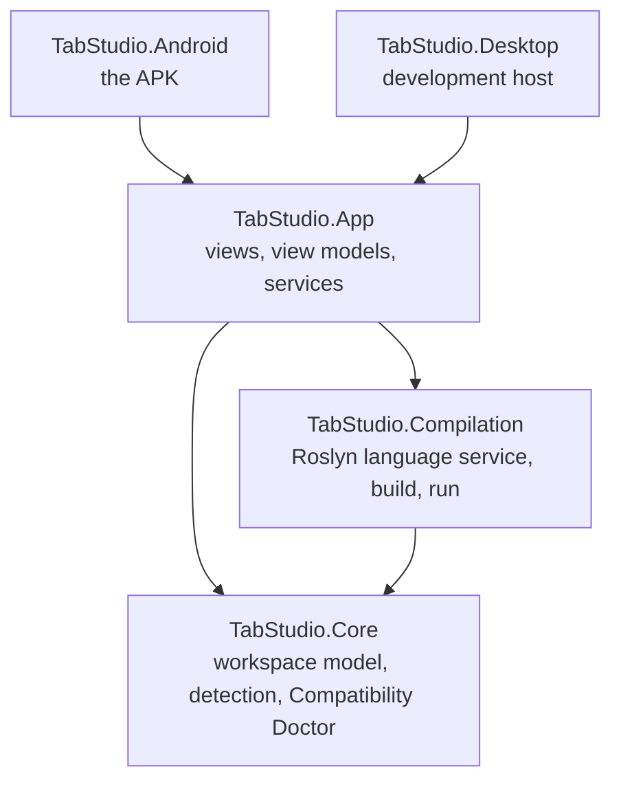
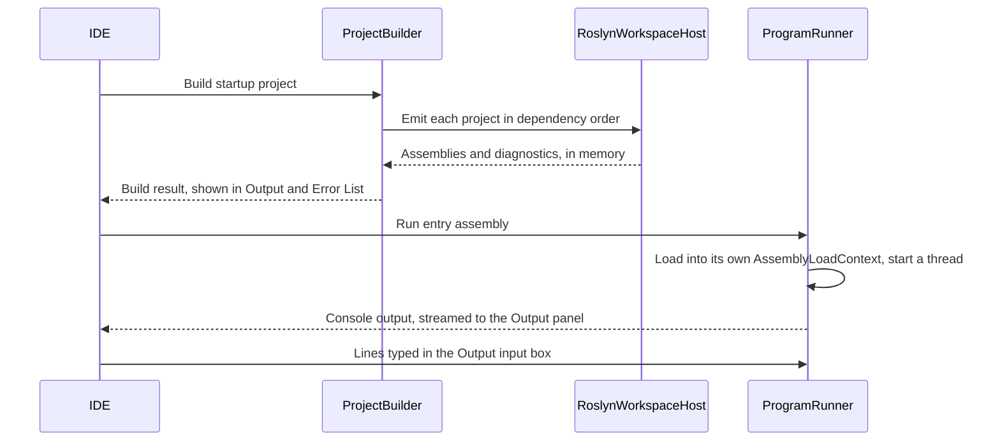

# Architecture

This document explains how TabStudio is put together: the layers of the code, what happens when you open a
solution and press F5, and the Android rules every design decision starts from.

## Layers

Dependencies point down only. Each layer has one job:

| Project | Responsibility | Depends on |
| --- | --- | --- |
| `TabStudio.Core` | Reads solutions (`.sln`, `.slnx`) and projects (`.csproj`, `.vbproj`, `.fsproj`, `.vcxproj`) into an immutable workspace model, detects the technology stack of any folder, and decides where each project can run. | Nothing but the .NET base library |
| `TabStudio.Compilation` | The C# language service: a live Roslyn model of the workspace, diagnostics, classification, in-memory builds and running programs in-process. | Core, Roslyn |
| `TabStudio.App` | The IDE: Avalonia views, view models, editor integration and app services. Platform-neutral. | Core, Compilation, Avalonia |
| `TabStudio.Android` | The Android entry point: activity, manifest, icons, platform services such as thermal status. | App |
| `TabStudio.Desktop` | A desktop window around the same app, so contributors can work from any computer. | App |

Core and Compilation have no UI dependency and are covered by unit tests. The App is tested headlessly with
Avalonia's headless platform, including screenshots of the real views.

## Opening a workspace

1. **Loading.** `WorkspaceLoader` takes a solution file, a project file or a folder. A folder opens its
   top-level solution if it has one, otherwise every project under it, otherwise it opens as a plain folder.
   `ProjectParser` evaluates the parts of MSBuild that matter for editing and building: properties (including
   conditions and `$(Property)` expansion), `Directory.Build.props`, SDKs, target frameworks, package and
   project references, and `Compile` items with globs. The result is an immutable `Workspace` with a tree for
   the Solution Explorer.
2. **Detection.** `StackDetector` reads marker files (`global.json`, `package.json`, `Cargo.toml`, `go.mod`,
   `CMakeLists.txt`, `foundry.toml`, `Move.toml` and more) to list every technology in the repository.
   `CompatibilityDoctor` turns each project's kind into a run host and an explanation.
3. **Language service.** `RoslynWorkspaceHost` mirrors every C# project into a Roslyn `AdhocWorkspace`,
   with project references, implicit global usings and the .NET 10 reference assemblies bundled in the app.
   From then on the editor sends every edit to the host, and the host answers questions about it: which
   diagnostics a file has, how to color it, and how to compile a project. Roslyn reuses its compilations
   between edits, so these answers stay fast as you type.

## Pressing F5

- **Build.** `ProjectBuilder` emits the startup project and the projects it references, dependencies first,
  as assemblies with portable PDBs in memory. Nothing is written to disk.
- **Safety.** A program runs inside TabStudio's own process, so `InProcessSafetyAnalyzer` rejects calls that
  would close the IDE, such as `Environment.Exit`, before the program starts (diagnostics `TS1001` and
  `TS1002`).
- **Run.** `ProgramRunner` loads the program into its own `AssemblyLoadContext`, redirects the console to the
  Output panel and starts `Main` on a dedicated thread with a 16 MB stack. Console input comes from the
  Output panel's input box. Stopping a program detaches its console immediately.

## Run hosts

The Compatibility Doctor gives every project a run host, and F5 uses it:

| Run host | Used for |
| --- | --- |
| In-process | Console apps and tests, compiled to memory and run inside TabStudio |
| WebView | ASP.NET Core, Blazor and WebAssembly front ends, served on the device and shown beside the editor |
| Android view | Avalonia and Uno apps, rendered natively in a pane |
| Windows Bridge | Anything that needs Windows, built and run on a PC you pair, and streamed to the tablet |

## Platform rules

Android limits what an app may execute and how. TabStudio is designed around those limits instead of
working around them, so it runs on stock Android with no root and no special permissions.

- **No executing downloaded files.** Since Android 10, an app may not `exec()` files in its own writable
  storage (the W^X rule). TabStudio never does: C# compiles to managed assemblies that the .NET runtime in the
  app loads directly, and native toolchains run only from locations Android permits, such as the app's
  native library directory or loaded in-process as shared libraries.
- **No Linux VM.** Android's Virtualization Framework is reserved for system and privileged apps, so
  TabStudio does not rely on a virtual machine or on a Linux user space such as proot.
- **One process, one console.** Programs share TabStudio's process. The console is redirected for one
  program at a time, and programs are isolated in their own load contexts.
- **Thermal limits.** Tablets throttle when hot. TabStudio reads Android's thermal status and compiles on
  fewer threads while the device is warm, so the UI stays responsive.

## Key decisions

| Decision | Why |
| --- | --- |
| C# and Avalonia for the whole app, not Kotlin | The IDE, its compiler and the programs it runs share one runtime, so Roslyn runs in-process and a program can be loaded the moment it compiles. Avalonia renders the same UI on Android and on the desktop, which is how the app is tested in CI. |
| Roslyn in-process instead of a language server | No process to start or talk to, and the same compilations serve highlighting, diagnostics and builds. |
| Its own project system instead of MSBuild | MSBuild needs the .NET SDK, which does not run on Android. TabStudio evaluates the parts of project files that editing and building need. |
| In-memory builds | The edit-run loop never waits for the disk, and builds reuse the editor's warm compilations. |

## Code conventions

See [CONTRIBUTING.md](../CONTRIBUTING.md) for code style, tests and how CI reports results.
