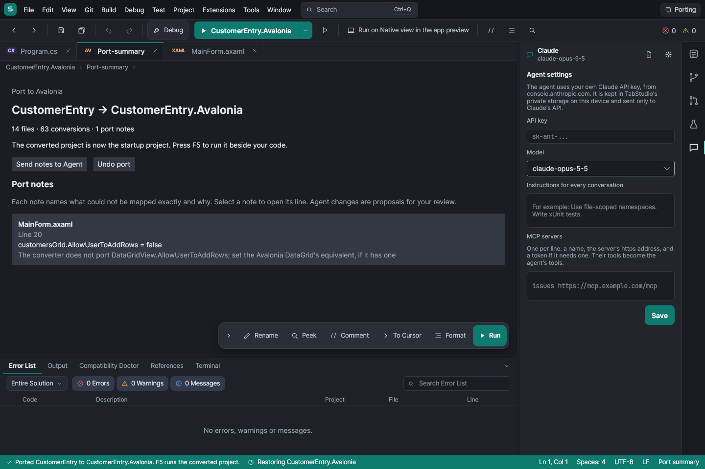
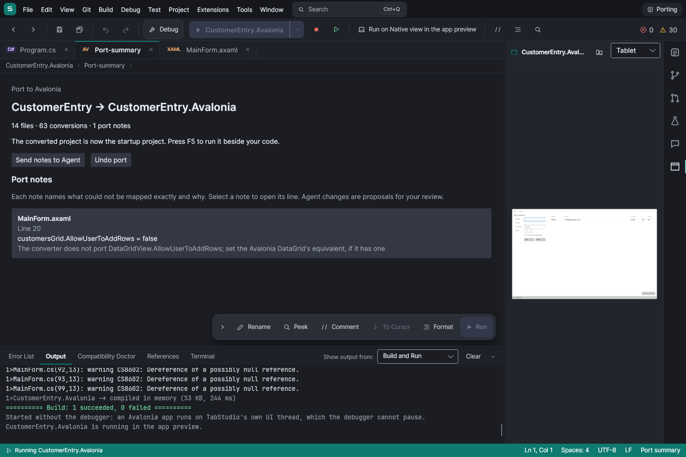
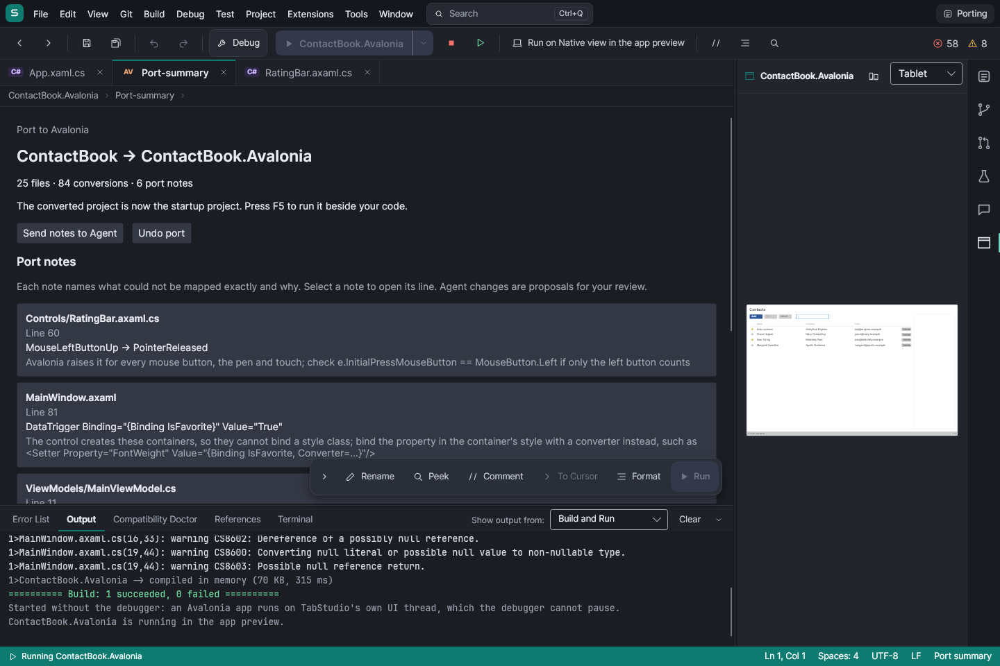

# Port to Avalonia

Choose **Port to Avalonia…** in the Compatibility Doctor, a C# WPF or Windows Forms project's Solution Explorer
context menu, or the Project menu. The dialog proposes `<original>.Avalonia`. Conversion reads the saved project,
writes a sibling project atomically, adds it to the solution, and makes it the startup project. The original project
and source files are never rewritten. With a project opened without a solution, the containing folder becomes the
workspace so both projects are visible. F5 starts the result in the native Avalonia app preview.

The summary is a document tab. Every port note has a file, a one-based line, what needs attention, and why. Selecting
a note opens that generated file at its line. Unknown XAML, designer statements, components and APIs retain TODO(port)
comments with their explanation. Unsupported code is preserved as comments rather than silently replaced by invented
behavior. WPF collection views, triggers without a direct mapping, Windows-only components, and approximate designer
properties need review even when the resulting project builds.

When notes exist, they are handed to TabStudio's agent as one task restricted to the converted project. Its normal
pending-change review applies: proposals are not automatically kept. With no configured agent key, or while the agent
is busy, the task waits in the input box. The summary also offers **Send notes to Agent** to retry deliberately.

**Undo port** removes the solution entry and moves the generated folder into TabStudio's trash, preserving subsequent
edits. Stop the app and agent first. It restores the previous startup project and leaves unrelated solution changes
alone. The conversion summary and undo ownership last for the current workspace session.

## Verification

- `dotnet test tests/TabStudio.Porting.Tests`: per-rule tests and complete golden projects, notes and summaries for
  VS WPF, VS WinForms, WpfContacts and WinFormsCustomers. Each sample is also written outside the repository and built
  with the real SDK and Avalonia XAML compiler. Build logs are saved to `ci-out/porting-build`.
- `dotnet test tests/TabStudio.App.Tests --filter FullyQualifiedName~PortingTests`: all four samples through the IDE,
  source preservation, note navigation, agent handoff, F5, a customer-entry click, safe undo, and dialog cancellation.
  The headless renderer saves summary and running-app screenshots to the usual screenshot output.
- The Android self test now converts a Windows Forms app, presses F5, clicks a converted event handler, verifies its
  label and unchanged original bytes, and captures `port-to-avalonia.png`. This runs in the existing emulator CI job.

Golden updates are deliberate: when a golden test fails, inspect the files in `ci-out/porting-actual/<sample>` before
copying them into `tests/TabStudio.Porting.Tests/Samples/<sample>/Expected` and rerunning the complete suite.

## Preview runtime

The IDE bundles Avalonia's DataGrid so its deferred theme bindings resolve in the host as well as during XAML loading.
Local style and resource includes expand from the current in-process build, with namespace prefixes reconciled at the
root and cycles reported. External package themes retain their own compiled resources.

## Screenshots

