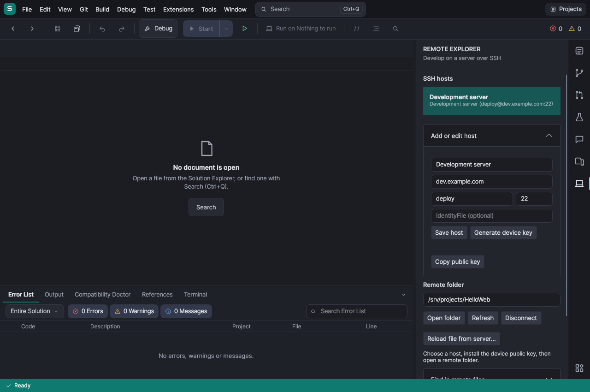

# Remote development over SSH

Open a local workspace, then choose **File > Open Remote Folder (SSH)**, or the Remote Explorer activity icon.



1. Enter an alias, host/IP, SSH user and port; choose **Save host**. Alternatively expand **Import ~/.ssh/config**
   and paste a config, or leave its text blank to read the current device's `~/.ssh/config`.
2. Choose **Generate device key**. Install the displayed public key in the account's `~/.ssh/authorized_keys` on
   the server. Never copy a private key to the server. On Android the private RSA key is generated inside Android
   Keystore; SSH.NET receives RSA SHA-2 signatures from it, not key material. Desktop development uses a private
   key file in the app's state directory (directory mode 0700, file mode 0600 on Unix).
3. Enter an absolute remote folder, such as `/home/deploy/HelloWeb`, and choose **Open folder**. On first use,
   compare the displayed SHA256 server fingerprint with `ssh-keygen -lf /etc/ssh/ssh_host_ed25519_key.pub` on the
   server. Trust only the fingerprint you verified. A changed saved fingerprint is rejected before authentication;
   verify legitimate rotations with the administrator before replacing the corresponding app-state pin.

The source tree appears in Solution Explorer. Open, edit and save files normally. SFTP saves check the server's
content against the downloaded baseline, then upload a sibling temporary file and atomically replace the file
using OpenSSH's POSIX rename extension. A failed upload or conflicting server change leaves the document dirty
and retains its local recovery text. Reconnect to the same host and folder before retrying a failed save. Compare
conflicts in the SSH terminal before refreshing; Refresh deliberately refuses unsaved editor changes.
To resolve a conflict, preserve the edits you want, then choose **Reload file from server** in Remote Explorer.
After confirmation it keeps a recovery copy under `.tabstudio/recovery`, reloads the current server version and
resets that file's baseline, so you can reapply your changes and save.

**Terminal** (Ctrl+`) opens a remote `xterm-256color` PTY in the source folder, including input, Ctrl+C and resize.
Creating, renaming or deleting remote files is currently done in that terminal; choose **Refresh** afterwards.
The explorer's corresponding local-only operations are blocked for remote folders. A disconnected remote folder
never falls back to running its commands or shell locally. Its source cache remains readable offline.

Ctrl+Q finds cached file names and the normal language features find available symbols. **Find in remote files**
in Remote Explorer performs a literal, case-insensitive text search over cached source and opens matches at their
line/column. Refresh to pick up other developers' server changes. Search returns up to 200 matches.

## Run, build and preview

Expand **Run and build on host**, enter build/run shell commands, and **Save run configuration**. F5 and Ctrl+F5
run the build command and, if it succeeds, the run command. **Build** runs only the build command. These are SSH
commands, not a remote breakpoint debugger. Commands run from the opened remote folder using the host's tools:

| Project | Build command | Run command | Web port |
| --- | --- | --- | --- |
| ASP.NET Core | `dotnet build` | `dotnet run --no-build --no-launch-profile --urls http://127.0.0.1:5000` | 5000 |
| Node.js | `npm ci` | `npm start` | 3000 (or the app's configured port) |
| Python | leave blank | `python3 -u main.py` | leave blank for a console app |

Output streams into the Output panel. Standard C# `file(line,column)` and `file:line:column` diagnostics link to
cached source and appear in the Error List. Shift+F5 cancels the SSH command; signal handling depends on the
server, so commands that deliberately daemonize should be managed separately on the server. Interactive programs
belong in Terminal.

Enter a remote HTTP port and choose **Open in preview**. SSH forwards a device loopback port to the remote
host's loopback port. The existing web preview's **Open in browser** button opens that tunnel in the device's
browser. Tunnels close on replacement, disconnect and workspace disposal. A run profile can open one before
starting the server; a slow-starting server may need the preview's Reload button.

Run profiles are saved in the source cache's `.tabstudio/remote-run.json`. They contain commands and a port, never
private keys. Reopening a cached remote folder after app restart requires reconnecting before it can save or run.

## Publish an ASP.NET Core project to a Linux server

On the server install the matching ASP.NET Core runtime and configure a systemd unit once. Give the SSH account
write access to the application directory and narrowly scoped, non-interactive sudo permission to restart this
unit. Do not grant unrestricted sudo. For example, a unit for `/srv/hello` may contain:

```ini
[Unit]
Description=Hello web application
After=network.target

[Service]
WorkingDirectory=/srv/hello/current
ExecStart=/usr/bin/dotnet /srv/hello/current/HelloWeb.dll
User=hello
Restart=on-failure
Environment=ASPNETCORE_URLS=http://127.0.0.1:5000

[Install]
WantedBy=multi-user.target
```

In a **local** ASP.NET Core or Blazor Web App project, choose **File > Publish to server**. Select a saved SSH host,
application directory, existing service name and server runtime identifier (`linux-x64`, `linux-arm64`, or the
matching `linux-musl-*` identifier for Alpine). Review the destination and confirm Publish. The profile is saved
per project in `.tabstudio/server-publish.json`; it contains no credentials.

TabStudio runs `dotnet publish -c Release --self-contained false -p:UseAppHost=false -r <server-rid>` locally. On a
tablet, if necessary it offers to prepare the Linux environment and install Alpine's `dotnet10-sdk` package;
on a computer, the SDK must be on PATH. The full SDK needs several hundred MB and is separate from the IDE's
normal in-process compiler. Package availability and supported architectures follow Alpine's repository.

SFTP uploads only the successful publish output into `<destination>/releases/<unique-id>`. After all uploads
finish it atomically switches `<destination>/current`, runs `sudo -n systemctl restart -- <service>` and checks
`systemctl is-active`. A failed restart restores the previous link and attempts to restart that release. Previous
release directories are retained for manual rollback/cleanup. The publisher does not create units, change sudo
policy or install packages on the server. Upload failures leave an unused release directory without switching
the running app. Avoid cancelling during activation; if the connection fails while systemd restarts, inspect
`current` and the unit's status on the host before retrying.

## Scope and verification

- SSH.NET 2026.0.0 supplies SSH, SFTP and forwarding. Password login, SSH agents, encrypted imported keys,
  ProxyJump/ProxyCommand and Include/Match evaluation are not supported. Hosts with explicit proxy routing are
  skipped on config import rather than accidentally connecting directly. Imports support concrete aliases,
  wildcard defaults, exclusions, HostName, User, Port, IdentityFile and common identity-path substitutions.
- Source caching excludes symlinks and standard generated/hidden directories. Open a source subtree if it exceeds
  10,000 files, 8 MiB per file, 128 MiB total or 64 directory levels. Cache baselines survive reconnects; cached
  files modified after a failed upload are preserved. The initial open downloads the source; Refresh updates it.
- Remote notebooks open as source so a notebook kernel cannot accidentally run on the tablet. Remote language
  servers, remote debugging and remote Git are not part of this integration.
- `TabStudio.Remote.Tests` covers config, pins, key signing and profiles, plus real OpenSSH authentication, SFTP
  saves/conflicts, commands, terminal input/resize and loopback HTTP forwarding. The SSH integration CI job runs
  both suites against the isolated OpenSSH container in `build/ci/ssh`; its password login is disabled and its SSH port binds
  only to runner loopback. Test private keys stay in runner temporary storage, outside published logs.
- App tests exercise opening/editing/saving remote files, build output/error navigation, remote terminals,
  offline protection and the Remote Explorer screenshot. The Android emulator self-test exercises the platform's
  actual key generation/signing provider and config import.
