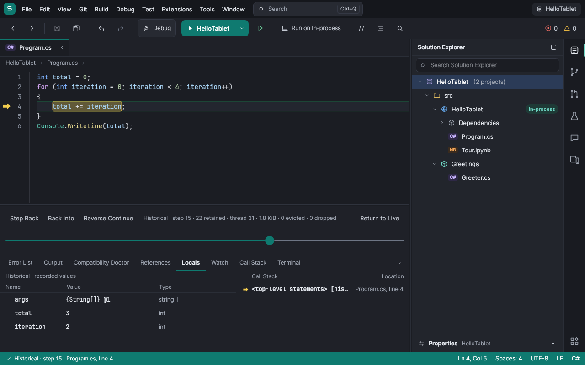
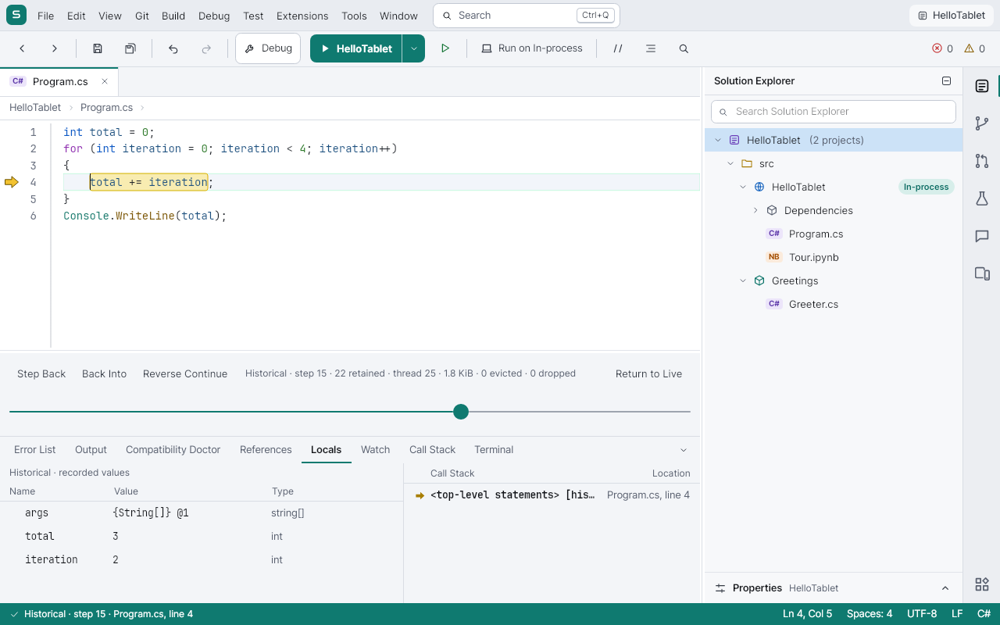

# C# time-travel debugging

Choose **Debug > Start with Recording** for a local, instrumented C# console project. Ordinary F5 keeps recording
off. Set **Debug > Recording Buffer…** to 1–512 MiB (default 64 MiB); the next recording uses the new size.
The setting is saved, but recording is never turned on automatically when reopening a workspace.

Pause at a breakpoint, use Break All, or let the program finish. The bottom dock's timeline remains available
after normal exit, Stop and a crash. Drag its slider to any retained event, or use:

| Action | Behavior |
| --- | --- |
| Step Back / Shift+F10 | Previous event in the current invocation or its caller, stepping over called functions |
| Step Back Into | Immediately preceding recorded event, including a called function |
| Reverse Continue | Previous breakpoint whose condition matched, or a derivable exception's faulty write |
| When did this change? | Last recorded write to the chosen variable/field in its invocation; available on Locals, Watch and DataTip context menus |
| Return to Live | Show the actual paused point again without continuing; after exit, clear the historical inspector view |
| F5 while paused | Resume execution from the actual live pause |

Locals, Watch, Call Stack and DataTips are explicitly marked **Historical**. Choosing a historical caller shows
that caller's last captured locals. These are immutable snapshots; historical inspection never runs getters,
`ToString`, methods, timers or network calls, and never changes the live program. Rewinding does not undo I/O.
The timeline reports retained steps, managed thread id, encoded bytes, evicted steps and oversized dropped steps.
Starting a new debugging run replaces the previous recording; recordings are held in memory, not persisted to disk.

The running IDE's timeline after selecting an earlier loop value:





Sequence points contain the current thread, logical method stack, locals, parameters and shallow object state.
Assignment/initializer/increment hooks add writes at their original source location, including unchanged values.
Primitives and full strings are copied by value. Objects are weakly identified and copied as an id plus their
primitive/string fields (public or private); nested object graphs, property getters and collection items are not
traversed. Auto-property backing fields are shown under their property names without calling getters.
Subsequent sequence points refresh those shallow fields. Ref structs/pointers cannot be boxed and are
omitted, as in the ordinary debugger. Object initializer fields are captured on first touch. Writes through
reflection, native code, indexers, arbitrary receiver expressions and uninstrumented package methods are visible
in later shallow snapshots where readable, but do not have precise last-write hooks. History records an observed
order of instrumented events across threads, not an atomic snapshot of external code or unsynchronized shared memory.

On an unhandled divide-by-zero or null-reference exception with one simple identifiable operand, the debugger
selects its last recorded faulty write automatically, if that write's value matches the faulting operand and
is still retained. Reverse Continue can find the same write after exit. Other exceptions and ambiguous operands
keep the regular exception view; there is no causal guess from an unrelated recent write.

The UI enables recording for the existing local C# console instrumentation path. Debug adapters, Windows Bridge,
Swarm and live UI/web previews retain their existing debugger behavior; the recording engine can also be used by
an explicitly configured hosted `DebugSession`, but those host UIs do not expose recording yet.

## Cost and reproducible measurement

Recording is synchronous at each sequence point and write. It adds boxing, shallow field capture, binary encoding
and a short global recorder lock. It can substantially slow tight loops and change thread scheduling. The ring
capacity bounds encoded retained history; active shallow frame state, weak identities, the record index and
temporary codec allocations are additional memory. No ring is allocated with ordinary F5.

`Recording_overhead_is_measured_against_the_same_instrumented_debug_build` runs a 10,000-iteration integer loop,
discards one warmup, and prints the median of three ordinary debug runs and three recorded runs, their ratio and
retained bytes. It excludes build time and uses an 8 MiB ring. Run:

Measured on Linux x86-64 / .NET 10.0.0 in the development host on 2026-10-26: **1.96 ms ordinary debugging,
196.26 ms recording (99.95×)**, retaining **3,449,828 bytes**. This deliberately dense loop reaches tens of thousands
of hooks in a few milliseconds without recording. The figure is workload- and host-dependent, and is not a claim
about Android performance.

```sh
dotnet test tests/TabStudio.Debugging.Tests -c Release \
  --filter FullyQualifiedName~Recording_overhead --logger 'console;verbosity=detailed'
```

The benchmark measures host CoreCLR. Android Mono/device measurements must be reported separately; the emulator
self-test verifies behavior rather than claiming a device overhead number. CI runs the benchmark as a test; use
the detailed logger command above to see its timing output. The App job renders the timeline in dark and light themes; the Android
emulator self-test records a loop and verifies an earlier value after exit.

## Editing during a recording

A recording keeps the source map from the build that started it. Applying C# edits, including line-only edits, requires restarting and starting a new recording; Hot Reload and Continue report this before updating any assembly. The live program stays paused and its existing history remains available. Reverting the edits allows Continue without restarting. Ordinary Continue with no edits works normally.
