# TabStudio design

How TabStudio looks and behaves: a Visual Studio you can hold. This folder is the spec every view follows. It covers
the principles, the foundations (type, spacing, radii, elevation, color), icons, how panels, dialogs and overlays are
built, touch targets per form factor, portrait, and the shared components that put these rules in code.

| File | What it holds |
|---|---|
| [README.md](README.md) | This spec |
| [tokens.md](tokens.md) | Every color token in both themes, and their contrast |
| [audit.md](audit.md) | What the IDE looked like at 0.8.0, problem by problem, with the screenshots that show each |
| [audit-0.16.md](audit-0.16.md) | The panels 0.15 and 0.16 added, checked against this spec in every screen size and theme, before and after |
| [stage-2.md](stage-2.md) | The next step: the shell rebuilt from the new components, as a precise list of edits, with mockups |
| [images/](images) | Screenshots of the components and the mockups, both themes, rendered by the tests |

Every image here was rendered by a test from the real controls, in `tests/TabStudio.App.Tests/Design/`. CI renders
them again on every run, in `screenshots/` of the IDE job; the light screenshots of every other screen are in
`screenshots/light/`.

## Principles

1. **Visual Studio first.** Someone who knows Visual Studio is at home: the same menus, the same tool window names
   (Solution Explorer, Error List, Test Explorer, Properties), the same key gestures (F5, Ctrl+Shift+B, Ctrl+Q, F12), the
   same document tabs and the same status bar. When a tablet needs something new, it gets a Visual Studio name.
2. **Touch is as good as the keyboard.** Everything has a touch path: no command needs a key gesture, a right click or
   a hover. Targets are 44 px. A long press does what a right click or a hover does: it opens the context menu, or names
   an icon-only button.
3. **The code comes first.** The editor gets the space. Chrome never covers the line being edited: the touch bar, toasts
   and popups keep out of the caret's way, and a panel the user is not using folds into its header.
4. **Calm by default.** State shows when it matters: a healthy device does not say "Thermal OK", a warm language server
   does not say "Roslyn warm". There is one primary (teal) action per surface. Color means something: teal is the
   action or the selection, red an error, amber a warning, green success.
5. **One way to find anything.** Ctrl+Q, or the Search button, finds files, commands (with their key gestures),
   settings, symbols, templates and recent solutions, ranked together. It is how anything with no room on screen is
   still one tap away.
6. **Adapt, do not clip or scroll.** Bars fold their least used items to icons and then into a More menu, by priority.
   Text is never cut mid word in a toolbar, and toolbars never scroll sideways.
7. **Same design in both themes.** Every color is a token defined for Dark and Light, so a view written once looks
   right in both. Light is Visual Studio's Light (white documents in cool gray chrome), not dark inverted.

## Foundations

### Type

The UI font is Inter, the code font JetBrains Mono (`CodeFont`). Sizes are in device-independent pixels, at the
default text size.

**Every font size is a token, never a number.** A view writes `FontSize="{DynamicResource Type.Body}"`, a setter
`Value="{DynamicResource Type.Body}"`, and code that creates text calls `TypeScale.SetBaseFontSize(text, 12.5)`. The
tokens are in `Theme/Type.axaml`; `Accessibility/TypeScale.cs` sets them all for the text size in use, so the whole IDE
and its editors follow **Tools > Text Size** at once (see [Text size](#text-size)). `TextSizeTests` fails on a font size
or a line height written as a number in a view.

| Role | Token | Size | Weight | Where | Style |
|---|---|---|---|---|---|
| Display | `Type.Display` | 26 | SemiBold | The Start screen's title, an extension's initials | |
| Hero | `Type.Hero` | 20 | SemiBold | A pull request's title, an extension's name | |
| Title | `Type.Title` | 18 | SemiBold | Page titles, pairing codes | `TextBlock.h1` |
| Heading | `Type.Heading` | 16 | SemiBold | A panel's own title (Terminal, TabStudio Link, Desktop mode) | |
| Subtitle | `Type.Subtitle` | 15 | SemiBold | Dialog titles, empty and error state titles, the search box | |
| Code | `Type.Code` | 14 | Regular | The editor (`CodeFont`) | |
| Large | `Type.Large` | 14 | Regular | Empty and error state titles, larger labels | |
| Lead | `Type.Lead` | 13.5 | Regular | Notebook text and cells | |
| Section | `Type.Section` | 13 | SemiBold | Section headers inside a panel, in sentence case; the menu bar; the terminal | `TextBlock.h2` |
| Body | `Type.Body` | 12.5 | Regular | Default text, list rows, buttons, text boxes | |
| Body strong | `Type.Body` | 12.5 | SemiBold | Panel header titles, names in rows | `TextBlock.header` |
| Small | `Type.Small` | 12 | Regular | Labels, secondary lines, the status bar, details | `TextBlock.label`, `.small` |
| Fine | `Type.Fine` | 11.5 | Regular | Code details, logs in panels | |
| Caption | `Type.Caption` | 11 | SemiBold | Pills, key caps, kind labels, counts | `Border.pill` |
| Micro | `Type.Micro` | 10.5 | Bold | Count badges | |
| Badge | `Type.Badge` | 9.5 | Bold | File type badges (C#, NB) only | `Border.badge` |

Wrapped text that sets a line height uses `Type.Line.Body` (18) or `Type.Line.Relaxed` (20), which grow with the text.
Fluent's own sizes (`ControlContentThemeFontSize`, `ToolTipContentThemeFontSize`) are scaled with the tokens, so text
no view sizes follows too.

**Text grows; containers make room.** A control that holds text never has a fixed `Height` that fits only the default
size: it has a `MinHeight`, so at Very large it grows instead of clipping. A label beside a field in a fixed-width
column trims with an ellipsis and a tooltip, or wraps.

**Text in a fixed height is always centered vertically; never rely on stretch.** A pill, badge, chip, key cap, tab,
header, status bar item or row with a fixed height sets `VerticalAlignment="Center"` on its text (or on the panel that
holds the text, so the panel sizes to it). A stretched text block draws its line at its top: in the headless
screenshots this is a pixel or two, but Android's font metrics put the glyphs visibly high (the Start screen's template
tags on a real tablet, 0.8). The same goes for a name beside a taller pill or tag in a row: center the name. Multi-line
text next to an icon is the exception: it aligns to the top, with the icon on its first line. Three checks find single
lines of text that are taller than their text (`StretchedText` in the tests):

- every screenshot test fails on one (`UiTestHelpers.SaveScreenshot`), and lists it in `stretched-text.txt` beside the
  screenshots, in both themes;
- `CenteredTextTests` looks at the Start screen and every tool window, screenshot or not;
- the self test looks at the Forms designer and the Start screen on the Android emulator, with Android's own fonts, in
  both themes (`SelfTest.Design.cs`), and saves the pictures with the emulator job's logs (`design-0*.png`).

Section headers are sentence case ("This commit", not "THIS COMMIT"). Text that can be long (paths, test names,
messages) trims with an ellipsis and shows in full in a tooltip; paths trim in the middle when the file name matters.

### Spacing

A 4 px grid (`Space.1` = 4, `Space.2` = 8, `Space.3` = 12, `Space.4` = 16, `Space.6` = 24 in `Theme/Shell.axaml`).
Panels pad their content 12; dialogs 20 to 24; rows 8 to 10 horizontally. Items in a toolbar are 2 apart, groups are
split by a 1 px separator (`Border.toolbarSeparator`, `AdaptiveBarSeparator`).

### Corner radii

| Token | Radius | Where |
|---|---|---|
| `Radius.Small` | 4 | Key caps, badges, small chips |
| `Radius.Control` | 7 | Text boxes, combo boxes, list rows |
| `Radius.Button` | 8 | Buttons, tool buttons, popups' rows |
| `Radius.Card` | 10 | Cards, popups, notices, the touch bar's buttons |
| `Radius.Dialog` | 12 | Dialogs, the search, drawers, the touch bar |
| (full) | height / 2 | Pills and count badges |

### Elevation

There are three levels; panels never have shadows.

| Level | What | Surface | Shadow |
|---|---|---|---|
| 0 | Panels, the editor, bars | `Brush.Window`, `Brush.Panel`, `Brush.Toolbar` with 1 px `Brush.Border` lines between them | none |
| 1 | Flyouts, menus, completion, tooltips, the touch bar, toasts | `Brush.Popup` with a `Brush.BorderPopup` line | `Shadow.Popup` |
| 2 | Dialogs, the search, the portrait drawer | `Brush.Popup` over `Brush.Scrim` | `Shadow.Dialog` |

`Shadow.Popup` and `Shadow.Dialog` are `BoxShadows` tokens: softer and bluer in the light theme, where black shadows
look dirty.

### Color

Every color is a token: [tokens.md](tokens.md) lists them all with their dark and light values. The rules:

- **Use a token, never a color.** Views use `{DynamicResource Brush.…}` so they follow the theme; code uses
  `ThemeBrushes.Get("Brush.…")`, a brush that recolors itself when the theme changes, or `ThemedPen` for pens.
  `Brushes.Transparent` is the only built-in brush a view may use. A color that is content (a QR code, the sketch pad's
  paper, an avatar) is a fixed token, the same in both themes. What another platform draws is content too: a running
  Windows Forms app keeps Windows' system colors and its light Windows 11 frames in both themes, in the app preview and
  in the designer, while the desk around it follows the theme (`Brush.FormsDesktop`, `Brush.Window`).
- **Surfaces** go from the window's edge inwards: `MenuBar`, `Toolbar`, `Panel`, `Window` (documents), `Popup`.
  `Hover`, `Pressed` and `Selection` are the states of anything tappable.
- **Text** has five levels: `TextBright` (titles, the selected item), `Text` (body), `TextSecondary`, `TextLabel`
  (labels), `TextMuted` (hints and details). All pass WCAG AA (4.5:1) on every surface in both themes. `TextDisabled` is
  for disabled controls only.
- **Accent** (teal `#0F7A70`, the same in both themes, white text on it) is for the one primary action of a surface,
  the selection indicator and the status bar. `AccentText` is teal text that reads on any surface; `AccentSoft` is a
  teal tint behind it.
- **Status** colors (`Error`, `Warning`, `Info`, `Success`) only say status: never decoration. Each has a soft
  background (`Notice.Error` …) for notices.
- **Editor decorations** (`Editor.*`: selection, squiggles, breakpoints, diff lines) follow the editor's color theme
  rather than the IDE's (a dark extension theme in a light IDE keeps dark decorations); code reads them with
  `ThemeBrushes.Editor`.
- **Syntax** colors (`Syntax.*`) are one table for Roslyn's classifications and every TextMate grammar; the light ones
  are the same hues, darkened to pass 4.5:1 on white.

To add a color, add the token to both theme dictionaries in `Theme/Colors.axaml` (the dark one is `Default`, the
fallback) and check its contrast; `ThemePaletteTests` fails when the two themes do not have the same keys, or when a
main pair falls below AA.

### Theme

The IDE's theme is **Dark** (the default), **Light** or **Follow the system** (Android's dark theme setting, applied
at once when it changes). It is saved in `State/appearance.json` and applied before the first window shows.

- Choose it with Extensions > Color Theme… (the TabStudio group at the top), or Ctrl+Q and "theme". Stage 2 adds
  Tools > Theme.
- It drives the editor: in the light theme the editor uses TabStudio Light, built from the `Syntax.*` and `Editor.*`
  tokens. An extension's color theme still overrides the editor's colors, and choosing one also sets the IDE to that
  theme's kind, so a light editor theme never sits in dark chrome.

## Icons

- Icons are stroked line drawings on a 24-unit grid (`StrokeIcon` with an `Icon.…` geometry from the theme files),
  drawn with round caps and joins, about 1.8 units thick at 16 px. Fill is for the Run triangle, dots and badges only.
- Sizes: 14 in menus and inline in text, 16 in toolbars and buttons, 18 in the touch bar, 22 in the activity bar, 32
  in empty and error states.
- An icon takes its text's color. Color is for meaning only: status glyphs, the file type badges, IntelliSense symbol
  icons, project and folder glyphs in the Solution Explorer.
- An icon-only button always has a tooltip with its name and key gesture ("Save All (Ctrl+Shift+S)"), and a long press
  shows the same tooltip. `AdaptiveBarItem` and the activity bar do both.
- Each `Icon.…` key is defined once, in `Theme/Icons.axaml` unless it belongs to one feature. Six are defined twice
  today (see [audit.md](audit.md#consistency)); the later file wins, so the two copies must not drift. New shell icons
  are in `Theme/Shell.axaml`.

## Panels

A tool window (Solution Explorer, Git Changes, Test Explorer, Properties, Error List…) is built the same way, top to
bottom:

```
┌────────────────────────────────────────────┐
│ [icon] Title  subtitle            [a][b][⋯]│  header, 40 px          PanelHeader
├────────────────────────────────────────────┤
│ [search………………………]  [filter ▾]            │  toolbar (optional), 36 to 40 px
├────────────────────────────────────────────┤
│ Section header                             │  13 SemiBold, sentence case
│ rows …                                     │  content, scrolls
│                                            │
├────────────────────────────────────────────┤
│ footer (optional)                          │  34 px: the panel's own state, rarely
└────────────────────────────────────────────┘
```

- **Header** (`PanelHeader`): the title in sentence case, a muted subtitle for context (the repository, the selected
  item's kind), and at most three actions as icon buttons, the rest in a More menu. A header can fold the panel away
  (Properties does).
- **Toolbar**: a search box first, then filters. Search boxes say what they search ("Search Solution Explorer").
- **Content** shows one of four states; each has a component, so every panel says the same thing the same way:
  - **Content**: rows 32 px high (36 for two lines), 8 to 10 px padding, selection `Brush.Selection`.
  - **Empty** (`EmptyState`): an icon, a title saying what would be here, a sentence on how it gets here, and the one
    action that fills it ("No tests yet. Tests appear here after a build. [Build Solution]"). Never a lone gray line.
  - **Loading** (`LoadingState`): a spinner and what is happening ("Restoring packages…") with optional detail; the
    inline variant goes in a row or a footer. Shown after 300 ms, so quick loads do not flash.
  - **Error** (`ErrorState`): what failed, in a sentence; why, in a details box that can be selected and copied; and
    the ways out: Try Again, and the fix when there is one ("Install Python").
- **Footer**: only for the panel's own state. The GitHub account belongs in one place (the status bar or the account
  menu), not under every GitHub panel.

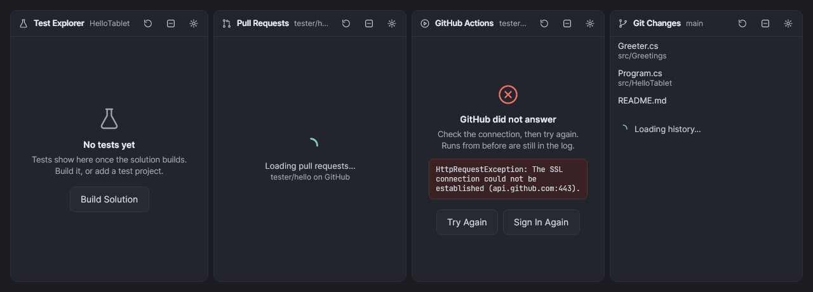
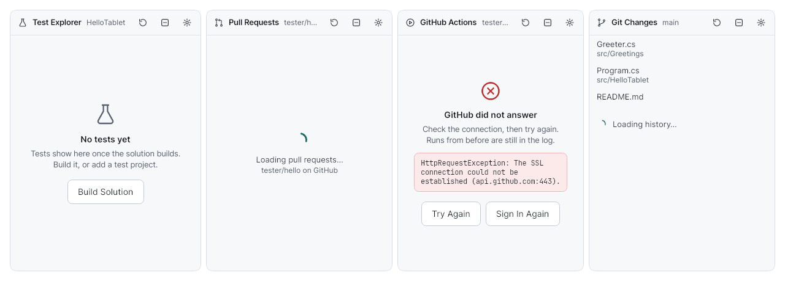

## Dialogs and overlays

| Kind | Use | Placement | Dismiss |
|---|---|---|---|
| Tooltip | Name and gesture of an icon, a truncated text | Next to its target | Pointer leaves, finger lifts |
| Flyout / menu | Choices anchored to a button | Under or beside its button | Tap outside, Esc |
| Completion, quick info, peek | Editor help | Under the caret line, never over it | Esc, typing on |
| Toast | Something finished or needs a decision soon ("HDMI screen connected") | Bottom right of the document area, above the touch bar, never over the Error List | Its buttons; info toasts after 8 s |
| Dialog | A decision or a form that blocks | Centered, 480 to 680 wide, `Brush.Scrim` behind | Cancel, Esc, tap on the scrim (unless it would lose input) |
| Search | Ctrl+Q | Top, 48 px down, up to 680 wide, over a scrim | Esc, tap outside, opening a result |
| Drawer | The side bar in portrait | From the activity bar's edge, 330 wide, over the editor | Tap outside, the same activity again |

Dialogs: a title (15 SemiBold) with an optional icon, a one-line explanation in muted text, the form, and the buttons
at the bottom right: Cancel (secondary) left of the primary action (teal, named by what it does: "Create", "Merge",
"Install", never "OK"). A destructive primary is `Brush.Destructive`. The first field has focus; Enter is the primary
action. Labels are words, not identifiers ("Dry run", not "dry-run"). On a phone, dialogs fill the width less 16 on each
side.

Only one toast shows at a time; more wait their turn. A toast never covers code the user is typing in.

## Touch targets and density

Every control that takes a tap (a button, a toggle, a row, a tab, a menu item, a text box, a combo box, a check box,
a slider) has a hit area of at least the screen's **touch target**. It is one set of resources per window
(`Accessibility/TouchTargets.cs`), chosen by the window's width, and one style applies it to every control
(`Theme/Accessibility.axaml`); a view never sets a smaller `Height`, `MinHeight` or `Width` on such a control.

| | Phone | Tablet (default) | Desktop mode |
|---|---|---|---|
| When | Width under 600 | Width 600 and up with touch | An HDMI screen with a mouse and keyboard |
| Touch target (`Target.Size`) | 48 | 44 | 32 |
| What a flat button draws (`Target.Visual`) | 44 | 40, with 2 transparent around that takes the tap | 28 |
| List and tree rows | 48 | 44 | 32 |
| Menu bar, toolbar | 48, 48 | 44, 46 | 32, 36 |
| Status bar | 48 | 44 | 32 |
| Activity bar | 56 wide | 48 wide | 40 wide |
| Touch bar | Icons only | Labels, folding to icons | Hidden |
| Hover-only affordances | None | None | Allowed, with a touch path too |

**Without looking heavier.** TabStudio's button themes (`ToolButton`, `SecondaryButton`, `AccentButton`,
`StatusBarButton`) draw the button at `Target.Visual` inside a transparent `Target.Inset` (2 on each side) that still
takes the tap, so a toolbar of 44-pixel targets looks as light as one of 40-pixel buttons, and two neighbours never
need a gap between their hit areas. Rows keep their 12.5 text and padding; only their pitch grows.

Gestures: tap activates; long press opens the context menu, or the tooltip of an icon-only button; double tap selects a
word in the editor; drag on a splitter resizes (splitters are 6 px wide with a 12 px touch area). Keyboard shortcuts are
shown in menus, tooltips and the search, so touch users learn them.

## Portrait

When the window is taller than wide or narrower than 900:

- The **activity bar stays** at the right edge; tapping an activity opens the side bar as a **drawer** over the editor
  (330 wide, `Shadow.Dialog`), and tapping it again or outside closes it. The editor keeps the full width.
- The **toolbar adapts**: Run and the debug controls stay, the configuration and the target fold to their icons, then
  editing commands go into More. Nothing is clipped ("Run on In-pr…").
- The **menu bar's search** becomes the Search button's icon; the solution chip trims with an ellipsis.
- The **status bar** keeps the state (Ready, errors, debugging) on the left and the caret on the right; the rest folds
  into More. A long operation (a download, an install, a restore, a build, an analysis) is one item with its stage,
  numbers and time left, such as "Downloading Pico SDK 120/340 MB · about 2 min left", and a thin progress bar; tapping
  it opens a small panel above it with every running operation, Cancel where stopping is safe, and Show details for
  the raw log. It is never a dialog: the editor stays usable while it runs.
- The **bottom panel** (Error List, Output) takes at most 40% of the height.
- The **touch bar** shows icons only for its least used commands, and sits above the bottom panel, clear of the caret.
- **Properties** is folded into its header.
- Dialogs fill the width less 16 on each side.

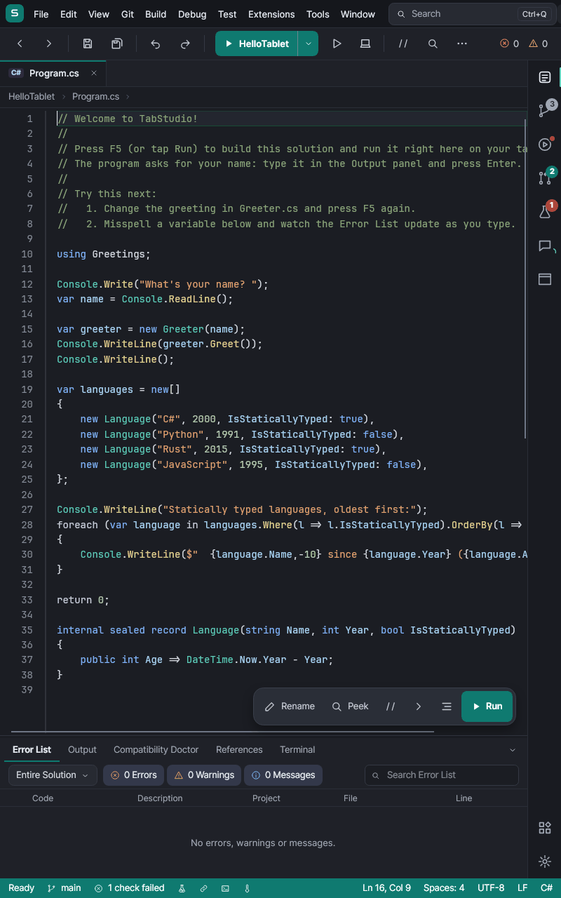

## Accessibility

TabStudio is comfortable for every hand and every eye. Each rule below holds for every view because one mechanism
applies it, not because each view remembers it, and each has a check that fails when a change breaks it.

### Text size

**Tools > Text Size** (or Ctrl+Q, "text size") has one setting: **Follow the system** (the default: Android's
Settings > Display > Font size), **Small** (85%), **Default**, **Large** (115%), **Larger** (130%) and **Very large**
(150%). **Make Text Larger** (Ctrl+Shift+.) and **Make Text Smaller** (Ctrl+Shift+,) step through them, as Visual
Studio's zoom does. It changes the whole IDE and every editor at once, without a restart; when it follows the system,
changing Android's font size changes the IDE while it runs. Android's sizes above 150% use Very large, the largest the
IDE is laid out for. It is saved with the theme in `State/appearance.json`.

Every view stays usable and unclipped at Very large, in landscape, portrait and on a phone: text is a token
(see [Type](#type)), and containers grow with it.

### Touch targets

See [Touch targets and density](#touch-targets-and-density): 48 on a phone, 44 on a tablet, 32 in desktop mode, for
every control that takes a tap.

### Screen readers

TalkBack reaches, names and operates every control (Avalonia's automation peers, which Avalonia's Android host gives
TalkBack). `Accessibility/AccessibleNames.cs` names every control that takes a tap from what it shows:

- a button, toggle, row or tab by its text ("Build Solution", "Program.cs, C#");
- an icon-only button by its tooltip, which every icon-only button has ("Save All (Ctrl+Shift+S)");
- a text box, combo box or slider by its placeholder ("Search Solution Explorer"), the label just before it or in its
  grid row ("Branch name"), or its tooltip;
- a menu item by its header, without the access key.

A name the view sets (`AutomationProperties.Name`) always wins; set one where what shows is not what it does. Names
follow the control as its text, tooltip or data change, as when a list recycles its rows. A control is never read as
its class ("Avalonia.Controls.StackPanel").

The editor reads its file, line and that line's text ("Program.cs, line 12 of 40: Console.WriteLine(name);") as the
caret moves. The Error List reads each error's severity, code, message, file and line; the Solution Explorer each
file and folder, with whether it is expanded; a dialog its title and fields, with the first field focused.

What the user's own app shows (the app preview, a web page, a designed form, a virtual device) is the app's: it is
marked `a11y:A11y.IsContent="True"` and checked by the layout checks (SWRM001 to SWRM005) instead.

### Keyboard

Everything works without touch. Tab and Shift+Tab move through the shell in reading order (menus, toolbar, side bar,
editor, bottom panel, status bar), only to controls that can be seen: an adaptive bar's item folded into More is not
a tab stop. The control with the keyboard focus shows it: a 2-pixel ring in `Brush.TextBright` (Avalonia's focus
adorner; a text box shows its own focused border). Every command has a key gesture shown in its menu, tooltip and
the search.

### Contrast

Every text passes WCAG AA, 4.5:1 (3:1 when large), and every icon and glyph 3:1, in both themes, on the surface it is
drawn on, as the person sees it (with its opacity and the layers behind it): see [tokens.md](tokens.md).

### Motion

When Android asks apps not to animate (Settings > Accessibility > Remove animations, or the developer options'
animator scale at off), spinners and indeterminate progress bars stand still (the `still` class, like `offscreen`)
and transitions are skipped, so a change shows at once. The text beside them still says what is happening.

### Right to left

When the device's language is written right to left, the IDE mirrors (`FlowDirection`): the activity bar moves to the
left edge, bars and rows read from the right, and only the icons that point a way (back, forward, the left and right
arrows and chevrons, undo, redo) mirror with it; Run's triangle and the debugger's glyphs do not. Code stays left to
right: the editors, the terminal and `.mono` text keep their direction.

### How it is checked

- **Every screenshot** (`UiTestHelpers.SaveScreenshot`) is audited by `Accessibility/AccessibilityAudit.cs` in the
  tests, in the dark and the light theme: tap targets, names, text contrast and icon contrast at the text size it was
  shown at; then the same window at Very large, saved in `screenshots/largest/`, for clipped text. A finding fails the
  test, and is listed in `screenshots/accessibility/findings.tsv`.
- `build/ci/accessibility-coverage.py` fails CI when a view of `src/TabStudio.App/Views` was never audited, and writes
  the counts to `screenshots/accessibility/summary.md`.
- `TextSizeTests`, `ScreenReaderTests`, `KeyboardTests` and `MotionAndDirectionTests` check the text size setting,
  the names TalkBack reads, Tab's order and focus, Remove animations and the mirrored layout, at tablet, portrait and
  phone sizes.

## Components

The shared pieces that put these rules in code. Each is tested in `tests/TabStudio.App.Tests/Design/` and rendered there
in both themes (the screenshots below).

### Activity bar

`Controls/ActivityBar.cs` with `ViewModels/Shell/ActivityBarViewModel.cs` and `ActivityItem.cs`. A vertical strip of
48 px icon buttons at the side bar's outer edge that replaces the tool window tabs: one per tool window, the selected one
marked by a teal bar on the inside edge. Tapping the selected one folds the side bar away (`IsSideBarOpen`).

- Badges: a count (`ShowCount(3, ActivityTone.Error, "3 tests failed")`, 99+ at most), a dot (`ShowDot`, such as CI
  failed or the agent has changes) or a spinning arc (`ShowActivity`, such as CI running). The badge's description is
  in the tooltip.
- Long press, or hover, shows the name, the gesture and the badge's description.
- Items can be unavailable (`IsAvailable`, such as App Preview with no app) and are then left out; items with
  `IsAtBottom` (settings, account) group at the bottom.
- When the bar is too short, the least important items go into a More button at the bottom (the selected one never
  does). `Overflowed` lists them.

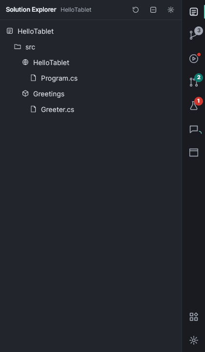
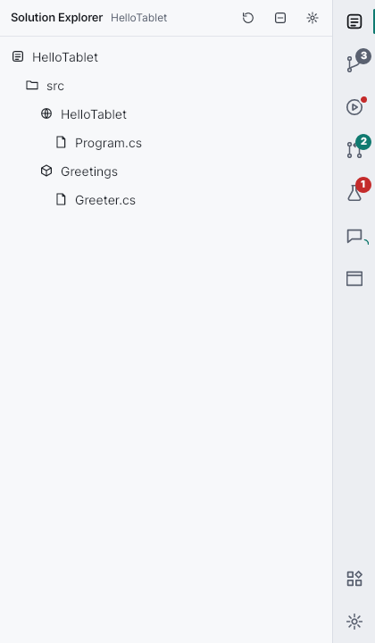
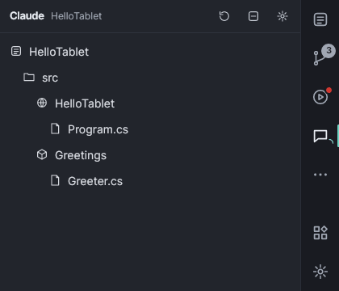

### Search

`ViewModels/Search/UnifiedSearchViewModel.cs`, `Views/Search/UnifiedSearchView.axaml`, providers in
`Services/Search/`. One search for everything, as Visual Studio's Ctrl+Q:

- **Providers** (`ISearchProvider`): files (`FileSearchProvider`), commands (`CommandSearchProvider` over a
  `CommandRegistry`), settings (`SettingSearchProvider`, the theme today), symbols (`SymbolSearchProvider` over an
  `ISymbolSearch`), templates (`TemplateSearchProvider`) and recent solutions (`WorkspaceSearchProvider`). A provider
  that fails or is slow does not hold up the others.
- **Commands** come from the IDE's own menus and key bindings: `CommandRegistry.AddMenu(menu)` walks the menu bar and
  records every command with its menu path ("Build > Build Solution") and gesture, and `AddKeyBindings` adds the
  gestures that have no menu item. Nothing moves; the menus stay the source of truth.
- **Ranking** (`SearchMatcher`, `SearchRanker`): exact, then prefix, word prefix ("bs" finds Build Solution), word
  starts, substring and scattered letters, with matches in a title above matches in its keywords or detail, and what was
  opened before boosted (`SearchHistory`, kept in `State/search-history.json`).
- **Results**: the best match on top, then each kind's group, best group first, four per group with "Show all 12
  files". Chips narrow to one kind; `>` typed first searches commands, `#` symbols. Before typing it shows what was
  recently opened. Rows are 44 px with the matched letters bold, a muted detail (the folder, the menu path) and the key
  gesture as key caps.
- **Keys**: Up and Down move (wrapping), Page Up and Page Down jump, Tab changes the kind, Enter opens, Esc closes.
  Tapping a row opens it; tapping outside closes.

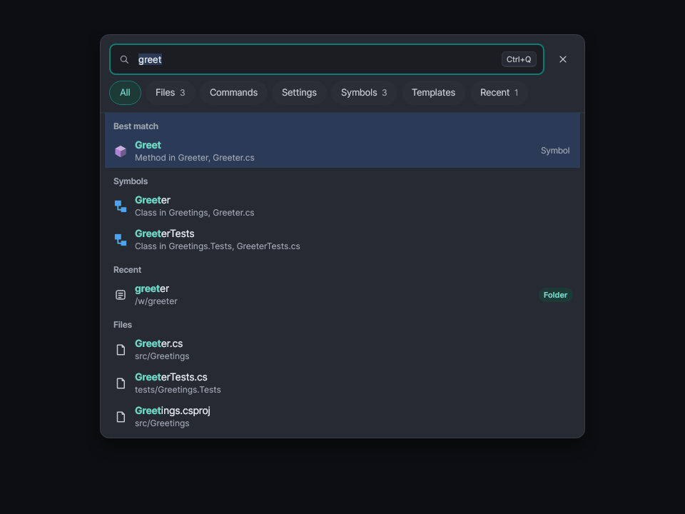
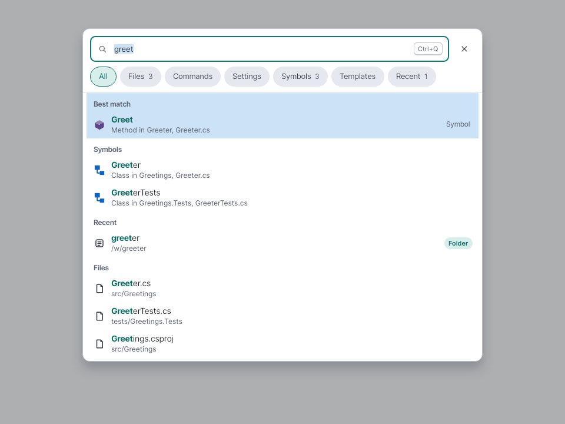
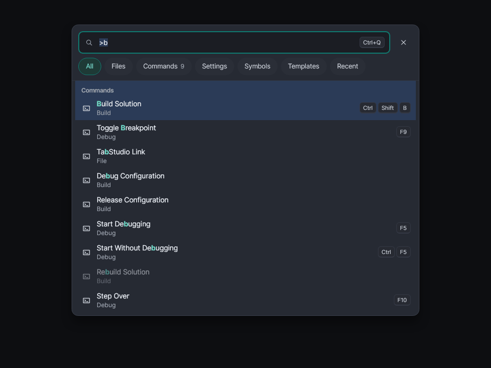
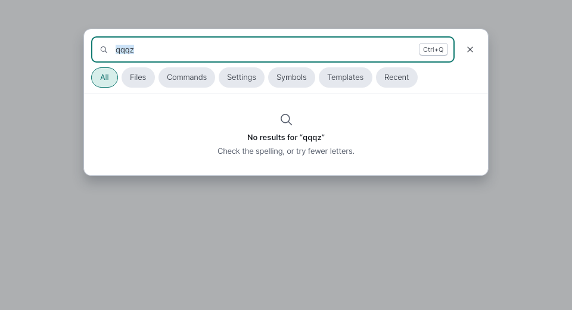

### Adaptive bars

`Controls/AdaptiveBar.cs`, `AdaptiveBarItem.cs` and the layout rules in `AdaptiveLayout.cs`. A horizontal bar for the
toolbar, the status bar and the touch bar. Each `AdaptiveBarItem` has an icon, a label, a gesture and a `Priority`.

- When the bar is too narrow, items fold to their icons, the lowest priority first; when that is not enough, items go
  into the More menu, the lowest priority first. `IsPinned` items (Run, the error count) never leave the bar.
- Separators show only between visible items.
- The More menu lists each item with its icon, label and gesture; an item with a menu (the configuration) becomes a
  submenu.
- Icon-only items have their name and gesture as a tooltip, also on long press.
- Other controls can go in the bar with the attached `AdaptiveBar.Priority` and `AdaptiveBar.IsPinned` (pinned by
  default).

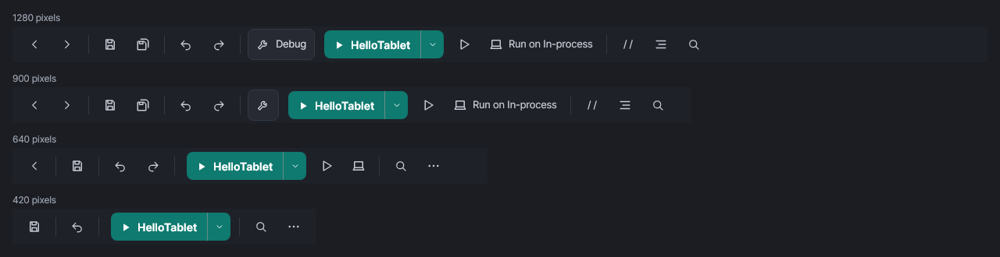
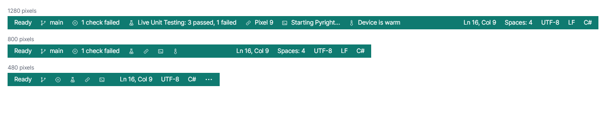

### Panel states

`Controls/PanelHeader.cs`, `EmptyState.cs`, `LoadingState.cs`, `ErrorState.cs`, themed in `Theme/Shell.axaml`. See
[Panels](#panels).

```xml
<controls:EmptyState Icon="{StaticResource Icon.Flask}" Title="No tests yet"
                     Message="Tests appear here after a build." ActionText="Build Solution"
                     ActionCommand="{Binding BuildSolutionCommand}" />
<controls:ErrorState Title="Python is not installed" Message="The Python language server needs Python."
                     FixText="Install Python" FixCommand="{Binding InstallCommand}"
                     RetryCommand="{Binding RetryCommand}" Details="{Binding Log}" />
```

### Theming

- `Theming/ThemeBrushes.cs`: live brushes for code (`Get`, `Editor`, `Find` for converters, `ColorOf`).
- `Theming/ThemedPen.cs`: pens that follow a token.
- `Theming/ThemeSync.cs`: switches the editor's built-in theme and recolors the live brushes when the theme changes.
- `Services/Appearance/`: the setting (`AppearanceService`, `AppearanceSettingsStore`).
- `Editing/BuiltInEditorThemes.cs`: TabStudio Light for the editor.
- `Controls/HighlightedText.cs`: a text block that bolds matched letters.
