# Audit of the panels added in 0.15 and 0.16

0.15 and 0.16 added a dozen panels, each written by a different agent, and none was checked against this folder's
spec. This audit looks at each one the same way, lists what was wrong, and shows it before and after. Every problem in
the tables is fixed on `agent/design-polish`.

## How the panels were checked

Each panel is shown in the real IDE by `tests/TabStudio.App.Tests/Design/PanelAuditTests.cs`, with the state that
shows it best (a SQLite database with tables, a Compose file with a service the tablet cannot run, a recorded debugging
session, a port with notes…), on three screens: a landscape tablet (1280 × 800), a portrait tablet (800 × 1280) and a
phone (412 × 915), in the dark and the light theme. That is six screenshots a panel, saved in `screenshots/audit/` of
the IDE job. `PanelAudit` then checks the panel in each:

- the layout checks of [docs/layout-checks.md](../layout-checks.md): no clipped text (SWRM001), nothing off screen
  (SWRM002), no overlapping controls (SWRM003) and no text below WCAG AA (SWRM005), as the layout checks report them
  for an app;
- touch targets of at least 34 × 34 (list rows 32), the smallest the IDE's own controls are (SWRM004);
- text trimmed with an ellipsis has its whole text in a tooltip ([Type](README.md#type));
- a line of text in a fixed height is centered in it, not stretched ([Type](README.md#type)).

`DesignRuleTests` reads the same panels' XAML for what a screenshot cannot show: colors are tokens, font sizes are on
the type scale, spacing is on the 4-pixel grid, radii are the radius tokens, every button has one of the IDE's button
themes, icons come from the icon set, and headers are in sentence case.

Both tests fail on any problem, so the panels stay as they are now. The audit's first run, on main before any fix,
reported 350 problems in the screenshots (a problem counts once in each screenshot that shows it) and 62 lines of XAML that
broke a rule; the tables below group them.

## What every panel shared

Most problems were the same in every panel, because each was written without the shared components:

- **No panel header.** Each made its own: "REMOTE EXPLORER" in capitals over a 70%-opacity subtitle, a 16-point
  "Services", a bare "Database Explorer" line. They now use `PanelHeader`, with up to three icon actions and a More menu.
- **Fluent's default buttons.** Gray filled buttons, 30 pixels high, in rows that wrap: "Start all", "Connect /
  Refresh", "Send notes to Agent". They are now `SecondaryButton`, `ToolButton` or the surface's one `AccentButton`,
  36 high, with Visual Studio's title case ("Start All", "Open Folder", "Send Notes to Agent").
- **Small fields.** Text boxes 30 high, combo boxes and check boxes 32: under the 34 the IDE's touch targets need. The
  forms are 36.
- **No empty states.** A lone gray line, or an empty list, where `EmptyState` says what would be there and how it gets
  there.
- **Literal styling.** Opacity for muted text, `FontFamily="monospace"`, a 6-pixel radius, 5- and 7-pixel spacing, 16,
  17 and 23-point type.
- **A text prompt for a choice.** Choosing an APK, a PIC USB device or an MPLAB configuration meant typing a number or
  a name into a text box. The in-app prompt now has a list to choose from (`PromptViewModel.ChooseAsync`), with Enter or
  a double tap to choose.
- **Three tool windows with one icon.** Services, Windows Bridge and Remote Explorer all used `Icon.Computer` in the
  activity bar. Services has `Icon.Server` now and Remote Explorer `Icon.Remote`, and Services moved from between the
  Solution Explorer and Git Changes to the other 0.15 and 0.16 tool windows.

## Database Explorer and the SQL tabs

| Problem | Fix |
|---|---|
| A bare "Database Explorer" line instead of a header, and Fluent's `TabControl` (13-point tabs) for Connections and EF Core | `PanelHeader` with the connection as its subtitle, Add Connection, New Query and More (Edit Data, Find Connections in the Solution, Remove Connection); the bottom dock's `PanelTabButton` tabs |
| With no connection the form showed at once, with watermarks for labels and a 6-pixel radius; the explorer had no empty state | `EmptyState` ("No connections yet", Add Connection); the form has labels, Cancel and Save at the bottom right, Save the one primary action |
| "Connect / Refresh", "Add", "Remove", "New query", "Edit data" in a wrapping row of gray buttons at the bottom | Connect beside the connection, at the top as a toolbar; the rest in the header; "Not connected" with Connect until the schema is read |
| Tree rows with no icons, selected in solid teal | The icon set's database, folder, table, view and key icons, and the Solution Explorer's selection color |
| The SQL tab: unthemed buttons ("Run · Ctrl+Enter"), `FontFamily="monospace"` on the editor, "Copy CSV" and "Copy JSON" side by side, a 13-point grid, "result set(s)" | A toolbar with Run (the one primary action), Cancel and Schema, the connection on the right, trimming with a tooltip; the editor's own font and colors; one Copy with a menu; Body type; "1 result set" |
| The data grid lay under the editor's touch bar (Rename, Peek, Run), which does nothing in a SQL tab | The touch bar is for code: a SQL tab and a port's summary no longer show it |
| No state before the first run | `EmptyState`: "No results yet", with how to run and complete |

| Before | After |
|---|---|
| 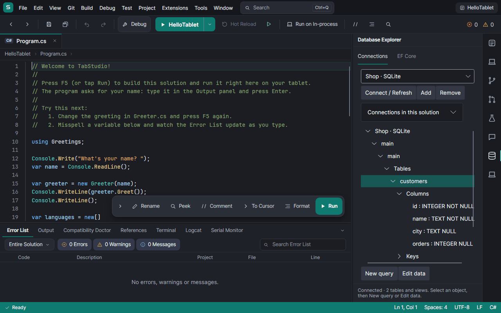 | 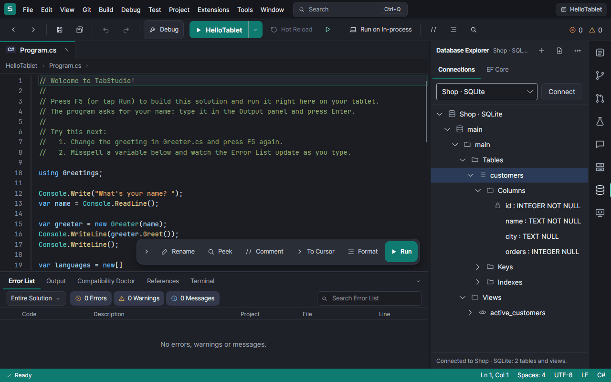 |

| Before | After |
|---|---|
| 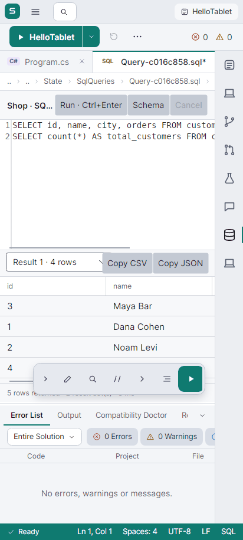 | 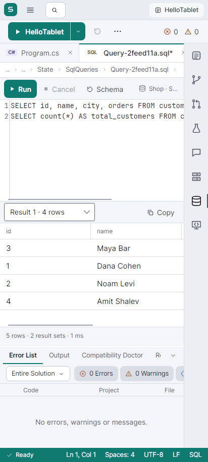 |

## View > Services

| Problem | Fix |
|---|---|
| A 16-point "Services" title and a row of five unthemed buttons (Start all, Stop all, Restart, Reload, Cancel) | `PanelHeader` with the Compose file as subtitle, Start All and Stop All as the Test Explorer's colored icons, Restart All and Reload in More |
| Opacity 0.75 and 0.65 for muted text, 11-point detail, a solid teal selection | `Brush.TextMuted`, Small type, `ListRow`'s `Brush.Selection` |
| The state was the enum's name ("Unsupported"), in plain text | A pill in the status colors: Running and Healthy green, Failed and Not healthy red, Starting and Stopping teal, "Not supported here" amber |
| The ports were buttons reading "Open localhost:15432" | Globe buttons, "localhost:15432", with a tooltip saying they open the web preview |
| Logs in a gray text box with the browser's monospace font | The terminal's colors and the code font, under a "Logs" section header |
| No Compose file: a sentence beside the buttons, which stayed | `EmptyState`: "No services", what Compose files run here; a file that cannot be read gets `ErrorState` with Reload |

| Before | After |
|---|---|
| 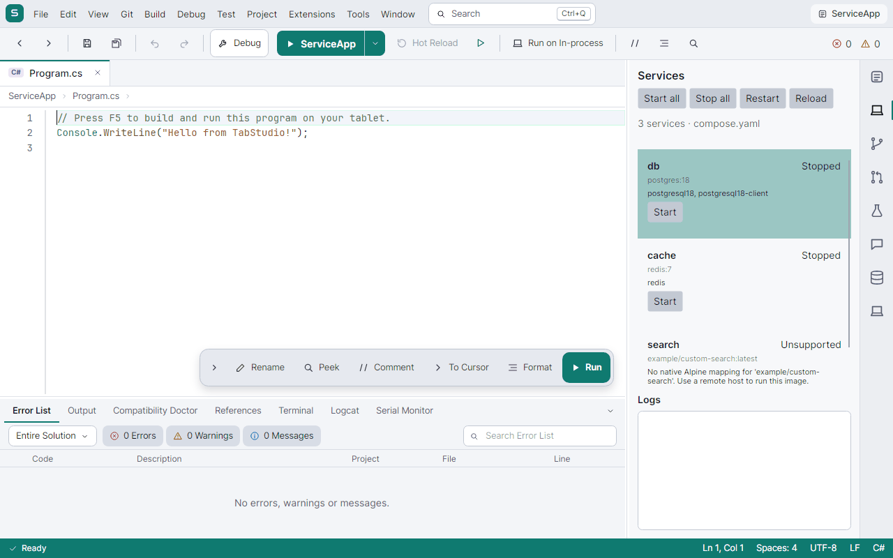 | 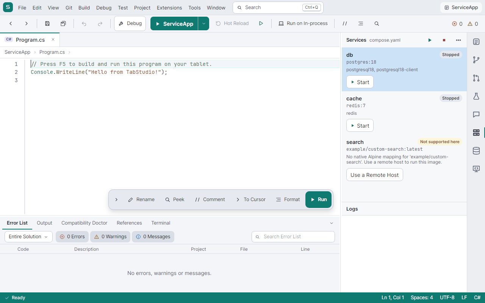 |

| Before | After |
|---|---|
| 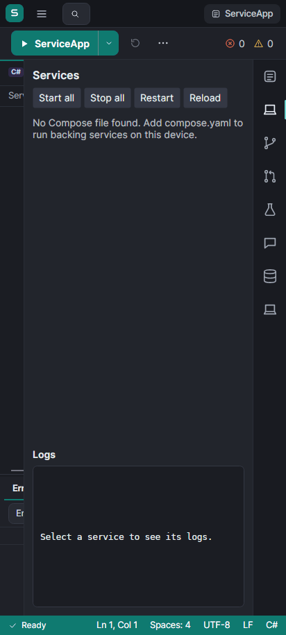 | 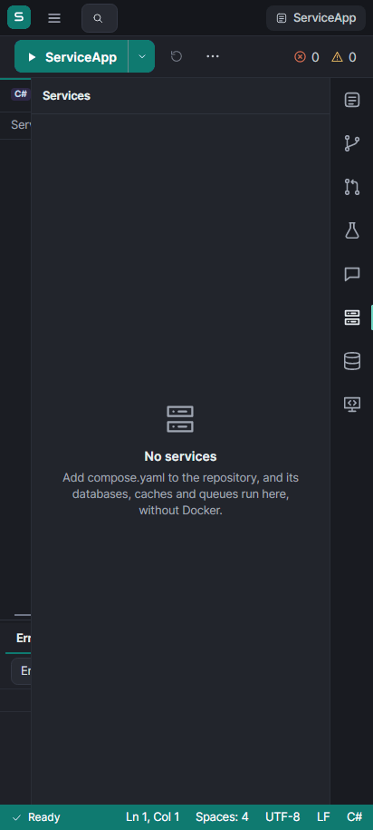 |

## Remote Explorer (SSH) and Publish to server

| Problem | Fix |
|---|---|
| "REMOTE EXPLORER" in capitals over a subtitle at opacity 0.7 | `PanelHeader` "Remote Explorer · SSH" with Refresh and More (Reload File from Server…, Disconnect) |
| Nine unthemed 30-pixel buttons, 30-pixel text boxes, 5- and 7-pixel spacing; "Open folder" no more prominent than "Refresh" | Open Folder is the one primary action; the rest secondary, 36 high, on the grid |
| A host's name twice ("Development server" over "Development server (deploy@…)") | The name, then `deploy@dev.example.com:22` (`SshHost.Address`) |
| The add-host form always open, with watermarks as its only labels | Labels; the form folds once a host is saved, and "No hosts yet" says what to do before |
| Publish to server: four text prompts titled "Publish to server", "Publish destination", "systemd service" and "Server runtime", the host and runtime typed in | One title for the four steps; the host and the runtime chosen from lists (the saved hosts; linux-x64, linux-arm64 and the musl ones) |

| Before | After |
|---|---|
| 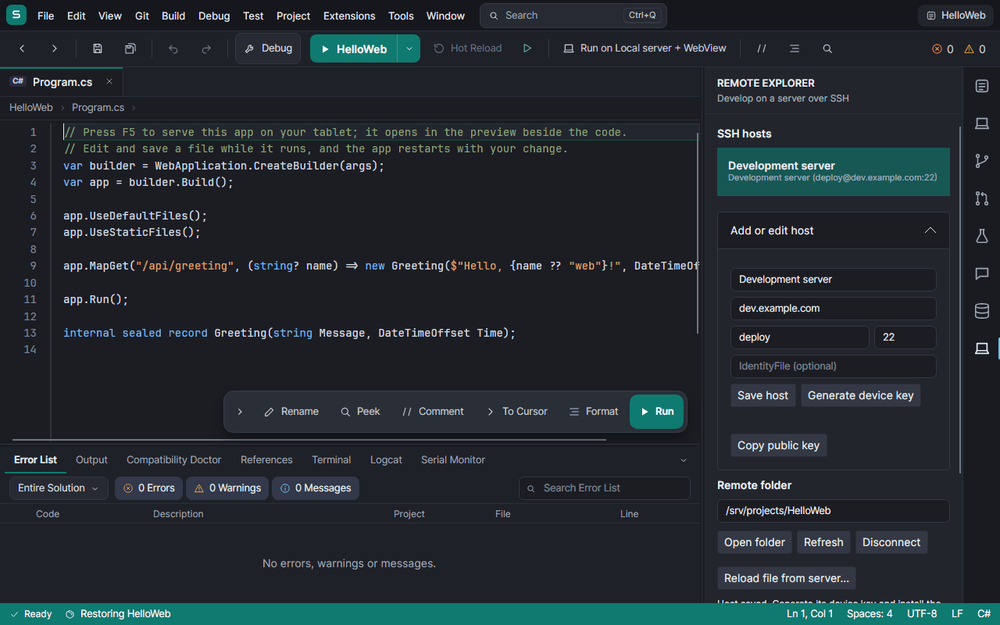 | 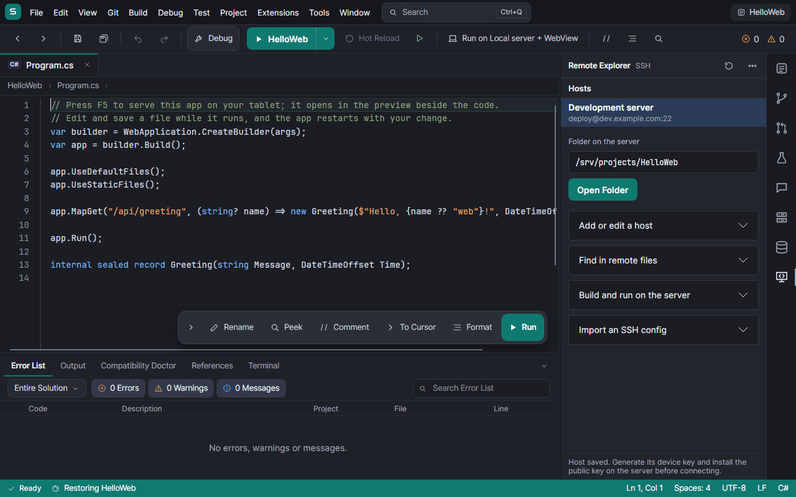 |

| Before | After |
|---|---|
| 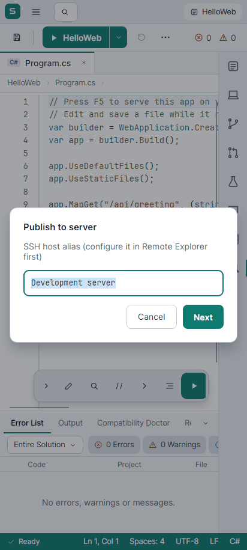 | 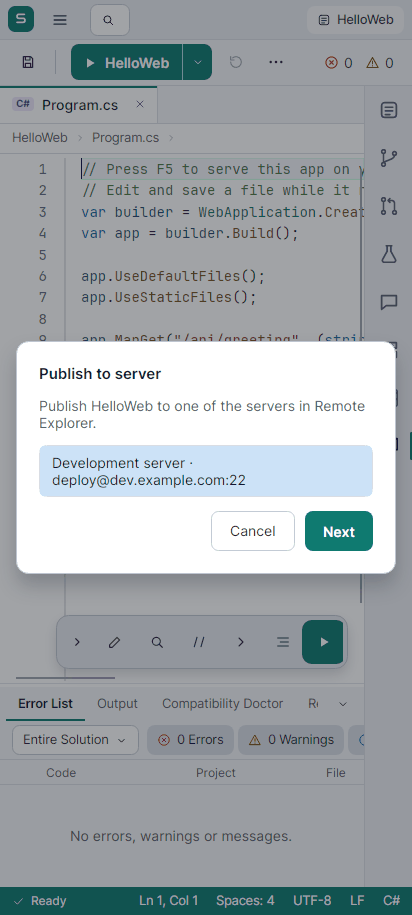 |

## Microchip PIC: targets, Flash and the Serial Monitor

| Problem | Fix |
|---|---|
| MPLAB configuration: the configurations listed in the message, and the name to type in a text box | A list of the configurations, each with its device and compiler |
| Flash with more than one USB device: "1. …, 2. …", and the number to type | "Choose a USB device", a list |
| The Serial Monitor's toolbar ran off a phone's screen: Refresh and Connect could not be reached, "8-N-1" was cut off | One row on every screen: the device, the speed (its button opens the speed and the interface), Refresh, and Connect, the primary action |
| Unthemed 30-pixel buttons, 32-pixel fields, a "Port" field that was the USB interface | Themed, 36 high; "Interface", with what it is for |
| No state without a device, and the line to send shown, disabled, before connecting | `EmptyState` "No serial device" with Refresh; the send row while connected only |
| The Serial Monitor and Logcat tabs showed for every project, pushing the debugger's tabs off a phone | They show for a PIC project (Serial Monitor) and an Android or Capacitor app (Logcat), while they have output, or while shown |

PIC Target… opens `pic-flash.json` in the editor, as before: it is a file, not a panel.

| Before | After |
|---|---|
| 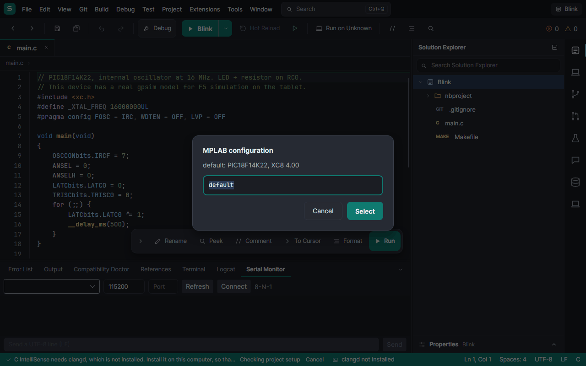 | 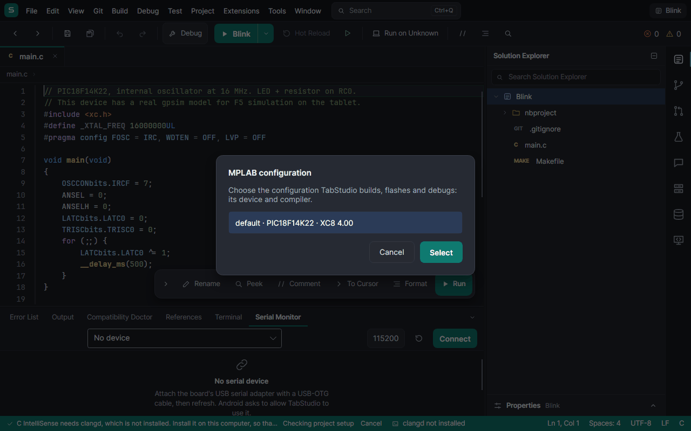 |

| Before | After |
|---|---|
| 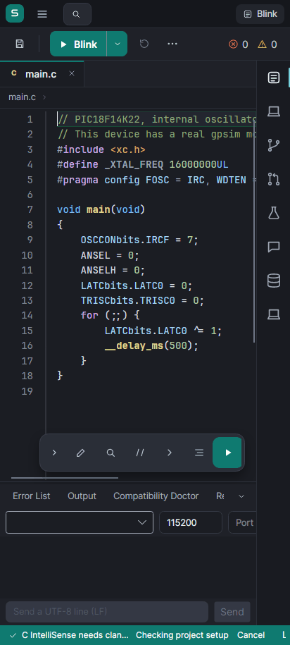 | 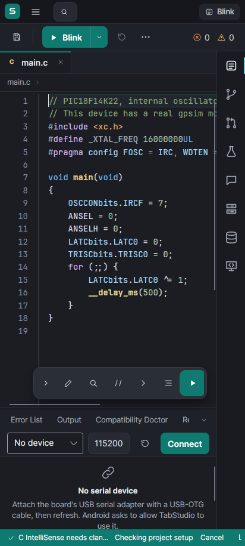 |

## The local AI model manager and Agent settings

| Problem | Fix |
|---|---|
| The model manager showed in cloud mode, between Local mode and the API key, which came last | Sections: where the agent runs (Local mode, or the API key and model), "On-device model", which also writes inline completions in either mode, "Every conversation", then Save |
| "LOCAL · Code and prompts stay on device" in capitals, on a line of its own | An "On device" or "Cloud" pill beside the title, with the full sentence in its tooltip |
| Download, Delete and Unload from RAM as unthemed 30-pixel buttons; check boxes and fields 30 to 32 high; an 11-point license | Secondary buttons with icons, 36 high; "Unload from Memory"; Small type |
| The download's Cancel was a separate full-width button far from the progress | A spinner with the progress and Cancel beside it |

| Before | After |
|---|---|
| 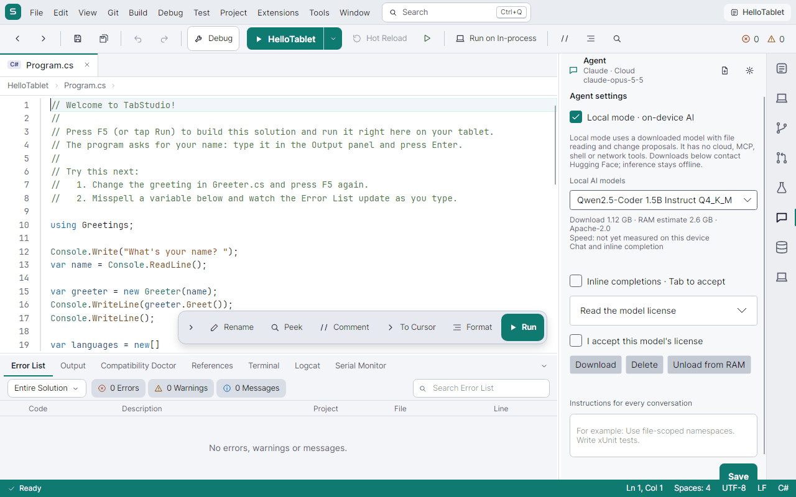 | 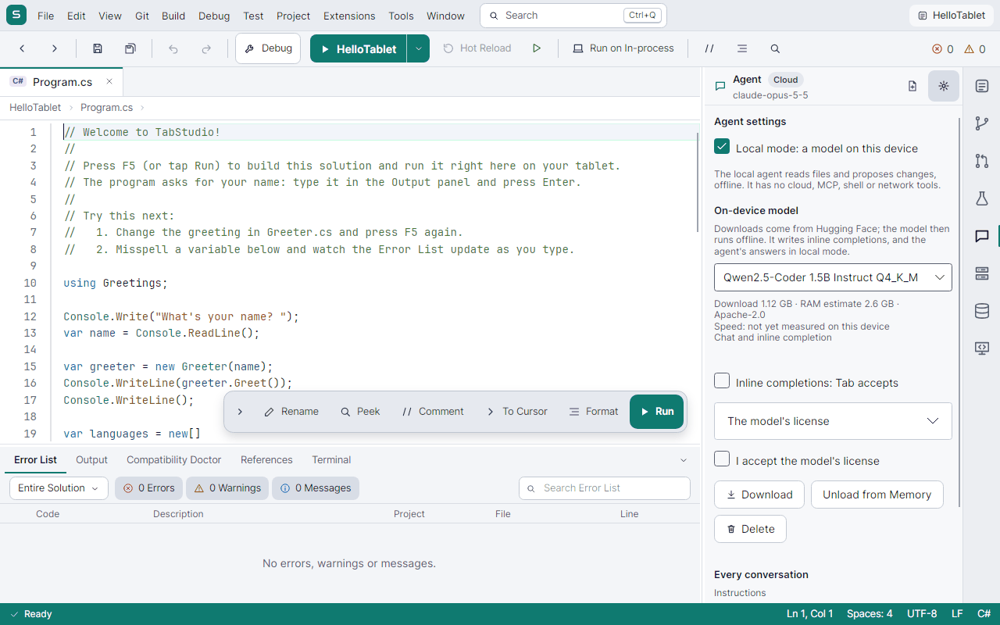 |

| Before | After |
|---|---|
| 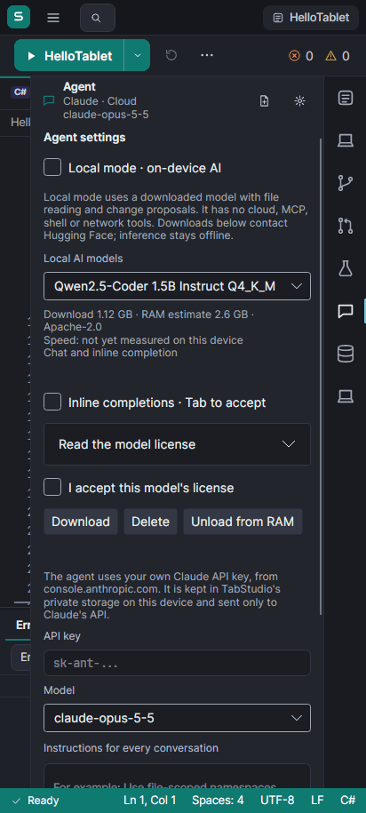 | 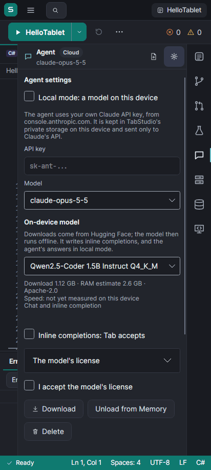 |

## The time-travel timeline

| Problem | Fix |
|---|---|
| Step Back, Back Into, Reverse Continue and Return to Live as text-only buttons in a fixed grid: on a phone "Return to Live" was cut off and the recording's position had no room at all | An `AdaptiveBar`, as the debug toolbar: icons (new `Icon.StepBack`, `Icon.StepBackInto`, `Icon.ReverseContinue`) with labels that fold to icons and then into More; Step Back stays |
| "Back Into" | "Step Back Into", as the release notes and Visual Studio name it |
| The position text beside the buttons, squeezed to nothing | Under the slider, trimming with its tooltip |
| A 32-pixel slider | 36 |

| Before | After |
|---|---|
| 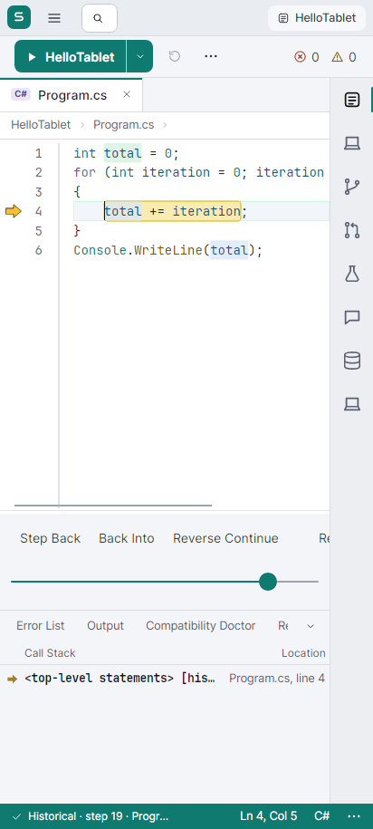 | 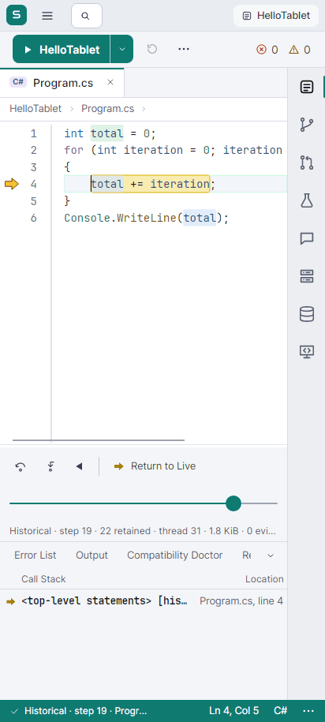 |

## The Port to Avalonia summary

| Problem | Fix |
|---|---|
| A 23-point title and 17-point section header | Title (18) and Section (13) from the type scale |
| "Send notes to Agent" and "Undo port" as unthemed buttons | Secondary buttons with the agent and undo icons, title case |
| Notes as unthemed buttons, the line number on its own line | `CardButton` cards: the file and its line on one row, the construct in the code font, why in muted text |
| The counts in a sentence | Pills: files, conversions, port notes |
| The editor's touch bar over the notes | The touch bar shows for code only |
| Nothing said when there were no notes, or after Undo | "Nothing to review", and a notice once the port is undone |

| Before | After |
|---|---|
| 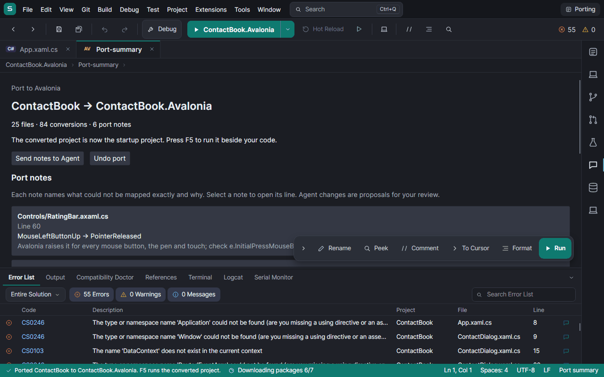 | 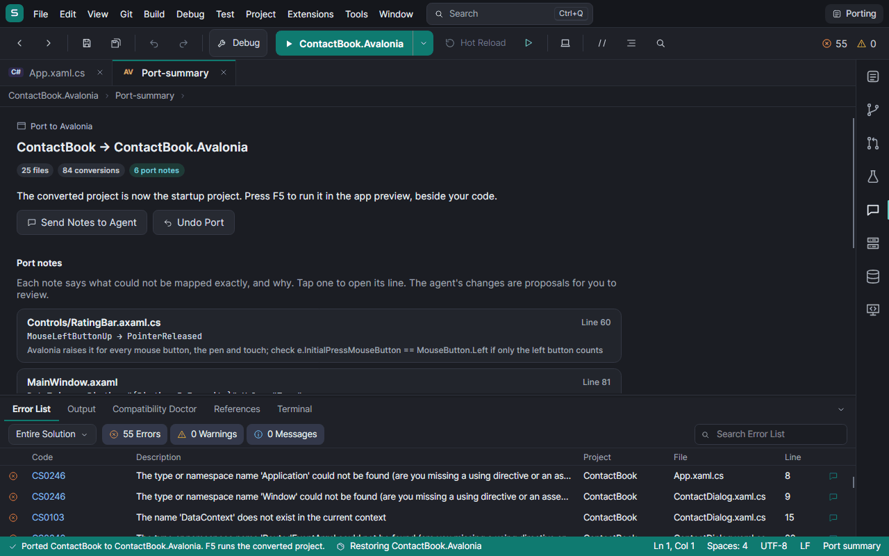 |

## Logcat and the Android and iOS build dialogs

| Problem | Fix |
|---|---|
| Logcat was an empty Output until an app ran | `EmptyState` "No log yet", with Run Android App |
| Logcat's tab showed in every project | Only for an Android or Capacitor app, or while it has lines (above) |
| Choose Android APK: the APKs in the message, and "Enter the number of the APK to install" | "Choose an APK", a list |
| The open-in-preview notice: an "×" for Dismiss, "Open in preview" in lower case, no shadow, and at the top right over the toolbar's Run | `Icon.Close`, "Open in Preview" and "Open in Browser", `Shadow.Popup`, and under the toolbar, stacked with the toolchain offer so the two never overlap |

Build for iOS's question ("Replace iOS workflow?") already followed the dialog rules; the prompt itself now wraps long titles
and is 480 wide, as dialogs are.

| Before | After |
|---|---|
| 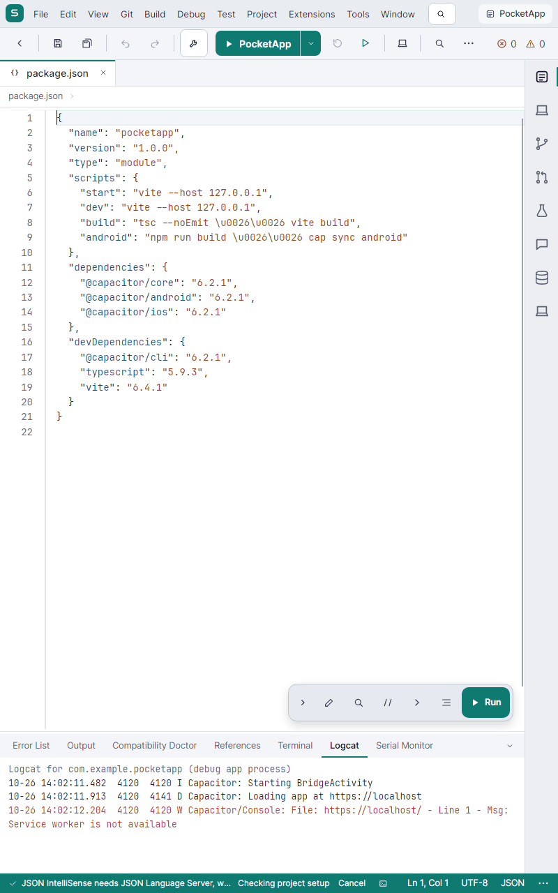 | 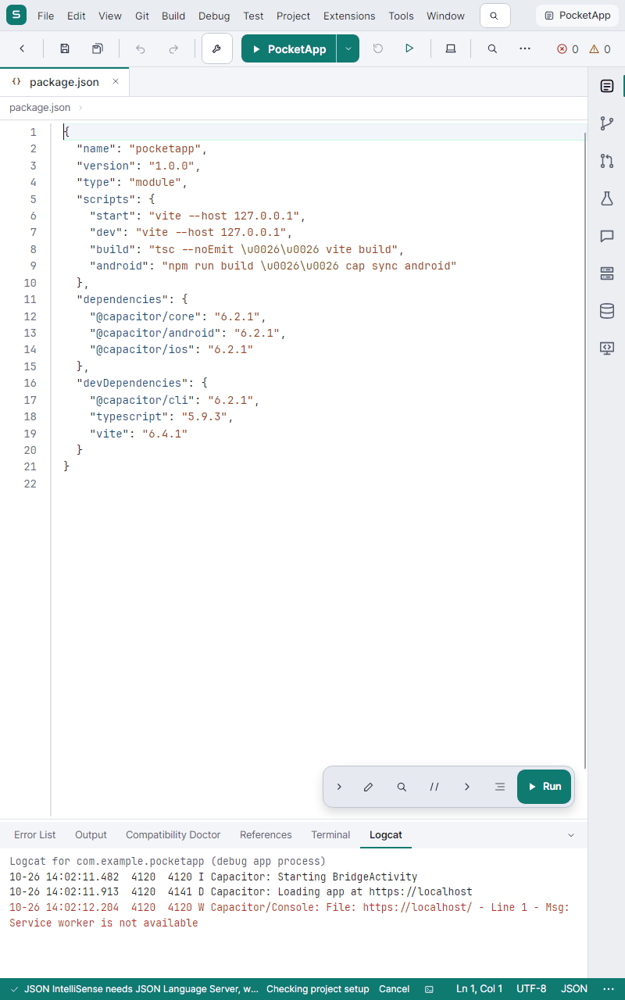 |

Before an app runs, Logcat says how its log gets there:

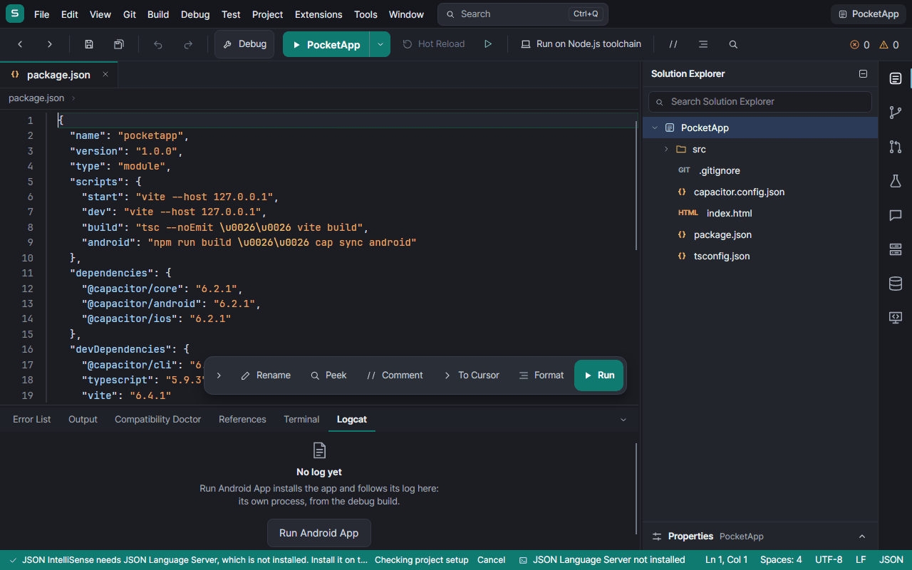

| Before | After |
|---|---|
|  | 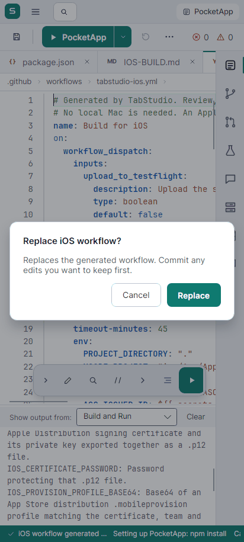 |

## The Toolchain Store's new entries

| Problem | Fix |
|---|---|
| Android SDK, Flutter, XC8 and XC32 had gray "Other" tiles reading "An", "Fl", "Mi" and "Mi" | Their own content tokens (`Brush.Toolchain.Android`, `.Flutter`, `.Microchip`, white text at 5.3:1 or more) and "An", "Fl", "X8", "X32" |
| Every row had a teal Install: five primary buttons at once | Install is primary only for the toolchain the Store was opened for; the others are secondary |
| On a phone the Install button kept its column, squeezing descriptions to a word or two and cutting them off | Below 560 pixels a toolchain's actions go under its text |
| Descriptions and the subtitle trimmed with no tooltip; the state pill its own 18-pixel, 11.5-point style | Tooltips with the whole text; the shared `pill` with its success, warning and ready colors |

| Before | After |
|---|---|
| 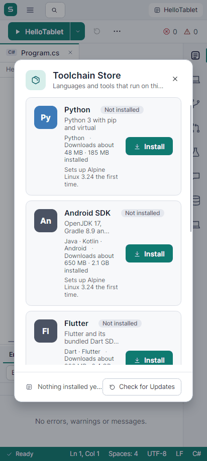 | 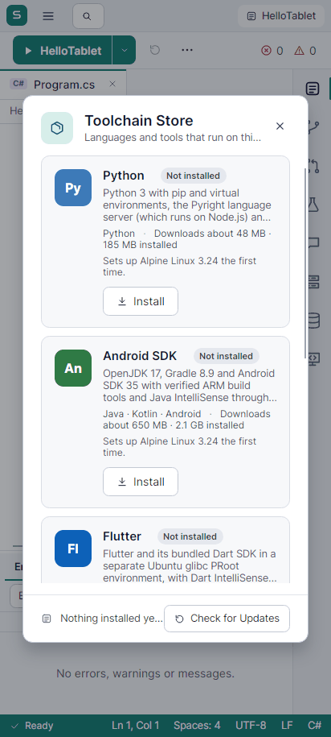 |

| Before | After |
|---|---|
| 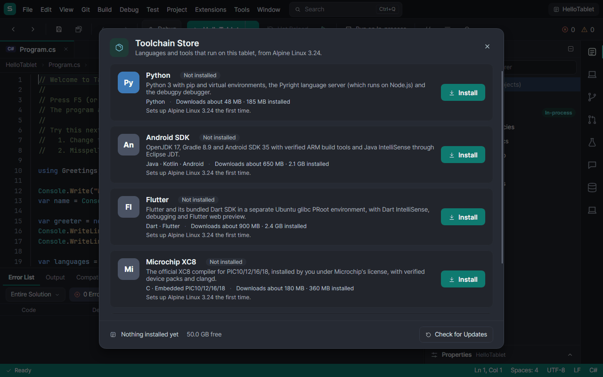 | 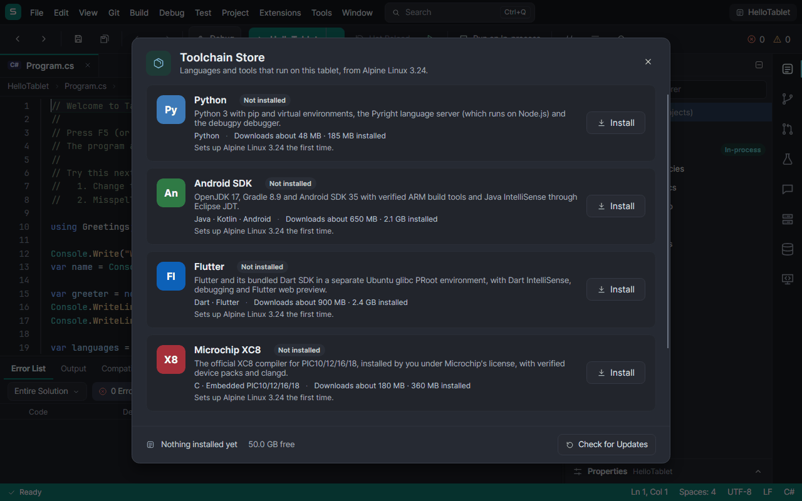 |

