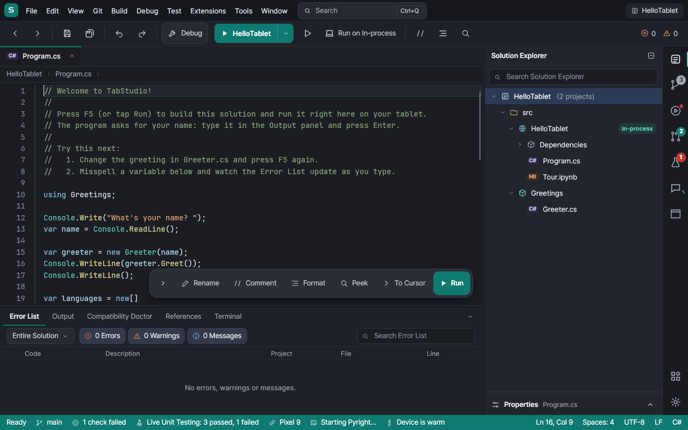
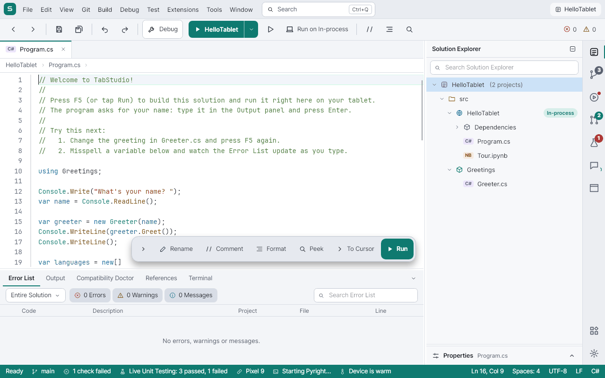
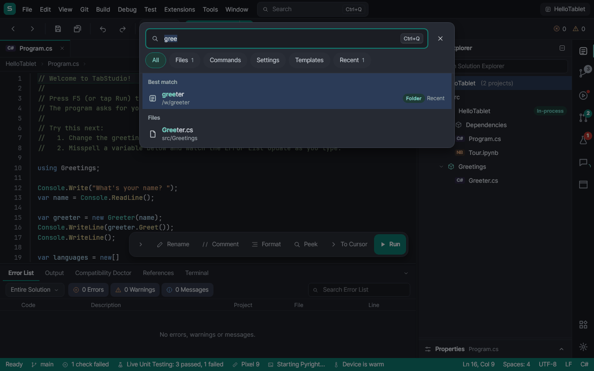
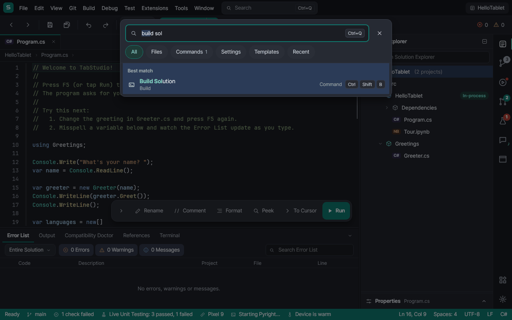
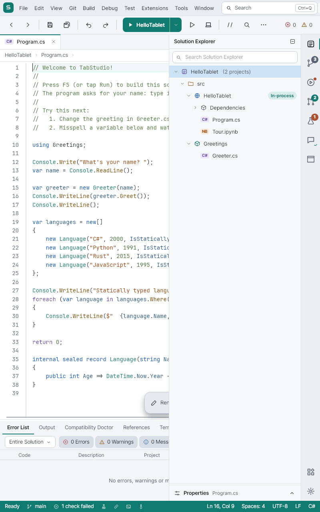
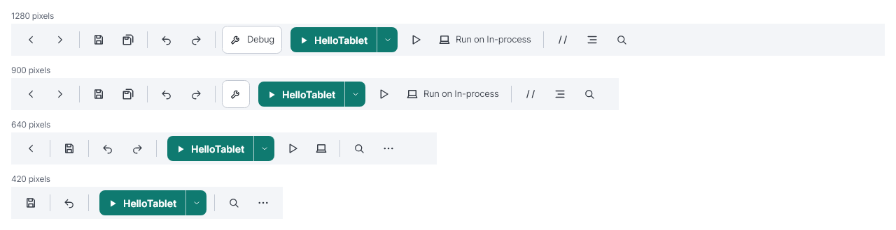
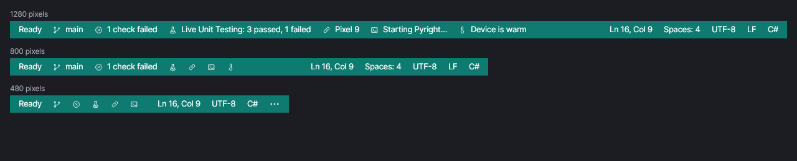

# Stage 2: the shell

Stage 1 built the pieces as standalone, tested components and gave the IDE a light theme. Stage 2 puts the pieces into
the shell (`WorkspaceView.axaml`, its code-behind and `WorkspaceViewModel`), which everyone else edits too, so it is one
focused change made after the feature branches have landed. This is the precise list of edits.

The mockups below are not drawings: `tests/TabStudio.App.Tests/Design/Stage2Shell.cs` makes these same edits in the live
visual tree of the real IDE with the sample open, and `Stage2MockupTests` renders it. Stage 2 is done when the real
shell looks like them.

## 2.1 Colors left in the shell

The files stage 1 did not touch still have literal colors. Each becomes a token:

| File | Line (0.8.0) | Now | Token |
|---|---|---|---|
| `Views/WorkspaceView.axaml` | 233 | `BoxShadow="0 8 24 0 #59000000"` (Quick Open popup) | `{DynamicResource Shadow.Popup}` (the popup goes away in 2.2) |
| `Views/WorkspaceView.axaml` | 311 | `BorderBrush="#59FFFFFF"` (Run split divider) | `{DynamicResource Brush.OnAccent.Divider}` |
| `Views/WorkspaceView.axaml` | 489 | `BoxShadow="0 8 24 0 #59000000"` (touch bar) | `{DynamicResource Shadow.Popup}` |
| `Views/WorkspaceView.axaml` | 828 | `Background="#99000000"` (prompt scrim) | `{DynamicResource Brush.Scrim}` |
| `Views/CodeEditorView.cs` | 24 | `CurrentLineBrush` `#23262F` | `ThemeBrushes.Get("Brush.CurrentLine")` |
| `Views/CodeEditorView.cs` | 25 | `CaretBrush` `#E8ECF2` | `ThemeBrushes.Editor("Editor.Caret")` |
| `Views/CodeEditorView.Folding.cs` | 14 | `FoldMarkerBrush` `#9AA1AE` | `ThemeBrushes.Editor("Editor.FoldMarker")` |
| `Views/CodeEditorView.Folding.cs` | 15 | `FoldMarkerBackground` `#1B1D23` | `ThemeBrushes.Editor("Editor.FoldMarkerBackground")` |
| `Views/CodeEditorView.Extensions.cs` | 177 | `Brushes.White` (selected fold marker) | `ThemeBrushes.Editor("Editor.FoldMarkerSelected")` |

The editor ones only show with the built-in dark editor theme (the light one is an editor color theme built from the
tokens), so the change is invisible; it makes the palette the one source.

## 2.2 One search for everything

Replaces the menu bar's Quick Open box (files only) with the Search button and the `UnifiedSearchView` overlay.

`WorkspaceView.axaml`:

1. Lines 222 to 246 (the `Panel Grid.Column="2"` with `QuickOpenBox`, its `Popup` and `QuickOpenList`): replace with a
   Search button, 240 wide and 32 high, `SecondaryButton` theme, `Command="{Binding Search.OpenCommand}"`, content: the
   `Icon.Search` icon, "Search" in `Brush.TextMuted`, and a "Ctrl+Q" key cap. Below 1000 px wide it shows the icon only
   (an `AdaptiveBarItem` with `ShowsLabel` bound, or a width trigger in code-behind).
2. After the last overlay (line 825, `ToolchainOverlaysView`), add
   `<searchViews:UnifiedSearchView Grid.Row="0" Grid.RowSpan="4" DataContext="{Binding Search}" />`
   with `xmlns:searchViews="using:TabStudio.App.Views.Search"`.

`WorkspaceView.axaml.cs`:

3. Lines 37 to 40: remove the `QuickOpenBox`/`QuickOpenList` handlers; the Ctrl+Q key binding becomes
   `new KeyBinding { Gesture = new KeyGesture(Key.Q, KeyModifiers.Control), Command = vm.Search.ToggleCommand }`, bound
   when the data context is set. Remove `OnQuickOpenKeyDown` and `OnQuickOpenTapped` (lines 157 to 190).
4. When the data context is set, fill the command registry from the view, once:
   `vm.Commands.AddMenu(MainMenu); vm.Commands.AddKeyBindings(KeyBindings);` (name the `Menu` `MainMenu`).

New `ViewModels/WorkspaceViewModel.Search.cs` (a new partial, so no one else's lines move):

5. `public CommandRegistry Commands { get; } = new();` and `public UnifiedSearchViewModel Search { get; }`, created in
   the constructor's one added line `Search = CreateSearch();` with these providers:
   - `FileSearchProvider(() => Workspace.Tree.DescendantsAndSelf().Where(n => n.IsOpenableFile).Select(n => new SearchFile(n.FullPath!, folder relative to Workspace.RootDirectory)), path => OpenDocumentAsync(path))`
   - `CommandSearchProvider(Commands)`
   - `SettingSearchProvider(SettingSearchProvider.Appearance(appearance, theme => extensions.UseTabStudioTheme(theme)))`
     with `AppearanceService` and `ExtensionsService` from DI. More settings join as they appear (editor font size,
     auto save).
   - `SymbolSearchProvider(new WorkspaceSymbolSearch(...), hit => GoToAsync(hit.FilePath, hit.Line, hit.Column))`, where
     the new `Services/Search/WorkspaceSymbolSearch.cs` implements `ISymbolSearch` with Roslyn
     (`SymbolFinder.FindSourceDeclarationsWithPatternAsync` over the solution's projects) and, for other languages,
     `LanguageServerHost.FindWorkspaceSymbolsAsync` of each running server, merged.
   - `TemplateSearchProvider(ProjectTemplates.All, template => ShowNewProjectAsync(template))`
   - `WorkspaceSearchProvider(() => recent.GetAll(), path => main.OpenWorkspaceAsync(path))`
   - `new SearchHistory(paths)` so what was opened is remembered across sessions.
6. Delete `WorkspaceViewModel.QuickOpen.cs` and the Quick Open members it declares; `LanguageServers.cs` uses
   `QuickOpenResults` in one place, which goes too.

Tests to update: `WorkspaceViewModelTests` and `LanguageServerCommandTests` use `QuickOpenText`; they search through
`Search.Query` and `Search.Rows` instead.

## 2.3 The activity bar

Replaces the side bar's tool window tabs (lines 674 to 728, a `WrapPanel` of tab buttons) with an `ActivityBar` on the
side bar's outer edge.

`WorkspaceView.axaml`:

1. Delete the `Border Grid.Row="3"` holding the tabs (674 to 728); `SideBar`'s `RowDefinitions` become `*,Auto,Auto`.
2. `MainArea`'s `ColumnDefinitions` become `*,Auto,330,48`; add
   `<Border Grid.Column="3" Background="{DynamicResource Brush.ActivityBar}" BorderBrush="{DynamicResource Brush.Border}" BorderThickness="1,0,0,0"><controls:ActivityBar Bar="{Binding Activity}" /></Border>`.

New `ViewModels/WorkspaceViewModel.Activity.cs`:

3. `public ActivityBarViewModel Activity { get; }` with one item per `SideBarPanel`, in this order: Solution Explorer
   (`Icon.Solution`, Ctrl+Alt+L), Git Changes (`Icon.Branch`), GitHub Actions (`Icon.Actions`), Pull
   Requests (`Icon.PullRequest`), Test Explorer (`Icon.Flask`, Ctrl+E, T), Claude (`Icon.Agent`), App Preview
   (`Icon.Window`), Web Preview (`Icon.Globe`); at the bottom Extensions (`Icon.Extensions`, Ctrl+Shift+X). Feature
   branches add theirs (Swarm) with one `Activity.Add(...)` line.
4. Keep the two in step: `Activity.Activated` sets `SelectedSideBarPanel` (Pull Requests runs `ShowPullRequestsCommand`
   as its tab does now); `SelectedSideBarPanel` changes call `Activity.Select(id)`; `Activity.IsSideBarOpen` is
   `IsSideBarVisible` both ways.
5. Availability and badges, from the properties the tabs bind today:
   - Actions: `IsAvailable = Actions.IsCiVisible`; `ShowActivity("CI is running")` while a run is in progress,
     `ShowDot(Error, "N checks failed")` when the last failed.
   - Test Explorer: `ShowCount(Tests.FailedCount, Error, "N tests failed")` when `Tests.HasFailures`.
   - Claude: `ShowCount(Agent.Changes.Count, Accent, "N changes to review")` when `Agent.HasChanges`;
     `ShowActivity("Claude is working")` while it works.
   - Git Changes: `ShowCount(GitChanges.Changes.Count, Neutral, "N changed files")`.
   - App Preview and Web Preview: `IsAvailable = AppPreview.HasApp` / `WebPreview.HasApp`.

Portrait (`WorkspaceView.axaml.cs`, `UpdateSideBar` at line 98):

6. When not wide, the activity bar stays; activating an item opens the side bar as a drawer: `SideBar` moves to an
   overlay `Border` (330 wide, right aligned, 48 from the right, `Shadow.Dialog`, a 1 px `Brush.Border` edge, `Brush.Panel`) over the editor, and
   tapping outside it or the same item closes it. The editor keeps the full width.

## 2.4 The adaptive toolbar

Replaces the toolbar's `ScrollViewer` (lines 260 to 368) with an `AdaptiveBar`; the problems counter stays in its own
column, pinned.

1. Each button becomes an `AdaptiveBarItem` with `Icon`, `Label`, `Gesture` (from its tooltip today) and `Priority`;
   separators become `AdaptiveBarSeparator`. The `ComboBox` and split buttons stay as they are, with the attached
   `AdaptiveBar.Priority`.
2. Priorities (higher stays longer; pinned never leave):

   | Item | Priority | Folds to |
   |---|---|---|
   | Run split button (Start / Continue and its chevron) | pinned | |
   | Stop (while running) | pinned | |
   | Step Over, Step Into, Step Out (debugging) | 90, 85, 80 | icon |
   | Break All, Restart (debugging) | 70, 65 | icon |
   | Save | 60 | icon |
   | Find | 55 | icon |
   | Undo, Redo | 50, 40 | icon |
   | Configuration (Debug / Release) | 48 | submenu in More |
   | Start Without Debugging | 45 | icon |
   | Run on (target) | 35 | icon, then More |
   | Back, Forward | 30, 20 | icon |
   | Save All | 25 | icon |
   | Comment, Format Document | 15, 10 | icon |

3. The Run split button gets one enabled state for both halves: when nothing can run, both are disabled (`Brush.Pressed`
   with `Brush.TextDisabled`), never a gray half and a teal half.

## 2.5 The adaptive status bar

Replaces the status bar's `StackPanel`s (lines 729 to 815) with two `AdaptiveBar`s (`ItemTheme="{StaticResource
StatusBarButton}"`, `MorePlacement` top), state on the left and the editor on the right.

1. Left, by priority: the status message (pinned, trims with an ellipsis, full text in a tooltip), debugging state
   (pinned), branch and incoming commits (80), CI (75), Live Unit Testing (60), TabStudio Link (50), desktop mode (45),
   language server (30), packages (25), device (20).
2. Right: caret (pinned), language (70), encoding (30), line endings (25), indentation (20).
3. Say less: the language service item shows only when it is not ready ("Loading C#…", "Python IntelliSense needs
   Pyright"), never "Roslyn warm" or "Pyright ready"; thermal shows only when the device throttles ("Warm: building
   slower"); Link shows only when linked.

## 2.6 Collapsible Properties

1. `SideBar` row 2 (Properties, 214 high) becomes `Auto`; `PropertiesView` gets a `PanelHeader` ("Properties", the
   selected item's name as subtitle, a chevron action) and folds to the 40 px header. A tap on the header opens it to
   its last height; the splitter shows only while open.
2. `WorkspaceViewModel.Properties` gets `IsExpanded`, saved with the session, false by default.
3. Properties hides rows with no value ("Startup Project: None" for a folder), and paths trim in the middle with the
   full path in a tooltip.
4. A designer with its own property grid (XAML, WinForms) hides the side bar's.

## 2.7 A smarter touch bar

The floating touch bar (lines 471 to 538):

1. It shows when the last input was touch or a stylus, and fades out (150 ms) while typing on a hardware keyboard; it
   comes back on the next touch. `WorkspaceView` tracks the last `PointerType` from `PointerPressed` (tunnel) and key
   presses from `KeyDown`, and sets `IsTouchInput` on the view model.
2. It keeps out of the way: it moves above the bottom dock's splitter, and when the caret line, the completion list, the
   light bulb or a coverage popup would be under it, it moves to the editor's top right instead.
3. It becomes an `AdaptiveBar`: Rename (30), Peek (25), Comment (20), To Cursor (15), Format (10), Run pinned. In
   portrait the low ones fold to icons.
4. The Run button is `AccentButton` (white on teal in both themes), not `Brush.Pressed` with white text, which fails in
   the light theme (S3 in the audit).

## 2.8 Tools > Theme

Add to the Tools menu (line 212) a Theme submenu with three checkable items, Dark, Light and Follow the system, bound
to `UseTabStudioThemeCommand` with an `IdeTheme` parameter (one new command in `WorkspaceViewModel.Search.cs` calling
`ExtensionsService.UseTabStudioTheme`). Extensions > Color Theme… keeps the full list with extension themes.

## Order and size

1. 2.1 (colors) and 2.8 (menu): small, any time.
2. 2.2 (search): self-contained, replaces Quick Open.
3. 2.3 (activity bar) with its portrait drawer, then 2.6 (Properties).
4. 2.4 and 2.5 (adaptive bars), then 2.7 (touch bar).

Each step keeps `ScreenshotTests` meaningful: 02-ide, 06-portrait and debug-02-paused change on purpose, and their
assertions on the side bar tabs and `QuickOpenBox` change with them. `Stage2MockupTests` and `Stage2Shell` are deleted
when the real shell matches them.
