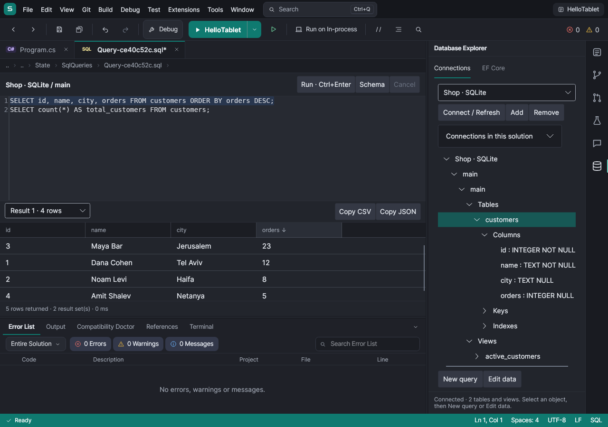
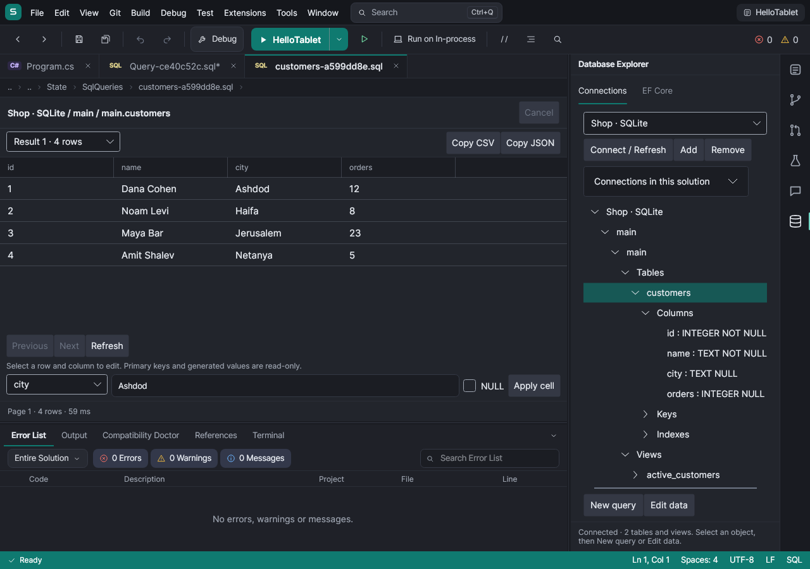
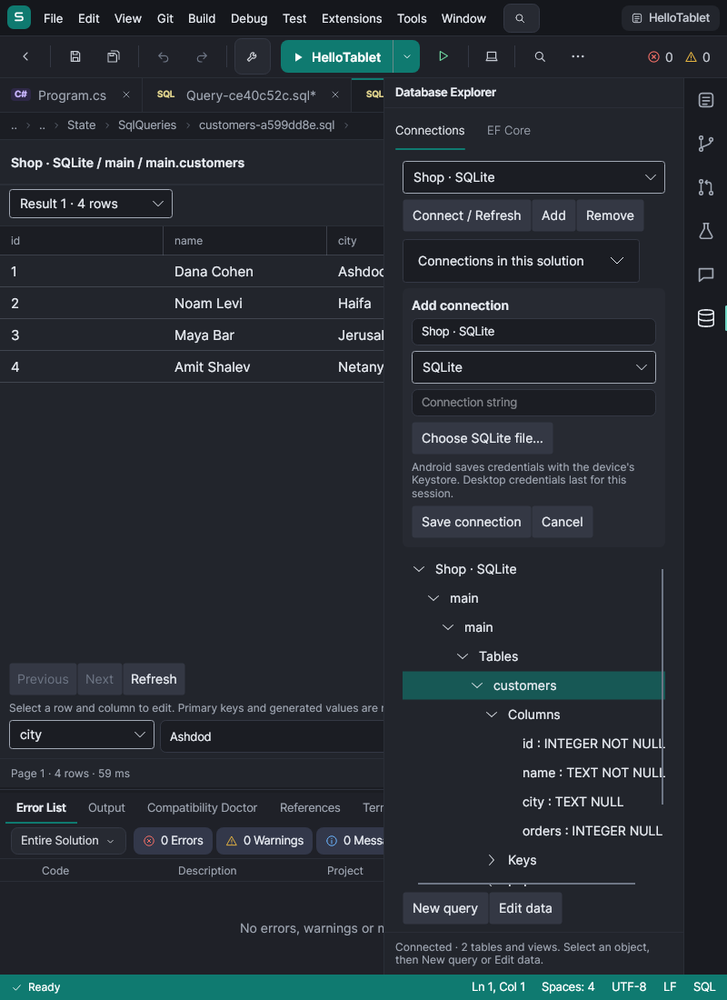

# Database Explorer

Open **View > Database Explorer**, choose its activity-bar icon, or search for it with **Ctrl+Q**.

## Connect

Choose **Add**, enter a display name, select a provider and enter a connection string. **Choose SQLite file** opens the device's file picker. A file exposed only as an Android content URI is imported into the app's private database folder; editing that copy does not update the original document-provider file. Close other database writers before importing a SQLite file, including its WAL changes.

| Provider | Example |
| --- | --- |
| SQLite | `Data Source=/path/to/shop.db` |
| PostgreSQL | `Host=db.example.com;Database=shop;Username=developer;Password=...;SSL Mode=VerifyFull` |
| SQL Server | `Server=db.example.com;Initial Catalog=shop;User ID=developer;Password=...;Encrypt=True` |

**Connections in this solution > Discover** reads `ConnectionStrings` from `appsettings*.json` in all solution folders and from the user secrets named by the solution's `.csproj` files. JSON comments, trailing commas and `ConnectionStrings:Name` keys are supported. On Linux/Android user secrets are under `~/.microsoft/usersecrets/<id>/secrets.json`; Windows uses `%APPDATA%/Microsoft/UserSecrets/<id>/secrets.json`. A tablet needs the secrets file available on that tablet. Select a suggestion and **Use selected** to review it before saving. Ambiguous provider strings can be assigned a provider in the form. Relative SQLite paths are resolved beside their configuration file.

Android saves the entire connection string using AES-GCM with a key in **Android Keystore**. The metadata file contains only a name, provider and ID; encrypted credentials are excluded from Android backup. **Remove** deletes the saved credentials. Desktop credentials stay in memory and need to be entered again after restarting. Discovery does not rewrite configuration files or automatically connect to their servers.

Choose a saved connection, then **Connect / Refresh**. Expand databases and schemas to browse tables and views, including their columns, keys and indexes. Only databases visible to your login are listed; connecting still needs that database's permissions. Remote databases must be reachable from the tablet's network and accept your authentication/TLS settings. SQL Server uses Microsoft.Data.SqlClient's managed networking implementation; SQL authentication avoids desktop-only integrated-authentication dependencies.

## Apps that use SQL Server

SQL Server has no engine for ARM64 Linux, so it cannot run on the tablet, in Services or anywhere else on it. When a project uses SQL Server (EF Core's SQL Server provider or SqlClient) and nothing answers at the server its `appsettings*.json` names, the **Compatibility Doctor** marks it **Needs a database** and F5's Output says so once, before the app starts; `(localdb)` and named pipes never answer on a tablet. A crash from SqlClient is explained the same way, not only with a stack trace.

- **Connect to SQL Server…** opens the connection form filled in from appsettings, with Windows sign-in (`Trusted_Connection`) replaced by an empty SQL login. Enter a server on your network or in the cloud and save: the connection, named `<Project>: <ConnectionName>`, is kept encrypted like any other, and every run of the project uses it as `ConnectionStrings__<ConnectionName>`. Remove it to go back to appsettings.
- **Use PostgreSQL** appears when the project also references Npgsql's EF Core provider. It writes a `compose.yaml` with a PostgreSQL service and the app's connection string (only when the repository has no Compose files), so F5 starts PostgreSQL in [Services](services.md). **Use SQLite** appears for projects with EF Core's SQLite provider and saves a connection to a `.db` file beside the project. The app itself must select that provider for the connection; appsettings files are never changed.

## SQL and results

Select a database or object and choose **New query**. Typing or **Ctrl+Space** offers tables, columns and SQL keywords from the connected schema. **Schema** refreshes completion after DDL or external changes.

**Ctrl+Enter** or **Run** executes the selection, or the entire document when nothing is selected. SQL is sent as entered; do not include client-specific `GO` or `\g` commands. The tab shows each result set separately, row counts, elapsed time and affected rows. Click a column header to sort ascending/descending. **Copy CSV** and **Copy JSON** copy the displayed set in its current sort order. JSON uses `{ columns, rows, truncated }` to preserve duplicate column names and nulls. Save the SQL text with the normal Save command.

**Cancel** interrupts the active command; closing the tab also cancels. A statement already committed by the database stays committed. The default command timeout is 60 seconds. To keep large queries manageable, display is limited to 5,000 rows per result and 32 result sets; a limited result is labeled. Use a `WHERE` clause, `LIMIT` or `TOP` for larger datasets. Rows beyond the display limit are consumed without retaining them, so the remainder of a multi-statement batch still executes.

## Edit data

Select a table or view and choose **Edit data**. Pages contain 100 rows. Previous, Next and Refresh fetch from the database again. Editable tables are ordered by their primary key. Views and tables without a primary key are read-only.

Select a row, choose an editable column, enter the new value (in invariant format), or select **NULL**, then **Apply cell**. Primary keys and generated values cannot be changed. Each update checks the original comparable row values and runs in a transaction; a row changed by another writer must be refreshed before editing again. SQL Server text/ntext/image/xml values cannot participate in equality checks, so these values are excluded from the concurrency guard. Common scalar values and hex binary values are supported; use the SQL editor for provider-specific complex values. Concurrent writes may shift rows between pages.

## EF Core

In the **EF Core** tab choose the migrations project and startup project, then **Build and list DbContexts**. **List migrations** lists the selected context's migration IDs without connecting to its database. **Update database** applies its outstanding migrations. **Add migration** scaffolds the migration, designer and model snapshot under the selected project's `Migrations` folder and reloads the solution.

These operations use TabStudio's existing in-process compiler and the project's matching EF Core design tools, restored from NuGet if missing. They require a C# project that builds successfully and a provider compatible with the tablet. Configure the connection in the DbContext, an `IDesignTimeDbContextFactory<T>`, or the startup project's configuration. The Explorer's selected connection does not override the context's configuration. For configuration that depends on the process working directory, use a design-time factory and the supplied `--contentRoot` argument; TabStudio does not change the IDE's global working directory. EF design operations are synchronous: once an update or scaffold has started, let it finish.

## Screenshots







## Verification

```sh
dotnet test tests/TabStudio.Database.Tests -c Release
TABSTUDIO_POSTGRES='Host=127.0.0.1;Database=tabstudio;Username=tabstudio;Password=...' \
  dotnet test tests/TabStudio.Database.Tests -c Release
dotnet test tests/TabStudio.App.Tests -c Release --filter FullyQualifiedName~TabStudio.App.Tests.Database
```

CI starts PostgreSQL 17 in the libraries job. App tests save `database-01-explorer-sql-results`, `database-02-table-editor` and `database-03-connection-tablet` screenshots, in both themes. The Android emulator self-test also exercises encrypted storage and SQLite queries.
