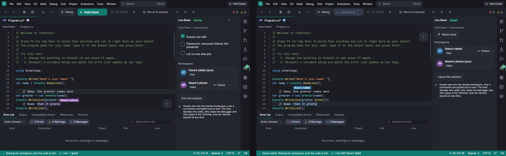

# TabStudio Live

TabStudio Live is real-time collaborative coding between devices on the same Wi-Fi. There is no account, no cloud
and no internet: one TabStudio shares its workspace, and other tablets and phones with TabStudio join it by scanning
a QR code. Everyone types in the same files at once, sees the others' carets, follows another participant, and
watches the host's run and debugging as if it were their own.

## Share a session

1. Open a solution or a folder, then choose **File > Share Session…** (or **Share session** in the **Live Share**
   window of the activity bar).
2. TabStudio shows a QR code, the address to type (such as `192.168.1.23:47814`) and an eight-character code (such
   as `7K3Q-M9XA`).
3. Choose what guests may do before they join: **Guests can edit**, or only watch; and **Classroom**, where everyone
   follows you.

On the other device, choose **File > Join Live Session…**, or **Join Live** on the start screen, and **Scan the
session's code**. Without a camera, type the address and the code. The guest gets a copy of the shared files, opens
the same solution, and its tabs show the host's text.

The status bar shows the session (**Live · 2 guests**, **Following Dana's tablet**, **Reconnecting…**); a tap opens
the **Live Share** window, which lists everyone, the host first, with their avatar in their color.

## Editing together

- **Every open document is shared.** What each participant types reaches everyone in a few milliseconds, letter by
  letter. Edits made at the same moment merge: nobody's typing is lost or overwritten, and every device ends with the
  same text.
- **Carets and selections.** Each participant has a color. Their caret is a bar in that color with their name on it,
  their selection a tint of it. The tab of a document shows the avatars of the others who have it open.
- **Your own undo.** Ctrl+Z, the Edit menu and the toolbar undo your own edits only, never someone else's, even after
  others typed around them.
- **Dropped Wi-Fi.** A guest that loses the connection keeps editing; it reconnects by itself and its edits merge
  with what happened meanwhile. The others see it as **Reconnecting…** for up to five minutes.
- **Saving.** A guest's Save saves the file on the host, and every copy of it updates. Files guests changed that the
  host never opened are opened on the host, unsaved, when the session ends, so no edit is lost.
- **Every language.** Live shares text, so it works with every file type. IntelliSense, completions and diagnostics
  run on each device, on its own copy of the files, with its own toolchains.

## Follow

Tap **Follow** beside a participant: your IDE shows the file they show, their selection, and the first line they
see, and keeps following as they move. Typing, tapping in the editor or choosing another tab stops following.

## Run and debug together

The host builds and runs; everyone sees it.

- **Output and Terminal.** The host's Output panel and Terminal appear on every guest. The Terminal is read-only for
  guests until the host allows a guest to type in it.
- **Error List.** The host's build errors appear in every guest's Error List, beside the guest's own live analysis.
- **Shared breakpoints.** A breakpoint set on any device is set for everyone.
- **The same pause.** When the program stops, every guest's editor marks the same statement, and their Call Stack,
  Locals, Watch and DataTips read the host's paused program.
- **Who steps.** The host decides: in a participant's menu, **Let them step the debugger** allows a guest to
  continue, step and break; without it, only the host does.

## Classroom

Turn on **Classroom** to present to a class (sessions are tested with 30 devices). Everyone follows the presenter
by default; a student can stop following to read on their own and tap **Follow the presenter** to come back.
Students tap **Raise hand**; the activity bar counts raised hands for the presenter, who can lower a hand or **Hand
them control**: that student presents, and everyone follows them, until the host taps **Take control back**. In a
class, carets are sent only for the presenter and the host, so thirty devices do not flood each other.

## What the host decides

In the menu beside each guest:

| Item | What it does |
| --- | --- |
| Let them edit / Let them only watch | Editors type and save; viewers' editors are read-only |
| Let them step the debugger | Continue, Step Over, Step Into, Step Out and Break All on the host's program |
| Let them type in the Terminal | Input to the host's shell |
| Hand them control | In a class, they present |
| Lower their hand | Answers a raised hand |
| Remove from the session | Disconnects them; they cannot rejoin this session |

**Let no one else join** locks the session. **End the session** ends it for everyone; each guest's copy of the files
is deleted.

## Security model

TabStudio Live is built on TabStudio Link's transport and pairing, and adds the rules of a shared workspace.

**Nothing leaves the local network.** Devices connect directly to each other over TCP (port 47814 by default). There
is no server, relay, account or telemetry. The host is the hub: guests connect only to the host, never to each other.

**Pairing.** The QR code carries the host's addresses, its port, the SHA-256 fingerprint of its certificate and the
session's code. A guest that scans it connects over TLS 1.2 or 1.3 and accepts only the certificate with that
fingerprint, so a device pretending to be the host is refused. A guest that types the address and code instead proves
it knows the code, and the host proves it too, before either trusts the other's certificate (TabStudio Link's
code-based pairing, PBKDF2-derived proofs). Every device has its own key pair, made on the device.

**The code.** Eight characters from a 32-letter alphabet (40 bits). Unlike Link's one-time codes, a session's code
admits several devices, so a class joins with one scan; it expires after ten minutes, and five wrong codes in a
row draw a new one. **New code** draws one at any time. Devices that joined rejoin after a dropped connection by
their certificate, without the code.

**End-to-end encryption.** Everything between host and guest (text, files, output, the Terminal, debugger state) is
inside that TLS connection, from device to device.

**Guests see only the shared workspace.** The host lists the files of the workspace's folder that it shares: no
hidden folders such as `.git`, no `bin`, `obj`, `node_modules` and other build output, no symbolic links, no file over
8 MB, at most 10,000 files and 256 MB. A guest can ask only for a listed file, by a relative path that is normalized
and checked (no absolute path, no `..`, no link that leads outside the folder); anything else is refused. The host
never runs a guest's request against its file system except to read a listed file or to save a shared document in
the folder.

**A guest's copy.** A guest writes the host's files only inside its own copy folder in the app's cache, checks each
file's SHA-256 against the host's list, and refuses any path that would leave the folder. The copy is deleted when
the session ends, and copies left by a session the app did not end are deleted when the app starts.

**The host is the authority.** Every edit is checked on the host: an edit from a viewer, or one written in another
participant's name, is refused and that guest's document is reloaded from the host. Saving, breakpoints, the
debugger and the Terminal are checked against what the host allows that guest, on the host, for every request.

**Guests do not build or run.** Builds, runs and debugging happen only on the host. Guests cannot start a process on
the host. A guest the host allows to type in the Terminal can run commands in the host's shell, as the host's user;
allow it only for people you trust with your device.

**Removing.** A removed guest is disconnected at once and its certificate is refused for the rest of the session.

**What it does not protect against.** Anyone on the same network who has the code, while it is valid, can join;
share the code only in the room, lock the session once everyone is in, and remove anyone you do not know. Guests
who edit change your files, and your program runs their code when you run it.

## Limits

- Up to 32 guests in a session.
- Live shares text documents. Designers (XAML, Windows Forms), notebooks and database queries are this device's own.
- Creating, renaming and deleting files on a guest changes only the guest's copy; the host's Solution Explorer is the
  one that changes files. Files the host saves or changes reach guests' copies as they change.
- A guest's IntelliSense uses its own toolchains: a language whose toolchain is not installed on the guest has
  syntax coloring but no completions there.
